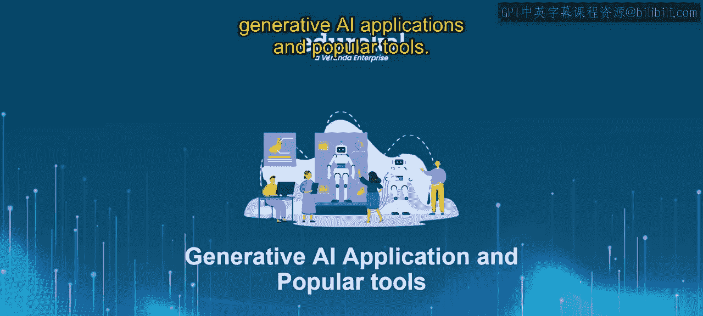
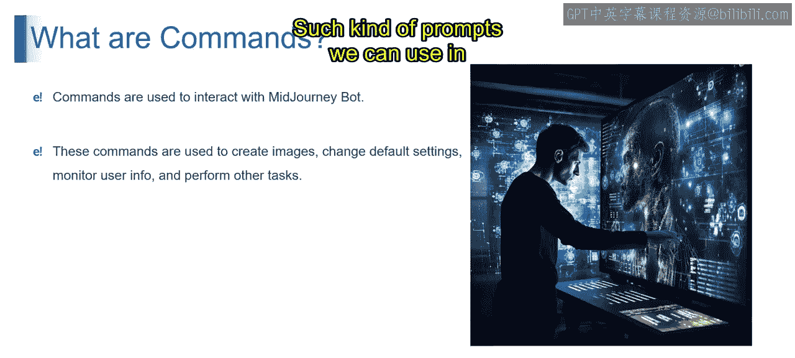
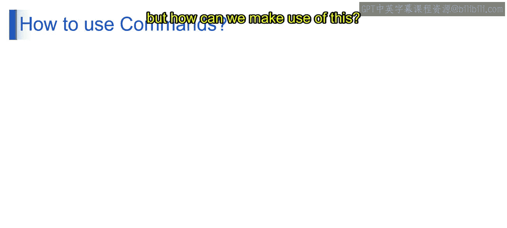
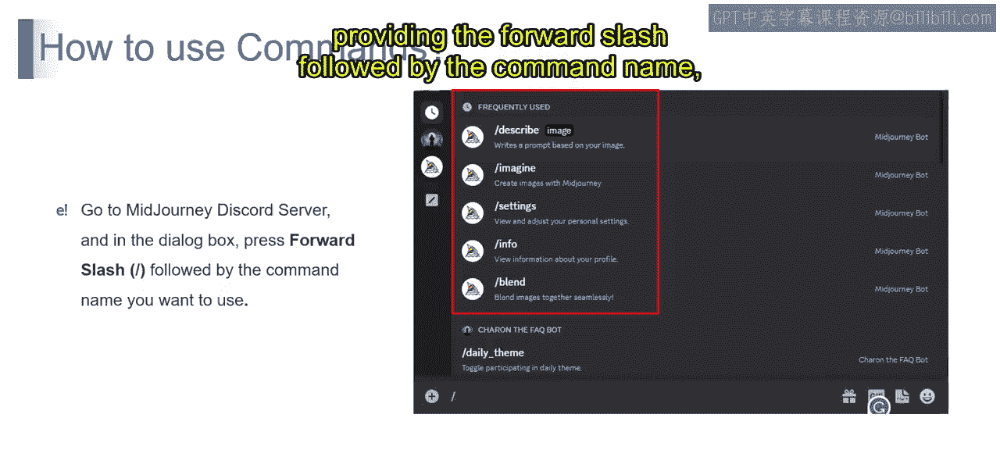
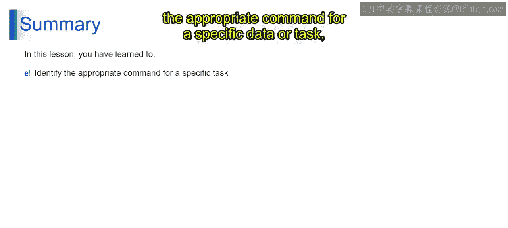
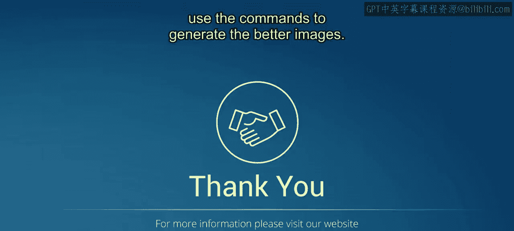

# Edureka《通过LLMs学习生成式AI（基础、应用开发、流行工具，第2、3、4课／共4课）｜Learn Generative AI with LLMs》中英 - P134：27_使用Midjourney命令指南.zh_en - GPT中英字幕课程资源 - BV1ym421V7gx

Welcome to the immersive journey into the world of generative AI applications and popular tools In this。

 we are going to cover midjoney commands and working with the midjoney commands by this we are able to evaluate the use of commands and analyze the features of commands and use them to generate the images directly let's get started with the midjoney commands。

 first of all， water commands commands are used to interact with the midjoney board These commands are used to create images change default settings and monitor user info and perform other tasks If you has remember in the previous example where we are generating one image we are trying to use the settings in order to change the version what we are using and if you want to provide some prompt you are expected to use the command called imagine and then provide the prompt such kind of prompts。

😊。

Use in order to create the images in the way we want。

 Then these mid journeyney commands can be used in any bo channel on private discord servers where the mid journeyney board has been permitted to operate or in direct messages with the mid journey board。

 This is all about the commands and how to use them。 So we understood that okay。

 there are multiple commands existing in the midjoney。

 but how can we make use of this in order to make use of this we are expected to go to the midjoney discord server and then start using it by providing the forward slash followed by the command name whatever you want to give De of the commands So commands working with the image there are n number of commands we are having in the mid journeyney Let's understand one by one。

 the first one is of image which is used to create image from the prompt means whatever the text message we are giving it allows users to generate creative and image。

😊。

Native content。 then the next one is blendnt。 If you want to adjust the balance between the different elements or styles in the output。

 you can use the command blend。 Then the next one is mutate if you wants to change the existing image or control the degree of which generated content can be modified or also can be edited the next one is style。

 it applies style to an image means it influences the visual or thematic style if you wants to change the appearance of the image style。

 Then the next one is of the color。 It manages the color and also the scheme used in the generated output。

 and if you wants to go for the fast switches to fast mode。

 it generates the images faster but with the lower quality obviously and then the next one is of relax it switches to relax mode which generates images more likely to be relaxing or calm。

😊，In general， by default， images can be generated in the relaxing mode only Then the next one is of the remix means to toggle remix mode allows you to create new images by remixing existing ones means what exactly we are doing here is combines or remixes the multiple element to create unique composition for that purpose we will use remix。

 then show it will generate the job within the Discd and using an image job I directly。

 Then it reviewss or displays generated content for user evaluation directly。

 Then the next one is of help。 It provides a help on the commands available。

 whatever we have seen so far。 it provides assistance and guidance on using the tool directly。

 Then next one is of about。 it provides information about the journeyney and offers the information about the tools background and also purpose as well。

 Then the next one is subscribed。😊，It allows users to receive updates on notifications about the tool。

 And also if you wants to subscribe or purchase a plan。

 then you can simply go for it and it generates a personal link for the user account page we have already seen that Then the next one is upt。

 It allows you to view and adjust mid journeyneys both setting means where I have utilized it in order to change the version generated。

 I thought of showing you the multiple version。 So that's where I utilized it。

 It is not only for that one single perspective。 you can access customization option for the tool also by using the settings option and prefer option。

 It sets user preferences for specific aspects of content generation it allows you to create or manage custom options and then prefer option list。

 It allows you to view your current custom options means list available preferences settings then。😊。

Suffix， it allows you to set suffix to upend to the end of each prompt means it will upend user specific elements to generate the content for the customization。

 So these are the explanations of the commands that we are going to use in order to generate the images by using the mid journey。

 So in summary， we can simply say here we are able to identify the appropriate command for a specific data or task and we now understood how to use the commands to generate the better images。

😊。

