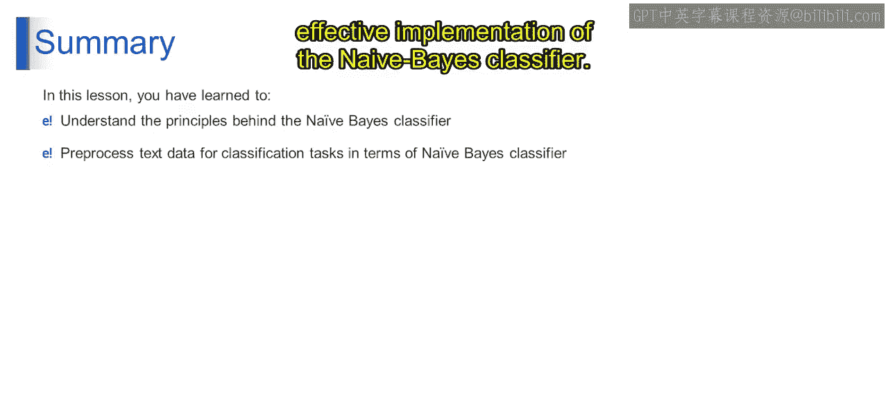

# Edureka《通过LLMs学习生成式人工智能（机器学习和NLP基础，第1课／共4课）｜Learn Generative AI with LLMs》中英字幕 - P135：134_多项式朴素贝叶斯算法.zh_en - GPT中英字幕课程资源 - BV1q4421Q7qh

So let's now explore the progression from our previous discussion。

 so now let's understand the mathematical representation in mathematical terms the multinoial na bias classifier calculates the probability of each class y given the input features x is equal to x1 x2 up to x n using the bay theorem means p of y given x is equal to p of y into p of x1 given y x2 given y up to x and given y divided by probability of x means here probability of y given x is the posterior probability of class y given the input feature x where p of y is the probability of class y and p of x I divided by y X n divided by y。

😊。

Is the conditional probability of feature X given class y P of x that is nothing but probability of x is the evidence which serves as normalization constant and can be ignored for class comparison under the assumption of feature independence。

 the conditional probability that is probability of X given y， X and given y for each feature。

 let's say for example， under the assumption of feature independence， the conditional probability。

 let's consider P of X given y， let's consider this So under the assumption of feature independence。

 the conditional probability of X given y for each feature X I given the class y is estimated from the training data in x classification。

 these probability。😊，itiesare typically calculated as the frequency of occurrences of each feature。

 nothing but word in the documents of class y normalized by the total number of words in those documents means the class with the highest posterior probability is selected as the predicted class for input feature x。

😊，So now let's understand the model training so in this during the training phase of the multinoial Nease algorithm the classifier learns from the provided training data to estimate two key probabilities one is prior probability that is p of y and the conditional probability that is p of x given y these represents the likelihood of each class occurring in the data set without considering any features。

 the classifier calculates the prior probabilitybabilities by simply counting the frequency of each class in the training data and normalizing it and coming to conditional probability of p of x given y these represents the probability of observing one specific set of feature values x given a particular class y in text classification。

😊，These probabilities typically represent the likelihood of absorbing each word nothing but feature in documents of a specific class。

 the classifier calculates these probabilities by counting the occurrences of each feature in documents of each class and normalizing by the total number of features in those documents means during the prediction when presented with new document or set of features。

 the classifier applies base theorem to calculate the posterior probability of P of y given it for each class y it then select the class with the highest posterior probability as the predicted class label。

😊，Further input document， this process enables the classifier to make predictions based on the learned probabilities from the training data now the summary in this module you we have gained an understanding of nave bias classifier a probabilistic algorithm widely used in the text classification additional we have learned preprocessing techniques tailored further text classification tasks essential for effective implementation of the nave bias classificationifier Thank you。

😊。

