# Edureka《通过LLMs学习生成式AI（基础、应用开发、流行工具，第2、3、4课／共4课）｜Learn Generative AI with LLMs》中英 - P135：28_Midjourney命令演示.zh_en - GPT中英字幕课程资源 - BV1ym421V7gx

Welcome to the immersive journey into the world of generative AI applications and popular tools。 Now。

 let's understand the practical commands。 Like how can we do that。

 We have seen like the commands like imagine setting and also multiple others， right。

 So now let's understand in a practical perspective。 So in the midjoney platform say forward slash。

 and you can see these are the commands that we are having。 now， first of all。

 I am taking the forward slash imagine where you are expected to provide the prompt in order to generate a beautiful image。

 So now I am telling a colorful。😊。

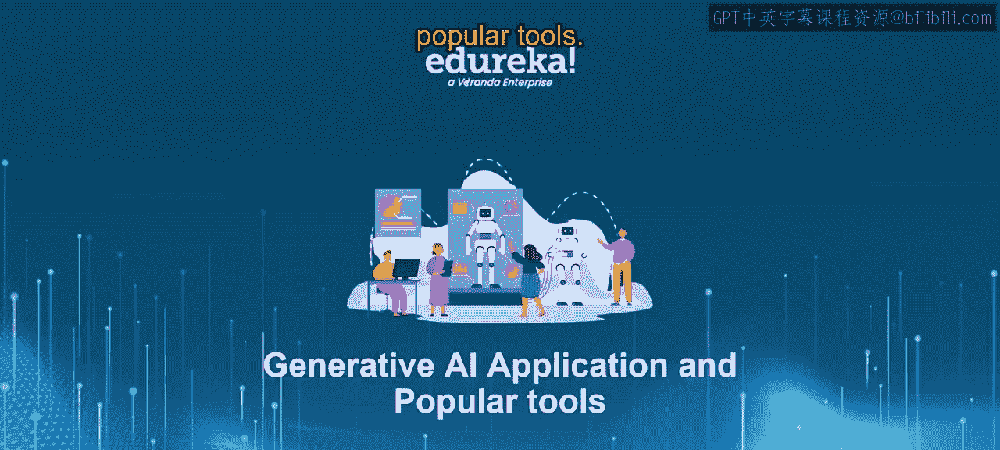

Underwater， seen with friendly dolphins。Playing with bubbles。 I'm just playing on enter。

It will take some time to load。

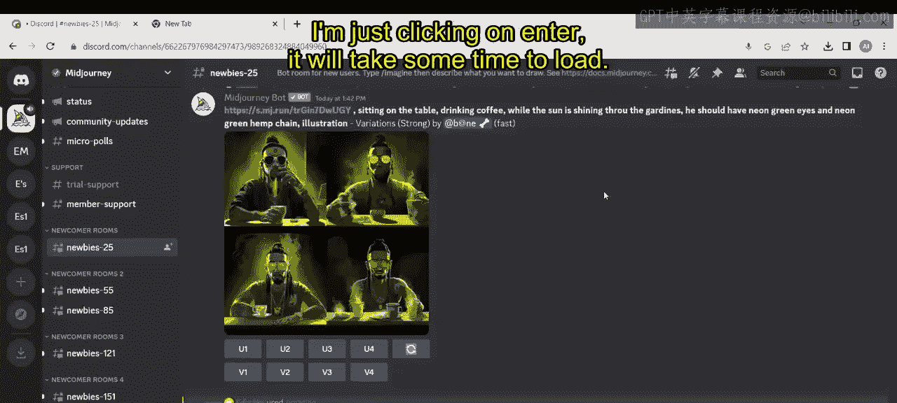

Now you can see that it started loading the 46%， 62%。93%。

And here we go 100% just click on it we can see four different images as I mentioned friendly dolphins playing with water bubbles here you can see four different types of images you can click on this and also zoom in and zoom out to check which one you wants to take it and all and also you can open it in the other browser also if you wants to download even you can download it as well so now if I can say I wants to select the fourth one now I can go here directly and can I can simply say you for。

😊，It will start generating my single image can you all say now you are getting the only one single image even you can zoom it and also check it。

😊，And you can save it even you can see zoom out to into and 1。

5 and also customized to zoo as well so this is the way you can generate by using the image right so if you did not like the picture if you want to regenerate the image you can simply click on this。

😊。

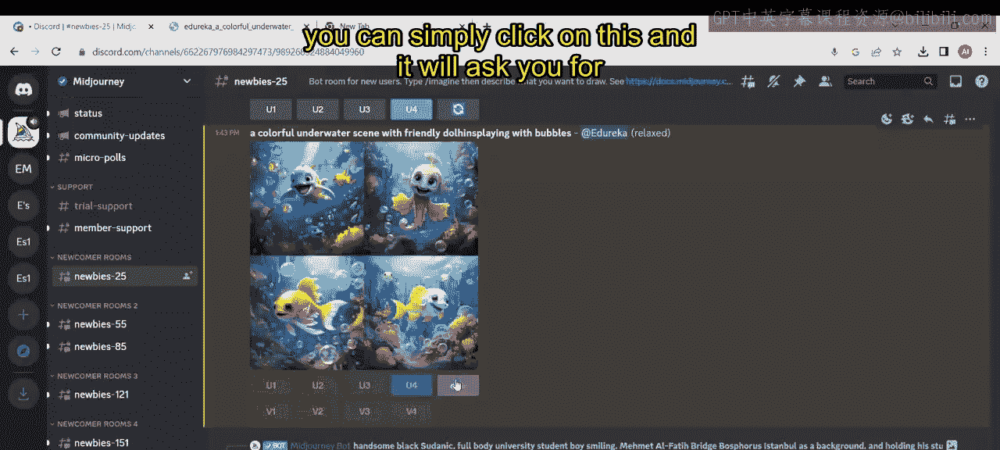

And it will ask you for the prompt whether you want to change anything I can simply say friendly little dolphin okay。

 and now clicking on submit and let's see what we are going to get now。

Hence even we can change accordingly if you do not like this and also you can click on the refresh and also can work on the things and also get it however you want So these are of the different ways we can perform it by using the image now let's understand now you can see here we are getting a colorful andvorous z with friendly dolphins playing with bubbles okay maybe it has taken another ways can you say this now it has generated the other image like this you can take it if you want to select the first image you can simply click on U1 or second image you2 likewise you can do that and the next command let's understand about the next command that is blend you can see this here and it is asking for image one and also image too I am simply selecting it from my local and I am having a little baby holding a monkey one image and the other image is that a little baby holding elephant image so what this blend will do。

😊。

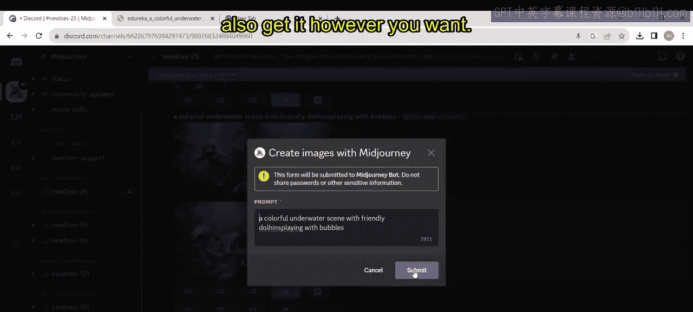

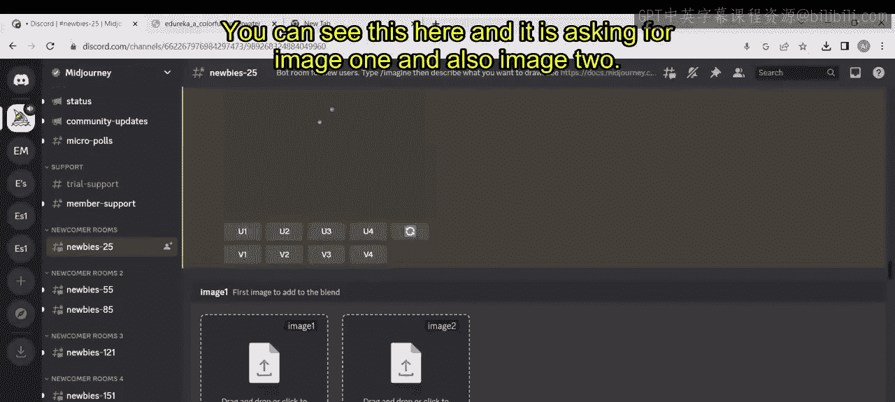

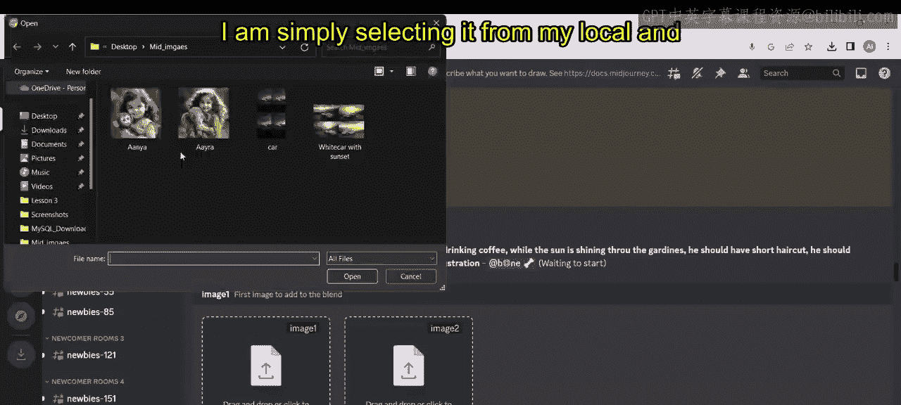

It will club the two images and can produce only one let's see how it is going to happen here I'm just clicking on the enter and it is sending the command and we will have to wait for some time it is started loading it will take some time。

😊，Can you see this now it could generated， click on it。😊，As I mentioned。

 blend will combine the two images and generate one as an output as because I provided two images。

 One is saying that a girl holding a monkey image and the next image was girl holding the elephant image。

 So it has to club those two images。 So together it has provided a girl holding。😊。

A doll with monkey and also faces of elephant likewise it has started giving means what it does the blend command。

 whatever we have given it combined two images and produced one output that is about the blend let's understand the next command okay so I told you the fast mode if you wants to generate the images in the fast mode and also but the quality will get reduced so that we are expected to use the command forward slash and you can say fast。

😊，And also， you can say imagine and also， you can provide your prompt over here a detailed。

Realistic drawing of a vibrant butterfly in here。Lsh garden。 let's say I'm giving this prompt。

 And now you can see it has generated done note that once you exhaust your fast hs。

 you can purchase more on the website means it is telling that we will， I mean。

 it is now capable enough to generate the fast images。 But if you do not want it。

 you can simply say relax to switch back to the relax more。 I can simply say relax。😊。

Can you see this done your jobs now do not consume fast as but might take a little longer you can always switch back to fast if you wont yes means if you want to generate the images with very fast mode you can simply select the fast command and also you can work on the imagine prompt or if you want your images do not consume more fast ways and also do not exclude that you can simply say relax mode that is about the relax mode and you can say remix。

Now let's understand about the settings if you wants to change any settings。

 you can simply say settings and click on enter you will get the options whether you wants the images to be raw mode or if you wants to change the version you can do all this from here and also you can select the fast mode from here and also turbo mode relax mode and also reset all the settings as well so that kind of options can be performed by using the setting if you wants to understand about the subscribe plans you can simply say subscribe and if you enter this it will provide you a new page stating that this is your personal link do not share it with anyone if you click on this it will navigate you to a new page where it will allow you to see the pricing structure and all such kind of information directly from here and also you can purchase the subscriptions from here directly that is about the subscribe then the next one and if I wants to say。

😊。

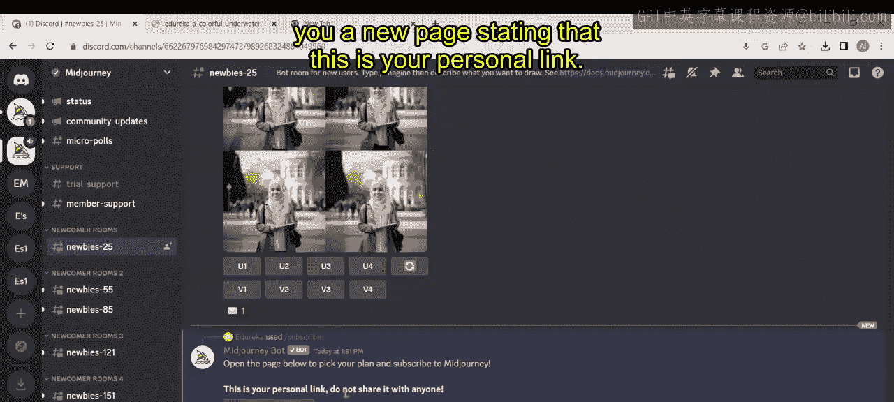

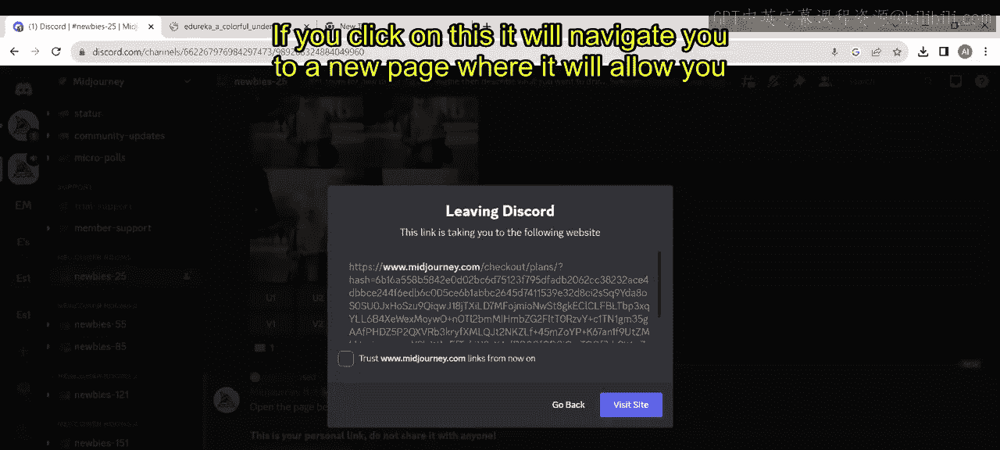

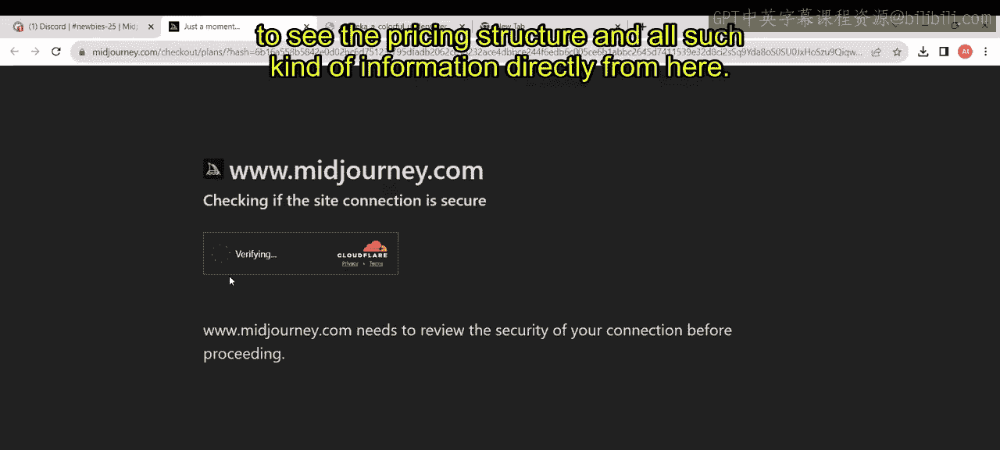

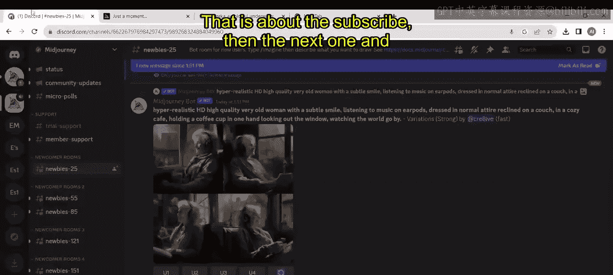

Prefer option， prefer remix， and you can see these are the options we are having with the prefer Pre remix。

 Pre autodium and also prefer option list means you can simply switch to multiple ways same like however。

 you are using the fast mode and also relax mode， even you can color it by using the color command。

 and also even you can style it as well in a simple way if I wants to save what the style I'm simply telling imagine and also you can provide the prompt portrait of a woman in the style of。

😊，Leonardo。Let's see how we are going to get means here I use the command of style even likewise you can even use the color as well you can give the color whatever you want means these all are the different types of things that you can make use of the commands of the mid journeyney and can work on the things however you wish to see it is loading。

Now you can see it is generated 100% means you can make use of any commands。

 whatever the commands we are having if you wish to see them you can simply go here and also can type forward slash and also you can get all the information about it and also give it try one by one you will be able to understand everything so this is all about the commands of form mid journey name。

😊。

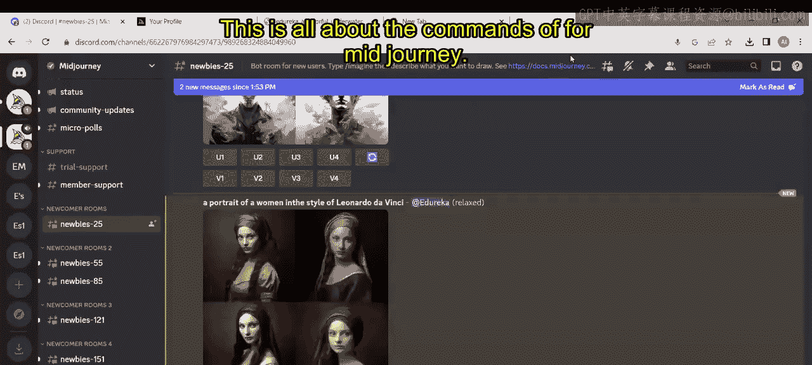