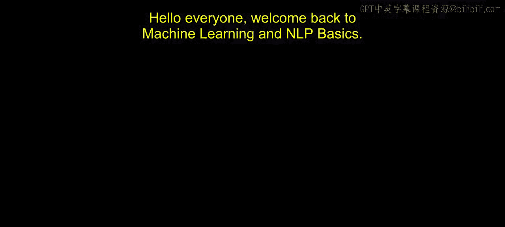
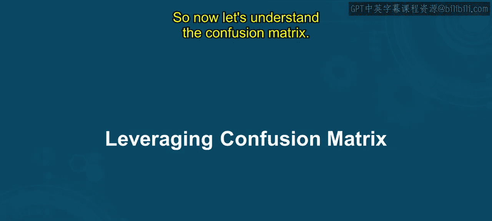
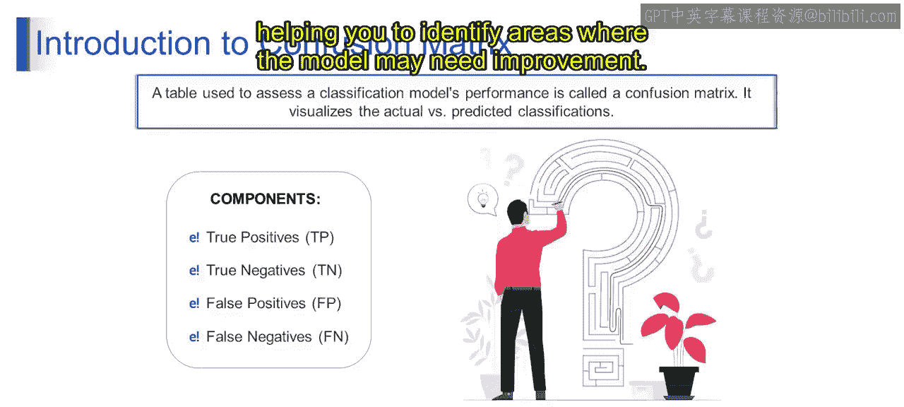

# Edureka《通过LLMs学习生成式人工智能（机器学习和NLP基础，第1课／共4课）｜Learn Generative AI with LLMs》中英字幕 - P136：135_利用混淆矩阵.zh_en - GPT中英字幕课程资源 - BV1q4421Q7qh

Hello everyone。 welcomee back to machine learning and NLP basics。

 So now let's understand the confusion metrics In this we are going to understand what exactly a confusion metrics is and leveraging confusion metrics by the end of the session you will be able to explore what a confusion metrics is including its components and able to analyze the confusion metrics for identifying model misclassifications So let's get started introduction to confusion metrics。

 a confusion metrics is a performance evaluation tool used in machine learning to visualize the performance of a classification model It's especially useful when dealing with the binary or multiclass classification problems。

 Imagine you have a model that classifies emails either spam or not spam。 just consider this。😊。

Imagine you have a model that classifies emails as either spam or notch spam a confusion matrix helps you understand how well the model is performing by summarizing its predictions compared to the actual labels。

 so lets understand how it is possible。😊，As mentioned。

 a confusion matrix is a table used to evaluate the performance of classification model by comparing its predictions with the actual class labels。

 it helps visualize how well the model is performing across different classes the components of confusion metrics are true positive true negative。

 false positive and false negative true positive is nothing but the number of instances correctly predicted as positive by the model and coming to the true negatives。

 the true negative is the number of instances correctly predicted as negative by the model。

 then false positive， the number of instances incorrectly predicted as positive by the model。

 then finally false negative， the number of instances incorrectly predicted as negative by the model these components。

😊，Provide insight insights into the models accuracy， prediction。

 recall and other performance metrics， helping you to identify areas where the model may need improvement。

So stay tuned for the next video where we will elaborate on this topic。😊。

