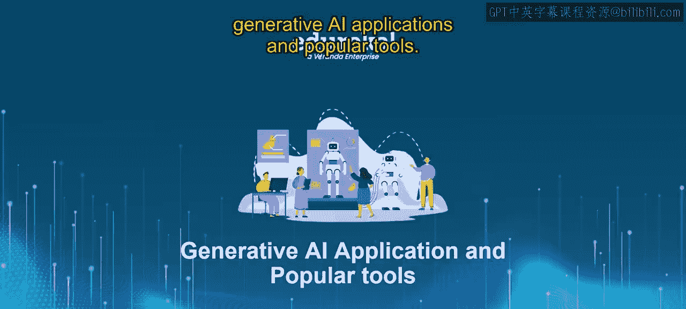
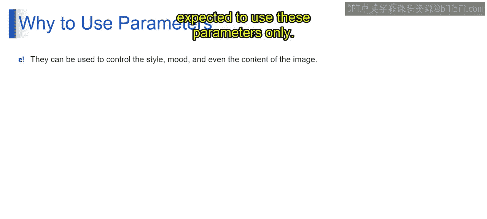
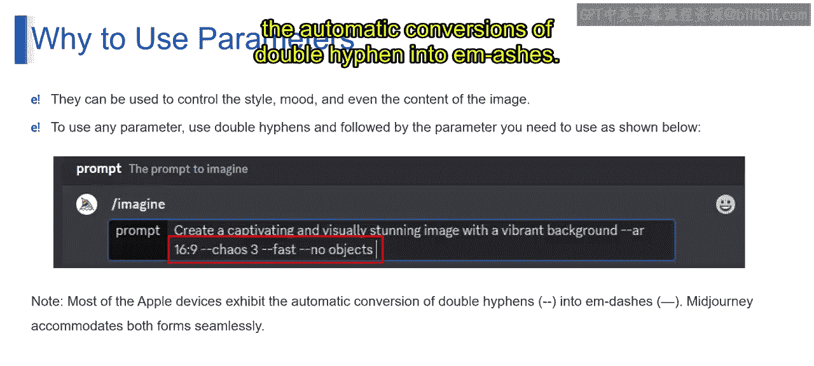
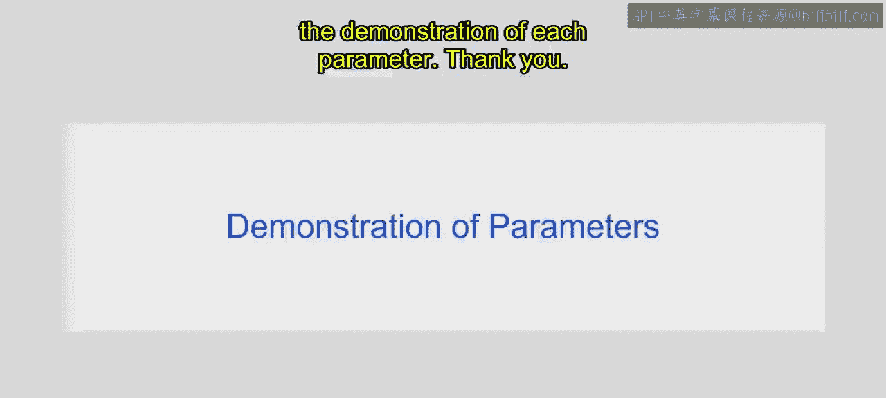

# Edureka《通过LLMs学习生成式AI（基础、应用开发、流行工具，第2、3、4课／共4课）｜Learn Generative AI with LLMs》中英 - P136：29_使用Midjourney参数指南.zh_en - GPT中英字幕课程资源 - BV1ym421V7gx

Welcome to the immersive journey into the world of generative AI applications and popular tools。😊。

Now let's understand the mid journeyney parameters so what are the parameters of midjourney festival midjoney parameters are options that can be added to a prompt to change how an image generates parameters can change an image aspect ratio style quality and many more so these parameters are always added at the end of the prompt and you can include multiple parameters in each prompt means in the previous cases we have seen if we wants to generate the image in the midjourney platform we are expected to use the command called image and also followed by the prompt now these parameters are appended at the end of the prompt。

So why to use these parameters so generally if you want to control the aspect ratio of your image。

 for example， you might want to generate square image for a special media post or a 16 is sign ratio image for a widescreen monitor for that example you are expected to use the parameter called aspect ratio and you are expected to provide the ratio of the image that is one thing the other example if you want to control the image for example whether you want to generate a realistic image or abstract image or cartoonish image whatever you want even for that perspective also you are expected to make use of the parameter and the other one if you want to control the quality of your image for example。

 you might want to generate a low quality image for a quick preview or a high quality image for a print or publication means you are handling or manage。

😊，In the quality over here means you are having a control over the quality of the image that can be managed by using the parameter and the next one。

 if you want to control the creativity and diversity of the images， for example。

 you might want to generate a series of image chest that are all variations of the same theme or series of images that are all very different from each other in that situation。

 you are controlling the creativity and diversity of the images however you want then the next one if you want to prevent the midjoney from generating the images with a certain concepts for example。

 you might want to prevent midjoney from generating the images with violence or nud in that situation also you are expected to use this parameter only so to use any parameter we are expected to use the double hyphen and followed by the parameter you need to use here is one example。

😊。

You can see create a cap and visually stunning image with a vibrant background and as you mentioned we are expected to use these parameters at the end of the prompt after the prompt here you can see double hyphen followed by the parameter aspect ratio 169 and chas3 and fast and no objects means here we are expecting an image without any objects in it with this particular size and also more creative and and also fast way this is one example so one note here most of the apple devices exhibit the automatic conversions of double hyphen into them ashes midjoney accommodates both forms seamlessly so now let's understand the demonstration of each parameter Thank you。

😊。

