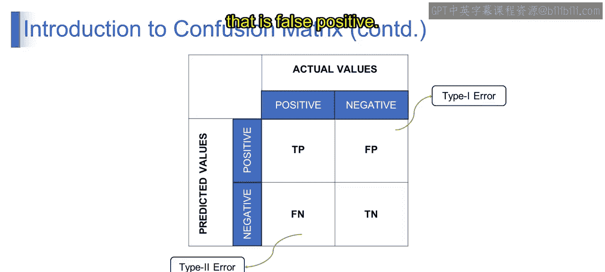

# Edureka《通过LLMs学习生成式人工智能（机器学习和NLP基础，第1课／共4课）｜Learn Generative AI with LLMs》中英字幕 - P137：136_混淆矩阵的表示.zh_en - GPT中英字幕课程资源 - BV1q4421Q7qh

So let's now explore the progression from our previous discussion so now let's understand it in a brief。

 so this is the representation of actual confusion metrics so it contains horizontal axis and vertical axis horizontal axis represents actual values and vertical axis represents predicted values so these represents the true labels or classes of the instances in the data set it typically shows the actual classes of the data with one category indicating the positive class P and the other indicating the negative class N then coming to the vertical axis it is nothing but predicted values this axis represents the predicted labels or classes assigned by the classification model similar to the horizontal axis it also distinguishes。

😊。

But positive and negative predictions made by the model。

 So here is how the metrics laid off The first one is of true positive。

 true positive is nothing but it is an instances where the model correctly predicts the positive class when the actual class is also a positive that is about true positive。

 So coming to the true negative。 It is nothing but instances where the model correctly predicts the negative class when the actual class is also a negative。

 then coming to the false positive， false positive is nothing but instances where the model incorrect predicts the positive class P。

 when the actual class is negative the name itself is indicating false positive。

 then the next one is of false negative。 it is nothing but the instances。😊。

Where the model incorrectly predicts the negative class when the actual class is positive。

 so this layout helps in evaluating the performance of the classification model by comparing its predictions with the actual ground truth it is powerful tool for understanding where the model is making mistakes and can guide the improvements in the model's performance now。

😊，Now what is type 1 error and type 2 error in this confusion metrics so in the context of confusion metrics the type1 and type 2 error refers to the different kinds of mistakes that a classifier can make when predicting the classes of instance first of all let's understand type 1 error it is also known as false positive type 1 error error occurs when the classifier incorrectly predicts the positive outcome that is predicts the presence of condition or class when the actual outcome is negative means for example in medical diagnosis scenario a type1 error would happen if the classifier identifies a healthy person as having a disease that is going to be the type 1 error the formula for type 1 error would be false positive。

😊，Divided by false positives plus true negatives means in our scenario of medical diagnostic scenario。

😊，It identifies a healthy person as having a disease then coming to the type 2 that is nothing but false negative type 2 error occurs when the classifier incorrectly predicts a negative outcome when the actual outcome is positive for example in the medical diagnosis scenario a type 2 error would happen if the classifier fails to identify a person with the disease as positive means it is represented as false negatives divided by false negative plus2 positive this is what about type 2 error so type 1 error is also known as false positive and type 2 error is also known as false negative means type1 and type 2 errors help to quantify the performance of classifier by identifying the types of mistakes it makes in its predictions for example。

😊，Let's understand a bit more about it by using the binary classification problem statement。

 such as classifying emails as spam that is positive class or non spam。 nothing but negative class。

 So here let's say， suppose we have the classification result for a set of hundred emails。

 let's say let's say for example， we are having total hundred emails。

 So actual values are 30 emails are actually spam that is represented as positive class。

 and 70 emails are actually non spam。 So 30 are actual spams and 70 are so it is a positive class and this is the negative class。

 So now let's understand the predicted values。 So positive class。

 the model predicts that 40 emails are spam and the negative class。 the model predicts。😊。

60 emails are No spam means out of all these the model predicts 30 emails as spam out of 30 emails that were actually spam means that is going to be the true positive in the false negative the model incorrectly identified 10 non spam emails as spam out of 70 emails that were actually non spam and then the model incorrectly predicts 10 spam emails out of the 40 emails classified as spam that is false positive。

😊。

