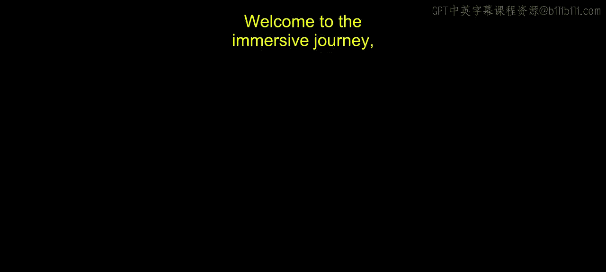
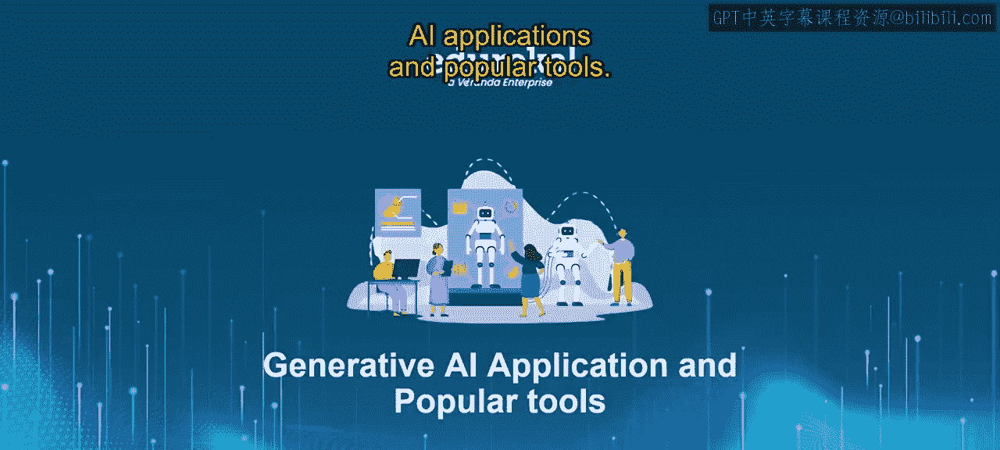
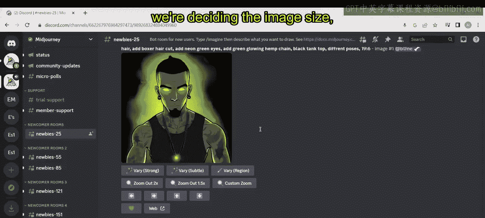
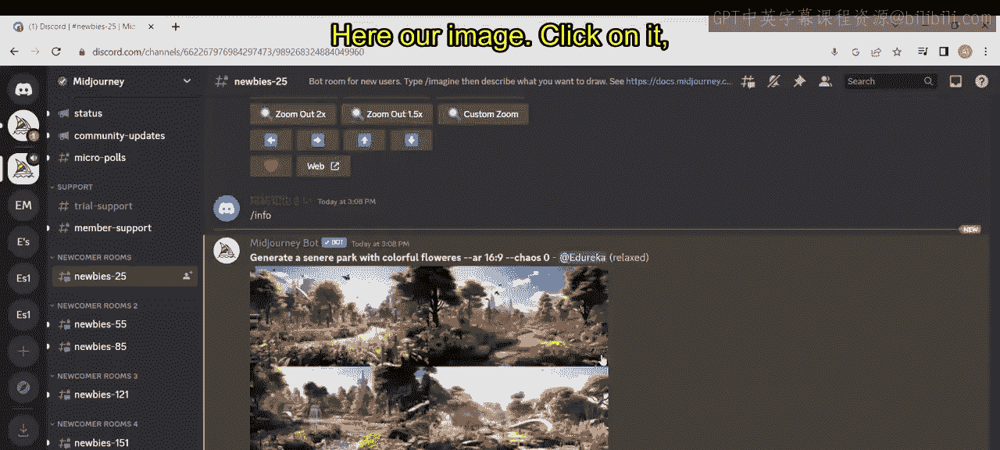
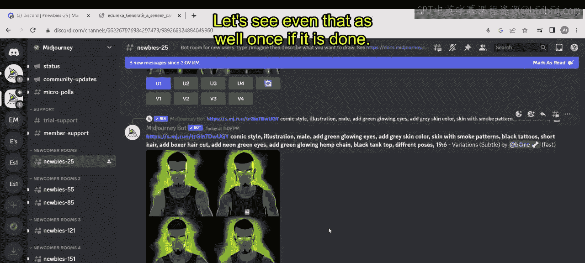
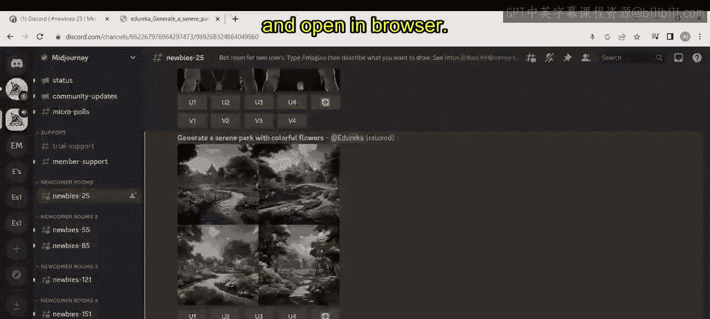
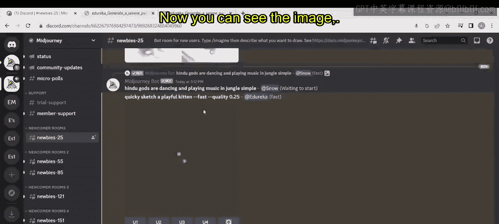
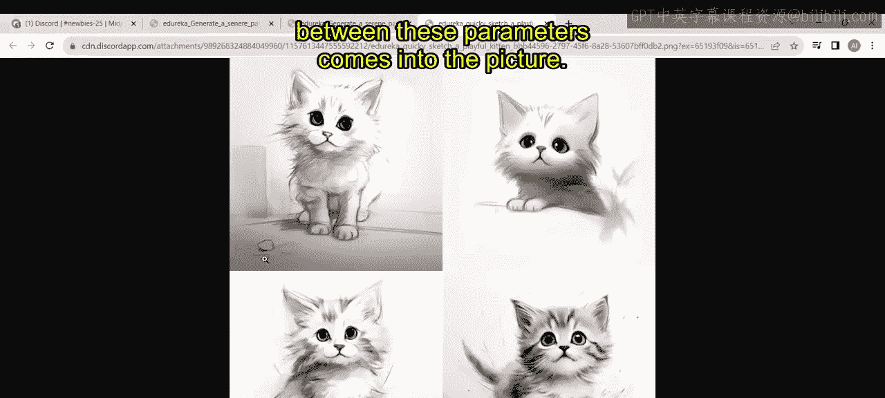
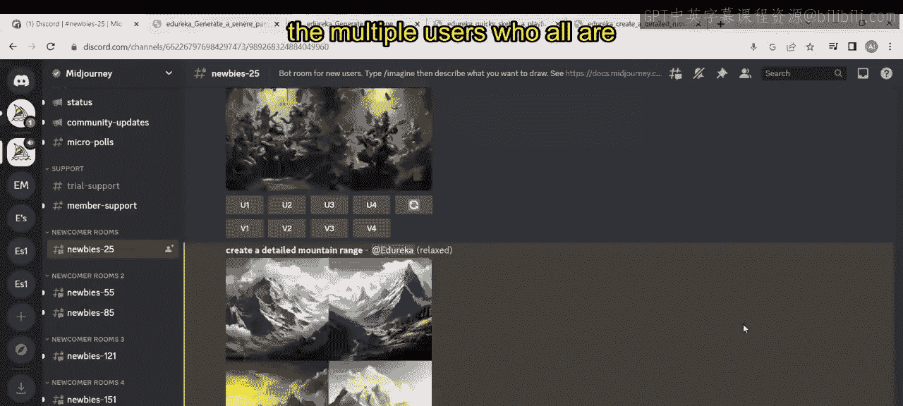
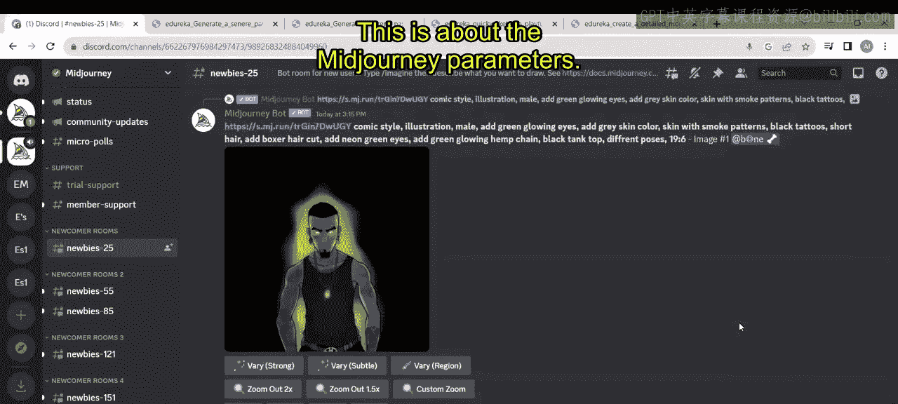

# Edureka《通过LLMs学习生成式AI（基础、应用开发、流行工具，第2、3、4课／共4课）｜Learn Generative AI with LLMs》中英 - P137：30_Midjourney参数演示.zh_en - GPT中英字幕课程资源 - BV1ym421V7gx

Welcome to the immersive journey into the world of generative AI applications and popular tools。 Now。

 let's understand some practical examples for midjoney parameters。 So as I mentioned。

 if you want to make use of the parameters。 first of all， you need to have a prompt。

 then followed by the parameters。 So now let's see one example。

 I am telling forward slash imagine and the prompt。😊。

G8 a。Sy park with colorful。Flers and now I wants to decide the aspect ratio for this。 So for that。

 I am expected to add some parameters for this。 So in order to add the parameters as mentioned。

 we are expected to use the double hyphen followed by the parameter name here my parameter name is aspect ratio。

 And here I am giving the ratio as6 each9， as well as I'm adding one more parameter， which is。😊。

Chavez， Im making it to0 and let's click on enter and wait for it。

 It will start generating the image。It will take some time。

 So generally this chs0 is nothing but if you want to generate the images with the low showss means nothing but more realistic。

 you can simply say chhows as zero if you want to make it more creative and diverseers you can give chs as one if you want the image to be very creative as well as divers。

 you can say chs2 and coming to the aspect ratio if you want to see the aspect ratio as a square or6 to9 means we are deciding the image size wide screen or portrait like however we want So here our image so click on it。

😊。

And opening browser and it will start generating you can see the quality and also the image now let do one thing。

Now I will be taking the same prompt， but without giving any parameters and can see the difference how exactly it is going to change the look and field we will be able to understand the importance of parameters I just clicked on enter here I did not given any parameters for my prompt it will take some time。

😊，So as I mentioned， if you wants to make use of with Chas or also aspect ratio that completely depends on you like if you wants to decide some size of your image。

 you can make use of aspect ratio and if you wants to decide what kind of images whether more realistic or diverse or more creative that can be decided by Chas and if you want to get the fastest images you can make use of the fast and also if you want to provide the image weight you can even provide the IW parameter I will explain even that as well in the next example you can see that it is still generating the images so image weight is nothing but here we are giving the importance whether we are giving the importance to the text prompt or the image to which we are giving the importance so that's where we can use the parameter called IW which is nothing but the image weight let's see even that as well once if it is done。

😊。

Yeah， it is done click on it and open in browser。😡。

And now you can see this image is generator along with the parameters added to the prompt and this is the image generated without having any parameters now you can see the difference the size and also the creativity or realistic nature of the images the differences between these two that is where the importance of parameters comes into the picture so now let's understand one more example I wants to get the image in a fast mode obviously the quality will go less now here I am saying in the prompt。

😊，Imagine， and also， the prompt is that。Quickly sketch a playful kitten and at the end now I am adding the parameter double hyphen fast as because I want the image to generate the fast as well as I am adding one more parameter quality and I am mentioning it as 0。

25 and click on the enter。😊，It is started loading and it will take some time to generate。

Now you can see the image。You can see the fastestness and also the image quality here that is where the difference between the parameters I mean these parameters comes into the picture now let's understand one more example as I mentioned if you want to give the image weight you are expected to provide the balancing weight for the image for example let's say imagine。

😊。

And the prompt that I'm going to give is that combine。😊，Futuralistic cityscape with。😊。

Paaceship and now I wants to give the parameter as image weight。

 So here I am giving the image weight as one and clicking on enter。

 So what exactly here happens is that if I am going to give the image weight as one here the image and text these two are equally important at this moment but if I am giving IW as 0 the text prompt is going to play high importance role or if I am going to give IW as2 the image prompt is going to be the more important one out of it Now let's see it is still generating it will take some time。

😊，Now you can see the output， click on it and also check this means we are giving the importance to both image as well as prompt text input Now let's understand with one more example if you want to generate multiple images or otherwise you can say if you wants to generate the high quality image with relaxed mode or we can simply say high quality image let's see how can we do that I'm simply telling image and I am telling create a detailed mountain range and here I want to provide the high quality image so that's where I'm giving a parameter quality as one and click on enter and wait for the image to get generate and then you can see the difference it is loading it will take some time。

😊，You can see the image output and also quality of the image directly from here。

I'm opening it in a new browser and you can see the image quality of your previous image And if you can see this and also click on the image quality。

 you can understand the difference over here。 That is where the quality of the image comes into the picture。

😊，Now let's understand one more thing so likewise we have seen the parameters like image weight as well as aspect of ratio and chas and fast mode and image weights and all and even you can give some examples like if you want to generate the no people in the image and also you can simply give the parameter as double hyphen no people and also if you want to provide the images like stop after a specific number of iteration you can even use stop5 and also the last one let's understand one more thing if you want to see the Tbo mode image let's that I can simply say imagine。

😊，And I am just giving a prompt over here， generate a quick sketch of pencil Dr and Im using the parameter called Tabo over here。

😊，And click on enter。And it will start generating the Eh。

You can see how fast it is going and also generating you can feel the difference right so this is the difference comes in the different to different parameters now let's see one more example if I can say imagine and I just wants to say make use of the parameter called weird。

😊，I can see I'm clicking on this and clicking on enter， it is not there。😊。

Okay so these all are the different parameters you can make use of likewise you can even make use of the high stylization like stylized to and also you can say tabrbo mode and tiled images and original mid journeyurney styles means these all of the different parameters you can still give a try and there are n number of parameters coming the picture and you can make use of this and can try with different to different images so that's where we can see multiple images from the multiple users who are generating so many images out of all this so this is about the midjoney parameters。

😊。

