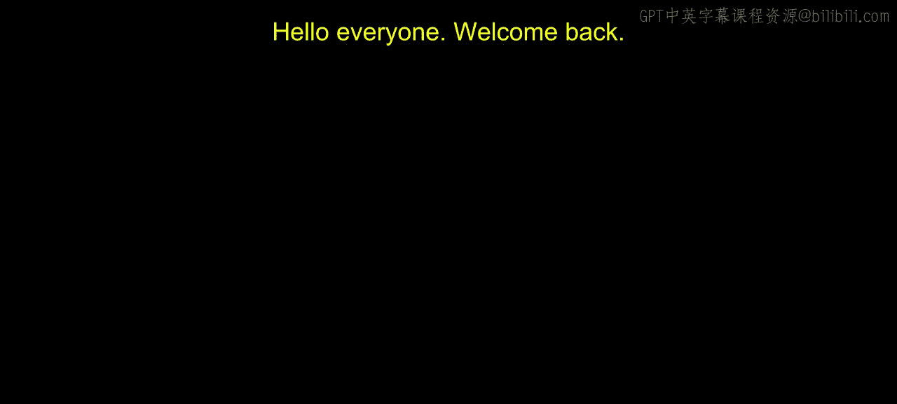
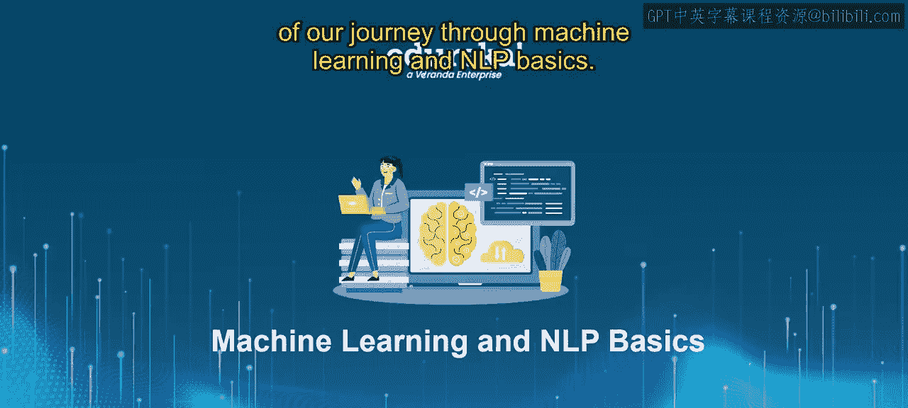
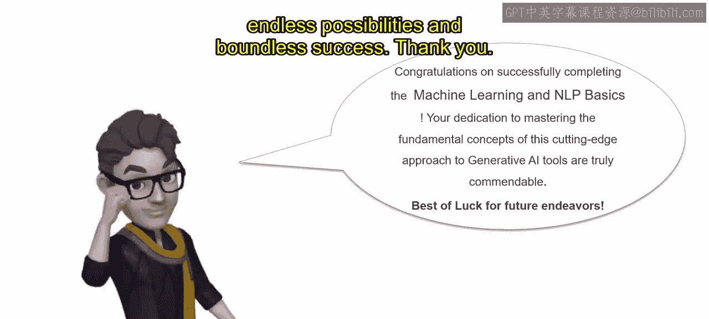

# Edureka《通过LLMs学习生成式人工智能（机器学习和NLP基础，第1课／共4课）｜Learn Generative AI with LLMs》中英字幕 - P138：137_课程总结.zh_en - GPT中英字幕课程资源 - BV1q4421Q7qh

Hello everyone， welcome back Now let's take a moment to recap the key highlights of our journey through machine learning and NLP basics。

😊。

In the first module we laid the groundwork with a deep dive into machine learning fundamentals you learn the core principles and algorithms driving this transformative technology setting the stage for your AI journey next we explore the various types of machine learning from supervised and unsupervised learning to reinforcement learning you gain a comprehensive understanding of each type strength。

 weaknesses and real world applications。😊，As we ra up the module you put your newfound knowledge to the test with engaging assignments。

 solidifying your grasp of machine learning fundamentals Moving on with delt into classification and regression to powerful techniques for solving a wide range of prediction problems you learned how to train models to classify data into distinct categories and predict continuous outcomes with remarkable accuracy with each concept explore and mastered you are now equipped with the foundational knowledge and practical skills to embark on your journey into the world of AI with confidence。

😊，So now that future path and opportunities， now that you have completed the machine learning and NLP basics。

😊，Course， let's explore the exciting opportunities that await you as an AI or MLl engineer。

 you will be at the forefront of innovation， designing and implementing。

 cutting urge solutions that push the boundaries of what is possible with artificial intelligence and data scientists get ready to dive into the world of big data。

 machine learning， natural language processing and extracting valuable insights and driving impactful decision making for business and organizations。

😊，Worldwide， so for freshers， your journey is just beginning。

 but with a solid foundation in machine learning and NLP。

 you are well equipped to pursue a wide range of exciting career opportunities in the rapidly growing field of AI and the opportunities don't stop here from AI consultants to research scientists entrepreneurs to educators。

 the possibilities are endless for those with a passion for AI and a drive to make differences。

 So as you chart your course forward， remember that the completion of this course is just the beginning。

 embrace the endless possibilities that await you and seize every opportunity to make your mark on the world of artificial intelligence the future is yours to shape embrace it with open arms and let your journey。

😊，To the world of AI begin Finally， congratulations on successfully completing the machine learning and NLP based course。

 Your dedication to mastering the fundamental concepts of this cutting edge approach to generative AI tools is truly commendable your dedication to mastering the fundamental concepts of machine learning and NlP is truly commendable throughout this journey you have demonstrated a hunger for knowledge and and a passion for innovation that will serve you well in your future invo as you step forward into the world of AI armed with new found skills and insights know that the possibilities are limitless whether you are seeking to advance your career。

 launch a new venture or simply explore your curiosity。

 the knowledge you have gained in this course will be your guiding light。😊，So。

 so from all of us here， we wish you the very best of luck for your future Endours。

 May you continue to learn， grow and innovate shaping the future of artificial intelligence and making a positive impact on the world around you。

 congratulations once again and may your journey into the exciting world of AIB filled with endless possibilities and boundless success。

 Thank you。😊。

