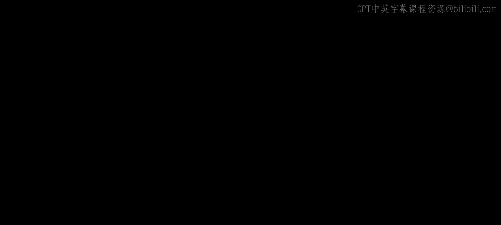
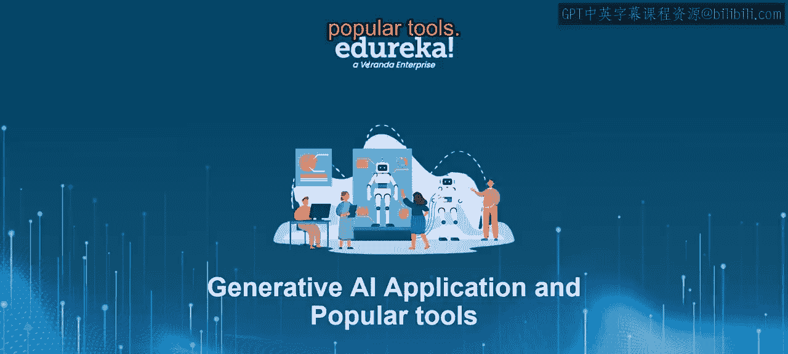
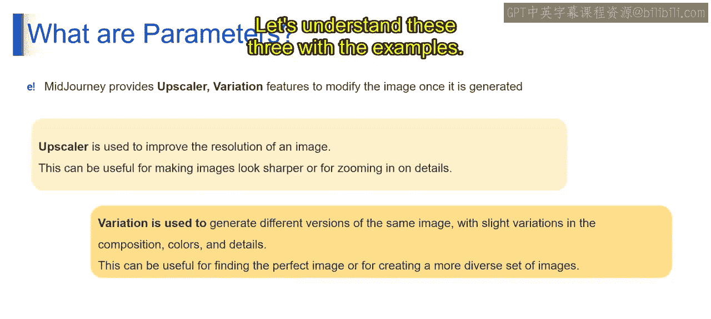
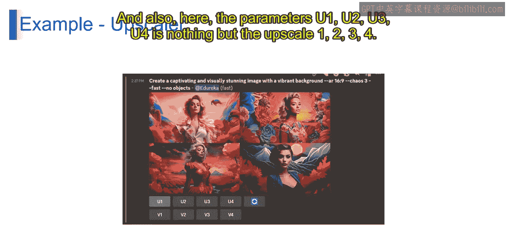
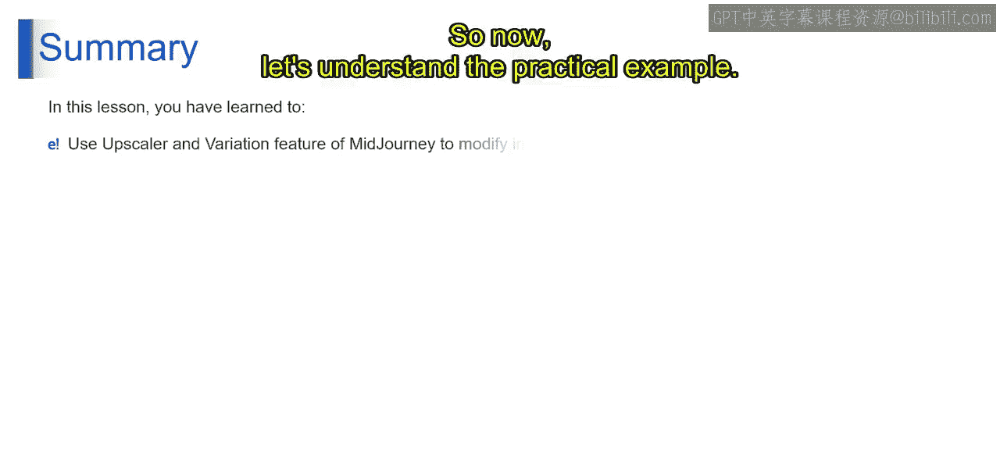
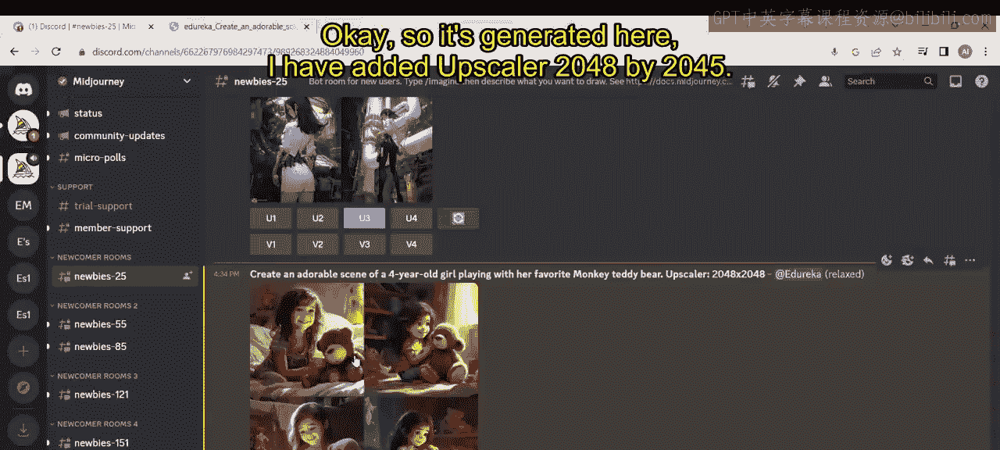
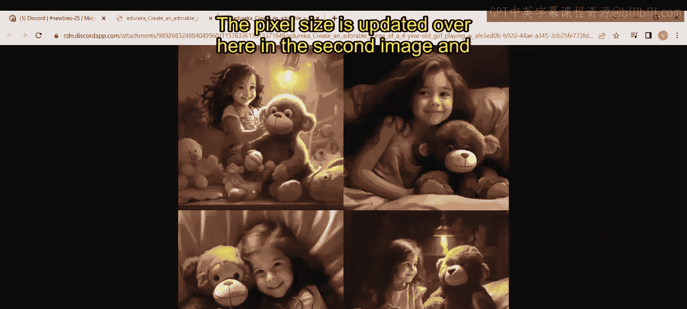
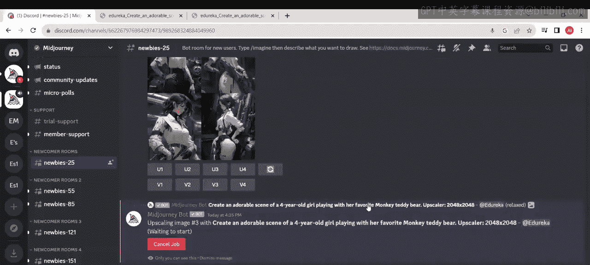
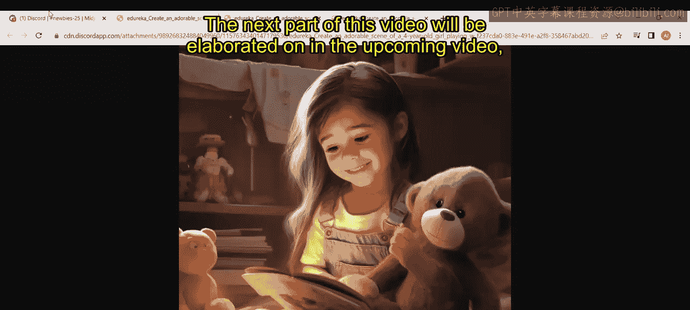
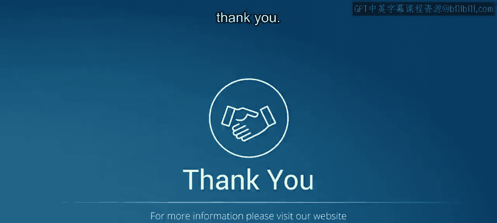

# Edureka《通过LLMs学习生成式AI（基础、应用开发、流行工具，第2、3、4课／共4课）｜Learn Generative AI with LLMs》中英 - P138：31_使用Midjourney修改图像.zh_en - GPT中英字幕课程资源 - BV1ym421V7gx

Welcome to the immersive journey into the world of generative AI applications and popular tools。😊。

Now let's understand modifying images in the mid journey So what are the different parameters available in order to change the images in the mid journey so generally image parameter in mid journeyney are used to control the style quality and resolution of the images that mid journeyney generates up and variation are two of the most important image parameter in mid journeyney so first let's understand about the upr the up parameter increases them resolution of an image making it larger and more detailed this can be useful for creating images that are suitable for painting and publishing purpose I mean also you can print it out to use the up parameter simply add it to the end of your prompt as we have already seen some example if we wants to generate an image what we are doing first of all we are providing the forward slash followed by the image。

😊，meter， then we are giving the text as an input。 If you want to upscale the image。

 you can simply provide the resolution of the image in the pixels。 However。

 you wants to see it that is about the upsscale the next one is of variation So here the variation is that it is a parameter generates new image that are based on an existing image。

 This can be useful for creating different versions of an image for exploring different creative possibilities means to use the variation parameter we are simply expected to add it to the end of your prompt and specify the strength of the variation。

 a higher value will produce a more varied images while the lower value will produce more similar images。

 for example in a simple day， if you want to change the variation of the any image at the end of the prompt。

 you are expected to add a parameter called variation media。😊。

Or low whatever you want And at the end we are having one more thing we can even combine this and like we can say combining upscaler and variation。

 let's understand these three with the examples Here is an example where you can see create a cap and visually stunning image with vibrant background and we have provided some parameters AR and also showss with the fast and no objects and here mid journeyney has generated some four different images you can see all the different four variations and also here the parameters U1 U2 U3 U4 is nothing but the upscale 12。

34 and here the V1 v2 v3 v4 are nothing but variations of each one So that's about the upscaler and as well as variation images So now let's understand the practical example now I'm opening my mid journeyney let's say I wants to create image。

😊。

Okay， now let' us understand with the practical example， let's say I want to create an image。

 I can say forward slash imagine and I can give the prompt。

 create an honorable scene of four years old girl playing with her favorite monkey teddy bear and if I am not going to give anything over here without giving any obscure parameters let's first enter it。

😊，It will take some time and can generate the image。😊。

Now you can see it is generated 100% click on it and open it in a new browser and check it。

 you can see four different variations and also four different upscale like you know animated and real stick as well as some different in it right so this is about one thing now let's go back and say the same prompt but now at the end。

😊，Add upki， and also provide。And at the end， add some pixel for upskir and click on enter。😊。

It will start generating the image。😊，Here you can see with the previous example where we have generated the image you can see U1 U2 U3 U4 this is nothing but the picture11。

2，34 represents respective images from left to right 1234 and U1 U2 U3 U4 is nothing but upscale1234 and here again V1 v2 v3 v4 or nothing but the variations of the image v is nothing but variation of image 1 and V is nothing but variation of image 2 and the remaining all respectively so these all about upscale and variation let's see our image of okay so it's generated here I have added upscaler 2048 by 2045 I will open this and also open in browser。

😊。

And now compare these two images， can you see the difference？😊。

The pixel size is updated over here in the second image and you can see the difference over there how there is a difference but in the first image and second image now let's say if I want to take only one single okay I will be selecting the u3 and I'm clicking in the u3 for upskilling image3 and you can see the difference now。

😊。

It will generate and now click on it and can see the difference and even you can open it in your browser and can check it so that's where it means it will upscale the image when compared to the remaining other variations or when when compared to the remaining other images it will upscale the image generally the next part of this video will be elaborated on in the upcoming video。

😊。

Thank you。

