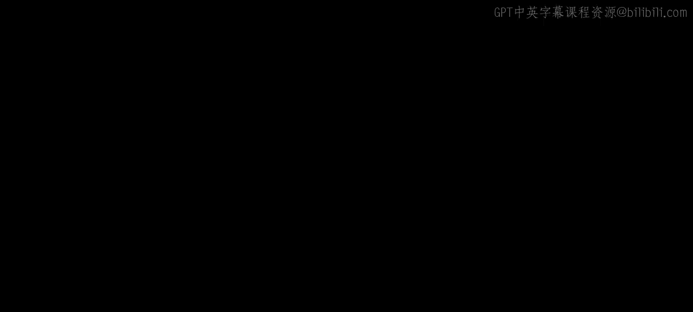
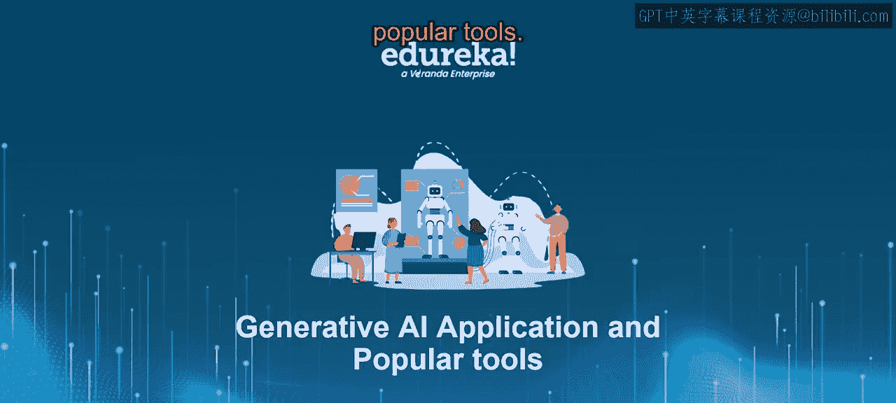
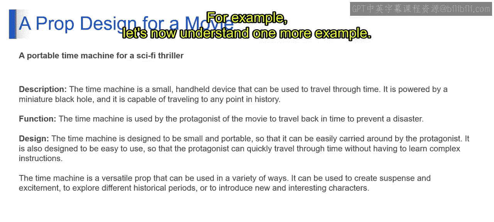
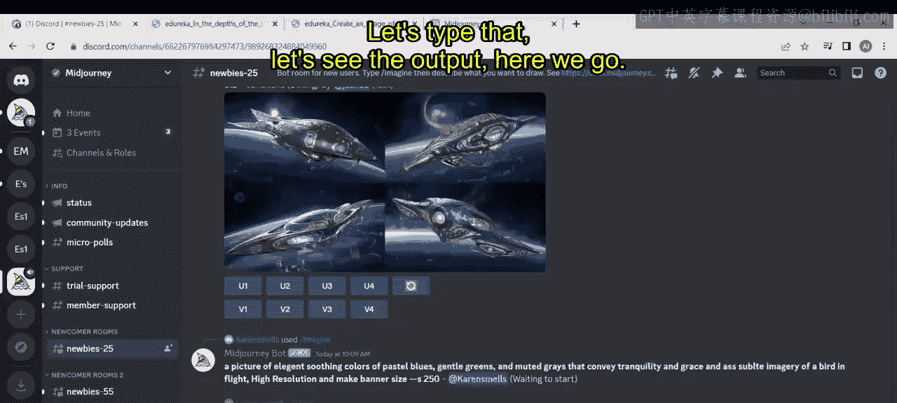
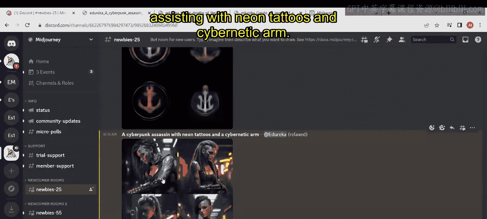
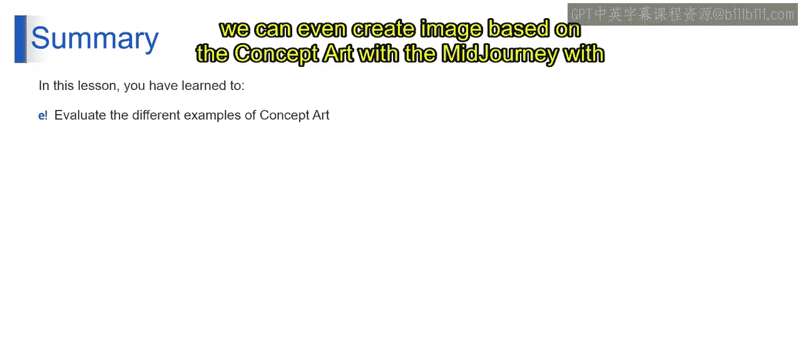
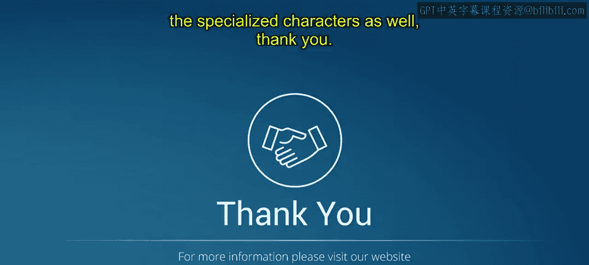

# Edureka《通过LLMs学习生成式AI（基础、应用开发、流行工具，第2、3、4课／共4课）｜Learn Generative AI with LLMs》中英 - P139：32_概念艺术演示.zh_en - GPT中英字幕课程资源 - BV1ym421V7gx

Welcome to the immersive journey into the world of generative AI applications and popular tools。

 So in this we are going to understand the concept art with the midjoney By this we are able to understand concept art and its use cases and analyzing the different examples of concept art and develop a description and generate an image on concept art Let's get started So what is concept art with the midjoney is concept art festival of all。

 So concept art in midjoney is a type of digital art that is used to create visual representation of ideas So use in films。

 video games， animations， comic books and other media as well it is a way to communicate ideas to other art and designers and to help everyone involved in project to understand the overall vision midjoney is a powerful AI image generator that can be used to create concept art in a wide range of styles from the。

😊。

Realistic to surreal。 because of this， it has already been used by artists to create stunning concept art for a variety of projects to create concept art with midjoney。

 You simply need to type a text prompt that describes the image you want to create For example。

 you could type cyberpunk city at night or a dragon flying through a forest。

 midjoney will then generate a limbbra of images based on your prompt。

 you can then select the image that you like best and refine your prompt to create even more specific results。

 Con art in mid journeyney can be used for a variety of purposes。

 It is not only restricted to one here you can see the examples。

 a character designed for a video game。 A spaceship design for a sky， a fantasy landscape。

 a futuristic city， a probe design for a movie， a costume design for a play。

 These are are some examples means this mid journey。😊。

Is a text to image diffusion model that can be used to create concept art。

 It is a powerful tool that can be used to generate a wide variety of images from the real to fantastical。

 So now let's understand one example， a probe design for a movie。

 a portable time mission for a skyfi thriller。 So let's understand how we are doing for us。

 The description。 The time mission is a small handle a device that can be used to travel through the time。

 It is powered by miniatureature black hole and it is capable of traveling to any point in history。

 So that's about the description。 Now let's give the function。

 a time mission is used by protagonist of a movie to travel back in time to prevent a disaster。

 that is about the functionality of a time mission。 Then the design。

 The time mission is designed to be a small and portable so that it can be easily carried。😊。

round by the protoagonist it is also designed to be easy to use so that the protoagonist can quickly travel through time without having to learn complex instructions。

 The time mission is a versatile prop that can be used in variety few ways it can be used to create suspense and excitement to explore different historical periods。

 or to introduce new and interesting characters means this is how you are expected to provide in the movie。

 For example， let's now understand one more example。 let me open my journey Now。

 let's say we want to use my journey to create concept art for a futuristic character。 Let's say。

 for example， a cyber pununk assisting with neon tattoos and cybernetic Let's type that。😊。

Let's see the output。Here we go， so let's open it in a browser。

You can see the output means by giving the input as a cyberpunk assisting with neon tattoos and cybernetic arm that is of whatever the input that we are giving here here we are using the concept art in order to generate a specialized character for a movie or whatever it is whether if it is for video game or if it is for the movie that enroll in the character wise and all such kind of examples so this is one example for this。

😊。

So that is about the concept art in this we have seen an example how to do that and we can even create image based on the concept art with a mid journeyney with a specialized cactus as well thank you。

😊。

