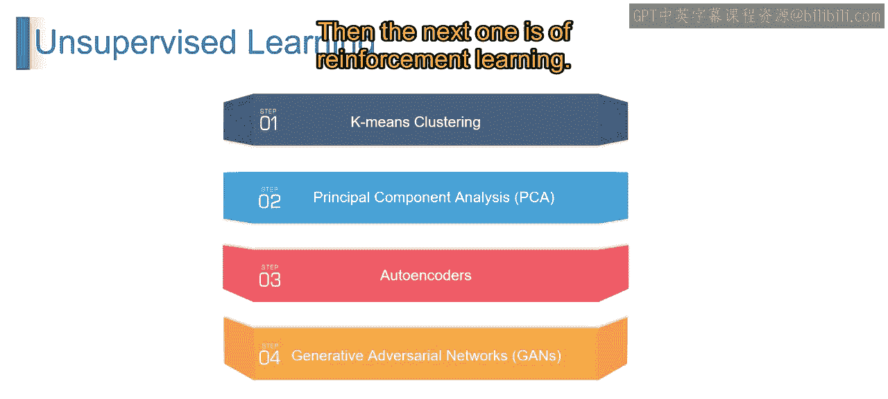
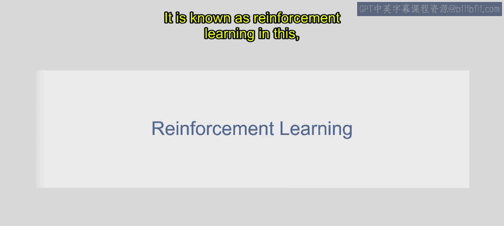
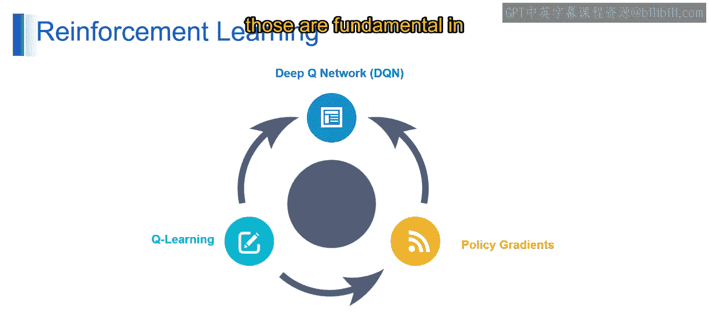
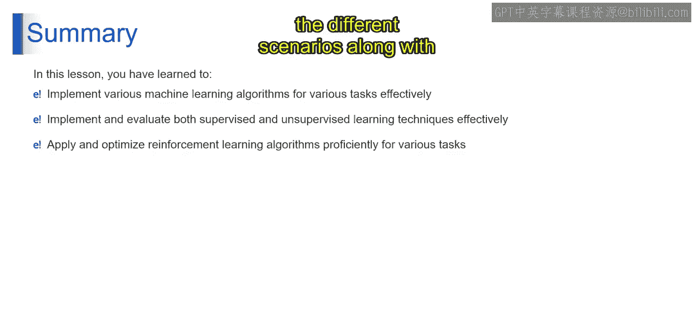

# Edureka《通过LLMs学习生成式人工智能（机器学习和NLP基础，第1课／共4课）｜Learn Generative AI with LLMs》中英字幕 - P13：12_机器学习算法第二部分.zh_en - GPT中英字幕课程资源 - BV1q4421Q7qh

So let's now explore the progression from our previous discussion then coming to the autoenrs。

 so consider a puzzle where you take a picture break it into pieces and then try to reconstruct the original image using those pieces autoenrs work similarly by compressing the data into a lower dimensional representation and then reconstructing the original data from that representation means technically autoencors are neural network architectures used for unsupervised learning and dimensionality reduction by training to encode input data into compact representation that is nothing but encoder and decode it back to its original form that is nothing but decoder aiming to minimize the reconstruction error that's about autoender then Gs。

Creative adversarial network Imagine a counterfeer trying to create a fake currency that is indistinguishable from the real currency So the GANs are like the game between the generator as well as the discriminator where the generator continuously improves their skills to produce the fake currency to fool the discriminator means GNs are unsupervised learning frameworks comes as of two neural networks a generator and a discriminator trained together in a game theoreic setting where the generator learns to generate the realistic data samples and the discriminator learns to distinguish between the real and the generator data Then the next one is of a reinforcement learning Imagine you are teaching a dog。

😊。

With a trick， like fetching a ball， you give the dog a treat when it performs the desired action correctly。

 if it does not， you might withhold treat or give a general correction or the penalty over the time the dog learns to associate fetching the ball with receiving treats I its behavior means reinforcement learning in machine learning is exactly similar。

 It is a type of learning where an agent learns to make decisions by trial and error receiving feedback in the form of rewards or penalities。

 The agent aims to maximize cumulative rewards over the time by learning the optimal actions to take in different situations。

😊，It is known as reinforcement learning In this we are having the deep Q network Q learning policy gradient so deep Q network it is also known as DQN imagine you are playing a video game and you want to train an AI to learn how to play it D and is like giving the AI a brain to understand the games environment and make the decisions it learns by trial and error adjusting its actions based on the rewards it receives means technically Dq and is a type of reinforcement learning algorithm that combines Q learning with deep neural networks to approximate the action value function that is nothing but the Q function allowing for more complex and high dimensionmensal state spaces then coming to the Q learning Q learning is。

😊。

Model free reinforcement learning algorithm that learns optimal action selection policies from Mark over decision processes by iteratively adapting estimates of the action value function based on the observed reward and next state value then the next one is of policy gradient policy gradients are a class of reinforcement learning algorithms that directly learns a policy function to maximize the expected rewards by updating the policy parameter in the direction of gradients computed from reward signals so these are are the techniques those are fundamental in reinforcement learning So now the summary in this lesson you have acquired the skills to effectively implement diverse machine learning algorithms for various tasks evaluate both supervised and unsupervised learning。

😊。

Techniques and proficiently apply and optimize reinforcement learning algorithms across the different scenarios。

 along with the reinforcement learning。 Thank you。😊。

