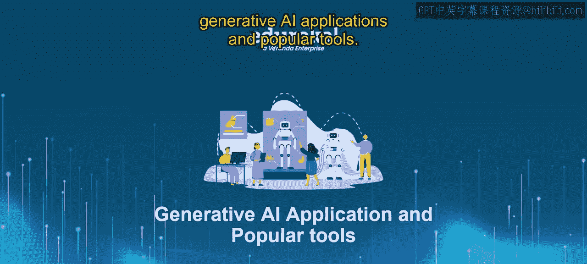
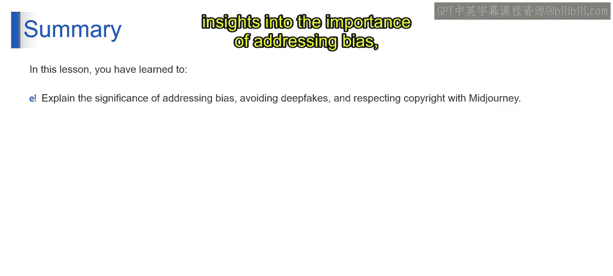
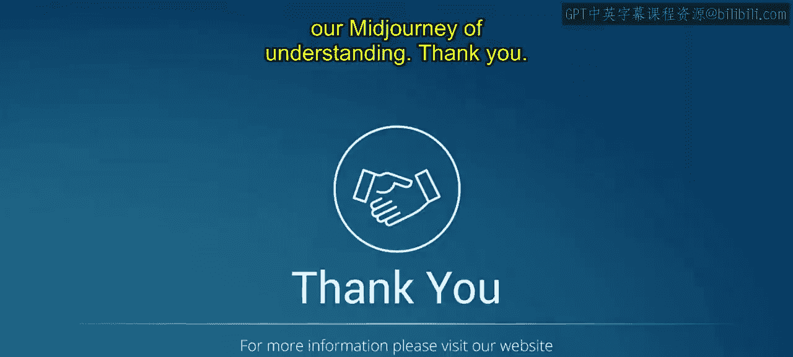

# Edureka《通过LLMs学习生成式AI（基础、应用开发、流行工具，第2、3、4课／共4课）｜Learn Generative AI with LLMs》中英 - P140：33_使用Midjourney的伦理考虑.zh_en - GPT中英字幕课程资源 - BV1ym421V7gx

Welcome to the immersive journey into the world of generative AI applications and popular tools。

 Welcome back to midjoney。 Now let's understand the ethical considerations with the midjoney in this by us def fakes copyright and intellectual property and how to use midjoney ethically So by this。

 we are able to understand how to develop a comprehensive ethical framework for the use of midjo in various contexts。

 So let's get started ethical consideration with the midjo。

 ethical consideration is very important when using midjoney because it is a powerful tool that can be used for both good and bad to prevent the spread of misinformation。

 protect the copyright of others and avoid the creation of harmful content。

 It is important to be aware of the potential of misuse of mid journeyney and to take steps to prevent it In short。

 ethical consideration is important when using midjoney to ensure that。😊。

Is used for good perspective。 So now let's understand the key ethical concerns when employing midjoney。

 The first one is of bias。 So bias refers to the tendency of a system to produce results that favor one group are attirre over the another this can be caused by a number of factors。

 including the data that the system is trained on the algorithms that it uses and the people who design and implement the system。

 One example of bias in mid journeyney is the way it in which it generates the images of the people。

 Some users have reported that midjoney is more likely to generate the images of men than women and that these images tend to be more flattering and positive this could be due to the fact that mid journeyney is trained on a data set of images that is predominantly male or to the fact that the algorithm that mid journeyney uses are biased in favor of male faces。

 So that's about the。By us the next one is of deep fake Deep fakes are videos or audio recordings that have been manipulated to make it look or sound like someone is saying or doing something that they never actually said or dead Deep fakes are created using a variety of techniques including machine learning artificial intelligence and computer graphics Deep fake can be used for malicious purposes。

 such as to spread disinformation or to damage someone reputation。 However。

 they can also be used for creative purposes such as to create parodies or to make a movie and TV shows more realistic one example of deep fake in mid journeyney is a video that was created of Tom Cruz playing a piano the video is very realistic and it is difficult to tell that it is not actually Tom。

😊，I playing a piano However， the video is actually a deep fake and it was created using a variety of techniques。

 including M， which is nothing but machine learning。

 artificial intelligence and computer graphics that is about the deep fakes and the next one is copyright and intellectual property So copyright is a legal concept that protects the creative expression of an author intellectual property is a broader term that encompassosees copyright as well as other forms of the intellectual protection such as trademarks and patents when you create an image using the midjoney you are the copyright owner of that image This means that you have the exclusive right to reproduce distribute and perform the image However there are some limitations on your copyright such as the fair use doctrine the fair use doctrine allows others to use。

😊，Your copyrighted work without your permission for certain purposes such as for criticism and commentary news reporting。

 teaching scholarship or research purpose in addition to copyright midjoney also has its own terms of service that govern how to use the images that you create for example in terms of service state that you cannot use midjoney to create images that are hateful discriminatory or illegal that is about copyright and intellectual property then now let's understand how to use midjoney ethically to ensure ethical use of the midjoney we will have to follow the guidelines those are addressing the bias and respect copyright and avoid the fix so address bias first of all so be aware of the potential for bias in midjoney and try to use prompts that are neutral and unbiased if you。

😊，Are getting images of people。 try to generate a variety of images that present different group of people。

 Be critical of the images that mid journeyney generates and don't use any images that are biased or discriminatory That is about address bias。

 The next one is of respect copyright。 So only generate images that you have the copyright to use be aware that mid journeyney is strain on a data set of images that are protected by copyright。

 If you are unsure whether you have the right to use a particular image。

 It is best to check with the copyrighted person directly。

 then avoid deepfi do not use mid journeyney to generate images or videos that are intended to de people。

 be honest about the fact that you are using mid journeyney to generate images or videos do not use mid journeyney to generate images or videos that are harmful or defam。

Obviously， so some additional tips I can tell you be mindful of the impact that your images may have on others do not use midjoney to generate images that are violent。

 hateful or discriminatory do not use midjoney to generate images that are sexually suggestive or exploitative and be respectful of the privacy of the others do not generate images of people without their permissions these are the simple agenda and some more examples I can tell you how you can use midjoney ethically for example。

 you can say generate images of people from different backgrounds and cultures to promote diversity and inclusion that is the best way that you can ask which cannot go for the biasness and when more example generate images of historical events or figures to educate people about the past life as you can use by using midjoney in a creative and ethical way you can make a。

😊，Impact on the world。 So that is about the ethical considerations of the midjoney。 now by this。

We have now gained insights into the importance of addressing bias。

 preventing the creation of deep fakes and navigating copyright concerns in our mid journey of understanding。

😊。

Thank you。

