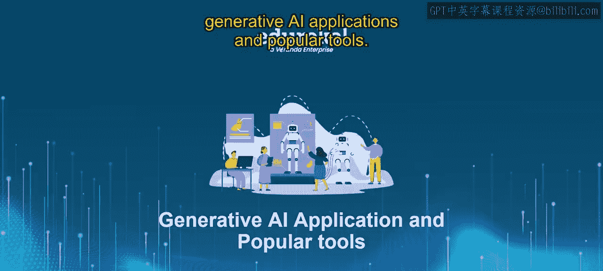
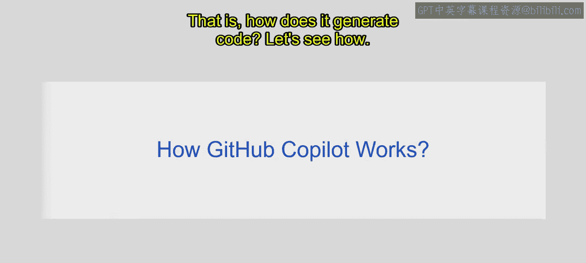
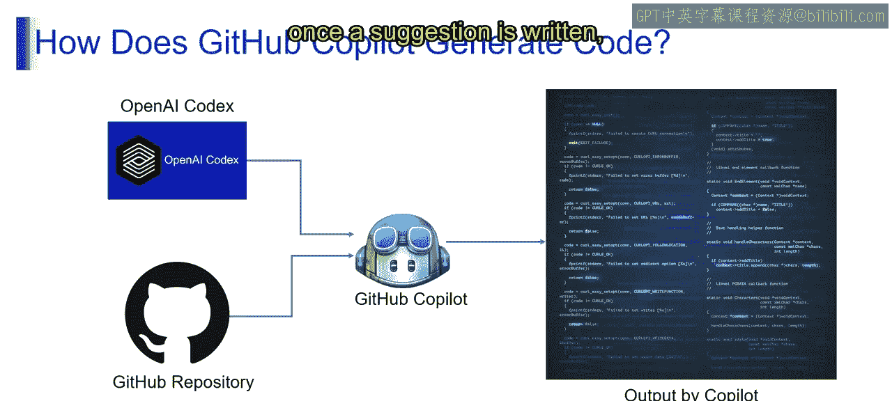
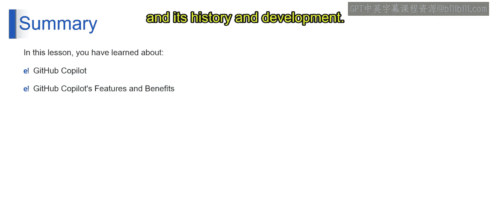

# Edureka《通过LLMs学习生成式AI（基础、应用开发、流行工具，第2、3、4课／共4课）｜Learn Generative AI with LLMs》中英 - P141：34_GitHub Copilot概述.zh_en - GPT中英字幕课程资源 - BV1ym421V7gx

Welcome to the immersive journey into the world of generative AI applications and popular tools。

 Let us first see the topics that we will cover under this。 Let us overview of Giub Co it。😊。

Introduction to generative AI and the AI powered coding assistance。

And how did it develop over the ears。 Let us see the learning objectives。 By the end of this lesson。

 you will be able to know about Gitthub Co it， its features and benefits。

 and its history and development over the ears。 Let us now see。 Here they are。

 Let us move on to what is actually Github Co it。😊，Let us check what is Github Coil it。

 It is an autocomplete system that is powered by AI。

 Just say if you want to write a function for doing something。 So what you want the function to do。

 write it as a comment and Github Coil it will autocomp it for you， Isn't it great。So basically。

 Gitthub Copilot turns the natural language prompts into the coding suggestions。

 and it works across dozens of languages。 It can work on multiple Is and function similar to the AI pay programmer。

 It is the same way。 as a pilot needs a coilt。 So the main work will still be done by the person who is writing the code。

 but the coppit with its suggestions will make the coding fast in the sense that instead of writing the entire code。

 Github Copit will give suggestions for coding， you can pick the one as per your need。

 and it will write the same for you in fraction of seconds， and that to very efficiently。😊。

It is the same way like we have certain softwares which corrects us on the grammatical errors or the spelling errors same way。

 like when we are writing a code， then this Github compiler gives suggestions for the better coding experience。

Let us now see how Giub compileil it works。 That is how does it generate code。

 Let's see how as you start typing a code， Github compileil it generate suggestions for you to choose from。

 and these suggestions are based on the context of your code and the libraries。

Auttocomplete feature of Github Copit increases the efficiency。

 So if you can see here like open AI codeex， it passes that as it breaks the national language and generate codes。

 And then this Github repository。 It is the set of millions of code。

 So Github Coilt share snippets or chunks of your code with Github to provide suggestions to you。

 code snippets's data is transmitted in real time to written suggestions and is discarded once a suggestion is written。

 So it is very safe。 generative AI and AI powered coding assistance。

 Let me take you to the features of Github Coilt。😊。

If we talk about its benefits， it has got many benefits like national language processing。

 it will give suggestions for the code， privacy and security is ensured its integration with code editors is really commendable。

 it is personalized and is supposed for multiple programming language。

Let us now see how Gitthub has developed over the years。In 2014。

 Gitub Co pilot evolved from the bank code search plugins。Between 2020 to 2021。

 Gitthubs started experimenting with open AI models。

 and in the year 2022 Gitthub Copit became a subscription based service for the individual developers and in 2023。

 the general availability of Github Copit was ensured and now the release of Gitthub Copit enterpriseterpris plan in 2024。

Let us come to the summary。 Now， in this lesson， you have learned about the Github Coil it。

Its features and benefits， and its history and development。😊。

Thank you so much for joining me in this video。 I will see you in the next video， till then。

 keep learning。😊。

