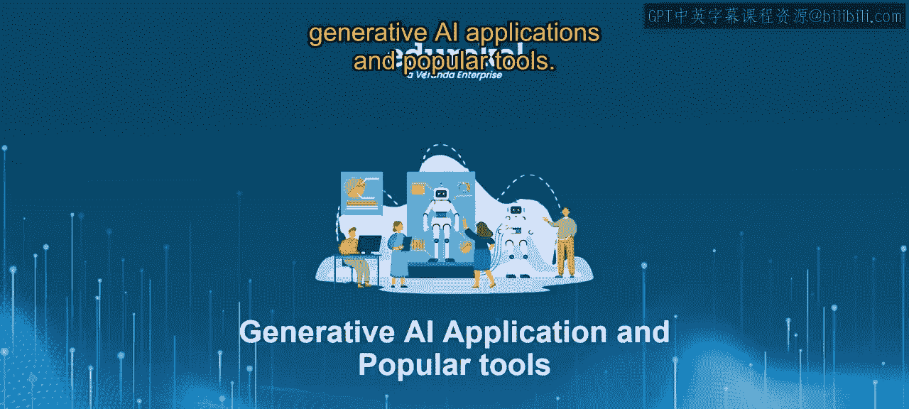
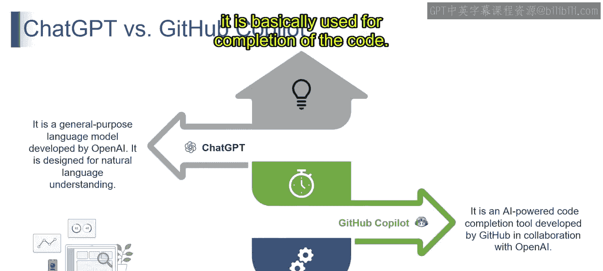
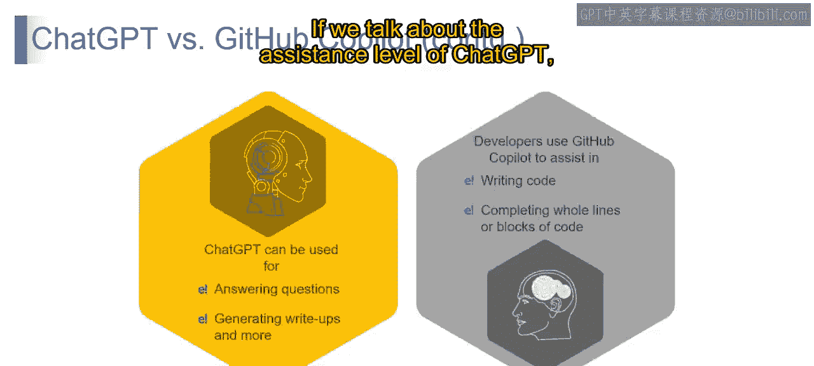
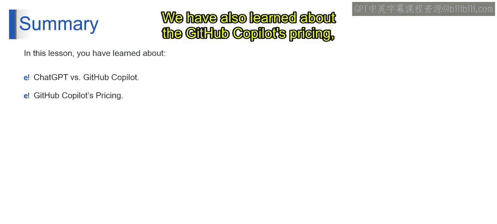
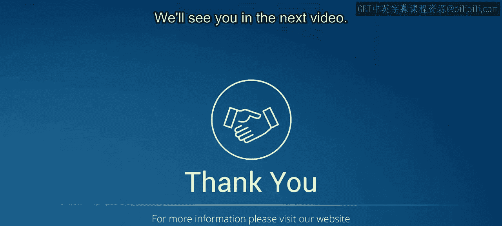

# Edureka《通过LLMs学习生成式AI（基础、应用开发、流行工具，第2、3、4课／共4课）｜Learn Generative AI with LLMs》中英 - P142：35_ChatGPT vs GitHub Copilot.zh_en - GPT中英字幕课程资源 - BV1ym421V7gx

Welcome to the immersive journey into the world of generative AI applications and popular tools。

 Let us see the topics that we're going to cover today。 That is Cha JPT versus Co pilot。😊。

And the pricing for Github Co it， let us move on to the learning objectives after the completion of this lesson。

We will be able to。Understand the difference between Github Copit and Cha GT and we will also know about the Github Copit pricing Let us now compare chat GT and Github Copit if we talk about chat GT it is a journal purpose language model it was developed by open AI and it is just designed for natural language understanding like whichever queries or doubts or questions come in your mind you can open the chat GT window you can type in there instead of calling them as a question or a comment we call them as a prompts and then you will get the answer and but if we talk about Github Copit it is an AI power code completion tool developed by Github which is in collaboration with open AI so in case of Github Copit when we talk about it it is basically used。

Completion of the code Cha GPT is basically used for answering questions or if you want to generate some write or if you want to get certain data then you can use chat GPT if we talk about Github Copi it on the other hand it is basically used for writing codes and the completion of whole lines or a certain block of code if we talk about the assistance level of chat GPT it is in the conversational mode you will be getting conversational responses and text generation is there so it is like when you type something you will feel that somebody is answering your questions if we talk about Github Copit when you are typing the code simultaneously Github Copi is understanding the logic that you are trying to build up and it will give you suggestions so it is basically supervised learning with the code examples。

If we talk about the training of both of them， then for Cha GPT。

 it is trained on a diverse data set of text in case of GitHub Copit。

 it is trained on the code repositories and the documentation if we talk about the learning approach。

 this is unsupervised learning from the internet text。

 but in case of GitHub Copit this is supervised one。

If we talk about the assistance level also for the Gitthub Copit。

 it provides code suggestions and the auto completion based on the context on which you read the code。

Let us now see the pricing of Cha GPT versus Github Copit If we talk about Cha GPT pricing it is user based pricing depending on your use and then if we talk about Github Copi pricing it is subscription based pricing let us now see the community support if we talk about chat GPT it is open AI community and has got developer resources if we talk about Github Copit it is the Github community and the documentation。

Let us now see the pricing of Github Copit。 It is there for the if you talk about the starter pack。

 that is the basic one， it has got a different pricing。 If you talk about the business one。

 it has got a little different pricing and it has got different things that you will be getting like for example if you just want to get a feel of Giub Copit or if you are a freelancer or if you are a stored it is free for you。

 it is free for open source maintenance as well if you just want to use for chat or the code completion the basic ones。

 you can get the starter one， but if you using it for a higher scale。

 then you should go for the business one there is also one more that is the enterprise one So depending on your usage you can pick the one which is right for you。

Let us now see the summary of today's lesson， what we have learned today in this lesson you have learned about Cha GPT and Gith Copis comparison we have also learned about the GiA Copis pricing。

That is it in today's lesson， we'll see you in the next video till then keep learning。

