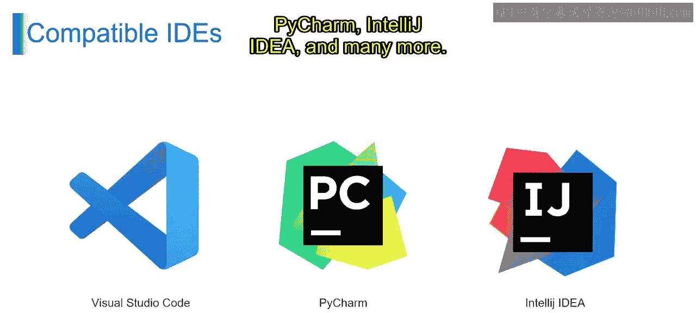
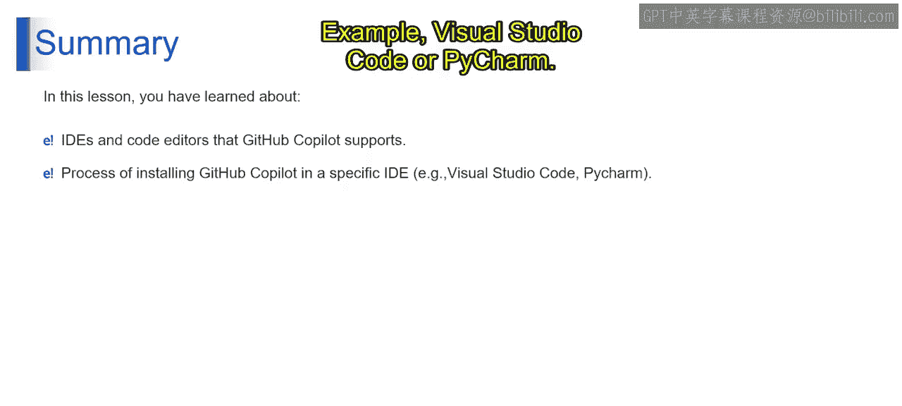

# Edureka《通过LLMs学习生成式AI（基础、应用开发、流行工具，第2、3、4课／共4课）｜Learn Generative AI with LLMs》中英 - P143：36_PyCharm的安装和设置.zh_en - GPT中英字幕课程资源 - BV1ym421V7gx

Welcome to the immersive journey into the world of generative AI applications and popular tools Let us see the topics that we are going to cover in this lesson These are Gitthub Copit installation and the IDs that support Gitub Copit moving on to the learning objectives Let us see what are the learning objectives for today's class That is by the end of this lesson you will be able to list down the IDs and the code editors that Gitthub Copit supports you will also be able to demonstrate the step by step process for installing Gitthub Copit in a specific ID。

Let us now explore the Gitthub Copit compatibleible IDs。

The ID that are compatible with Github Copit are visual Studio code P charmm intelligent idea or many more let us see how to install Github Copit in Pcharm if you want you can also install it in visual studios it is your choice but the procedure for doing is almost the same under Pchar when you will open this window。

 go to the projects click on projects and then open and click on this plus sign that is a new project and open the Pcharm window once you open the piecharm window scroll down you will get the plugins there as an option click on plugins then click on idea web and then you will get to see this particular window under the Market choose Giub Copit and then you will also see this install button you will be clicking on it。

And then you will get to see this window once you click on install Giub Copi it will start installing on your system。

Once it is installed in your system， please click here that is restart IDE so this will refresh the IDE and then you will be able to use it you will get this kind of screen where it will last tell you that welcome to Github Co it for PCha then you will be logging into Giub。

Now let us move on to the IDs that are also compatible with Gitthub Copit。

 you can use any of them that these are intelligent ID Android Studio， Cap code， C lion， Datagri。

 code with me guess， there are more which are there， letuce Datapell， Golan， Jet Brains， client， MP。

 PV Strom， and PCha。You can also try Rder Pbemin and Webstr so in today's lesson we have learned about the IDs and the code editors that GiHub Copit supports we have also seen the process of installing Github Copit in a specific ID example visual Studio code or Pyche。

That is it in today's lesson， I will see you again in the next video till then keep learning。

