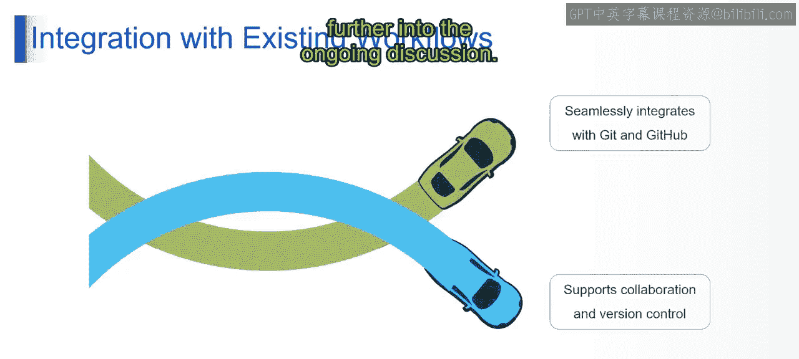

# Edureka《通过LLMs学习生成式AI（基础、应用开发、流行工具，第2、3、4课／共4课）｜Learn Generative AI with LLMs》中英 - P144：37_用户界面和功能.zh_en - GPT中英字幕课程资源 - BV1ym421V7gx

Welcome to GitHub Copilot， the AI pay programmer for codinging。

Let us see the topics that we are going to cover in today's lesson。These are usage of GitHub Copi it。

 its key features， how it enhances developer productivity and its integration with existing workflows。

Moving on to the learning objectives， by the end of this lesson。

 you will be able to explore the use and the key features of Gitthub Copi it。

 you will also be able to illustrate the developer productivity and its seamless integration with existing workflows。

So let's charge your coding workflow with an AI power assistance that is GiHub Copi it but before that let us see the usage of Gitthub Copi it as we know it is an AI power coding assistant that aids developers to code faster it is integrated with popular IDs like J print by charm and visual Studio code and it provides suggestions for the whole lines' of blocks of code depending on the context key features of GiHub Copi itHub Copits key features include code auto completion context suggestions and its ability to multiple programming language it can generate test and provide documentation for the code documentation in the sense like if there is any line or any word in a particular code that you want to understand you can just highlight it and it will give you the entire documentation about it like why that particular function is used what is the。

How can use it further Let us see how Github Copilate enhances the developer's productivity first of all。

 it speeds up the coding process by providing accurate and correct suggestions it helps to reduce the cognitive load on developers like when you are using Github Copit you do not have to stress your to memorize and recall the codes and then write it will reduce the cognitive load you can simply start writing your code if you are struck somewhere you can write it as a comment and Github Copit will give you relevant suggestions out of those suggestions you can choose the one which is appropriate for you which is the correct one for you it allows the developer focus on the problem solving rather than the syntax details so when you are making a program you don't have to think too much about the syntax the code and all you can just focus on the logical thinking part。

 the logical reasoning part while you are doing that program and what all steps are required for that。

It's integration with existing workflows we know that Github Coillate seamlessly integrates with Gi and Github and it supports collaboration and version control so the upcoming video will delve further into the ongoing discussion。

