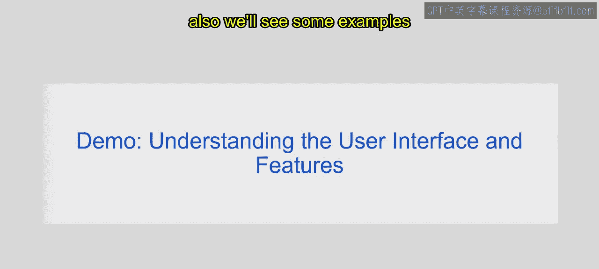
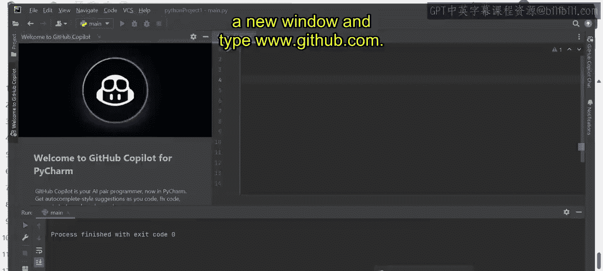
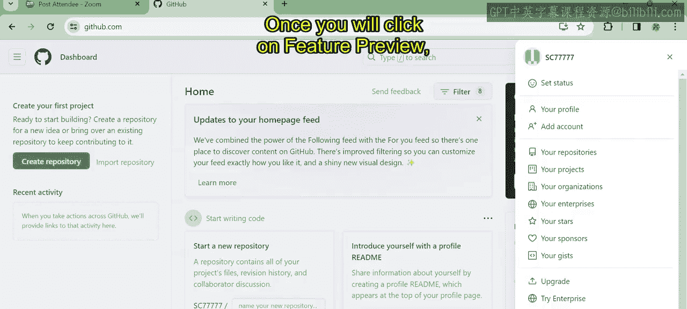
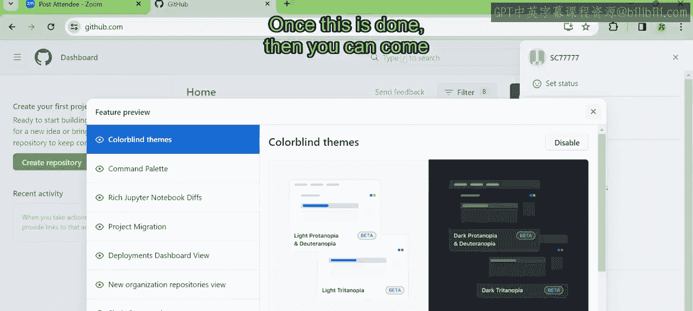
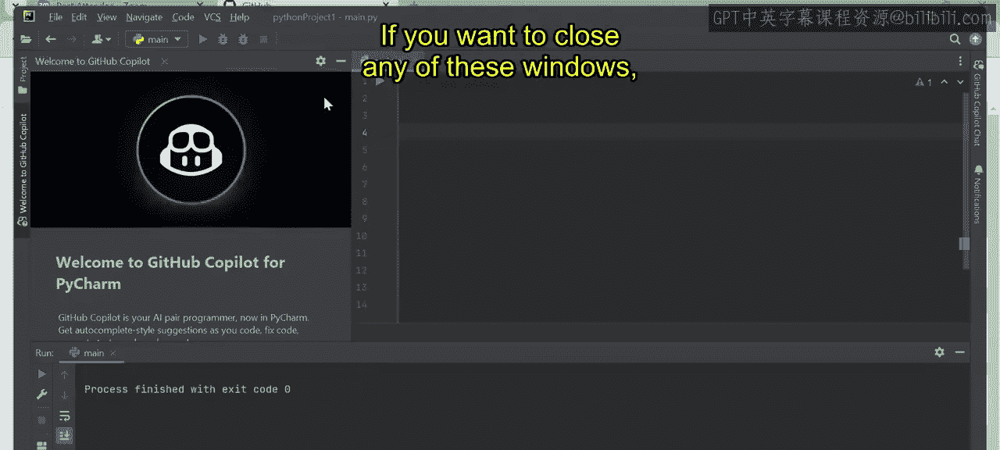
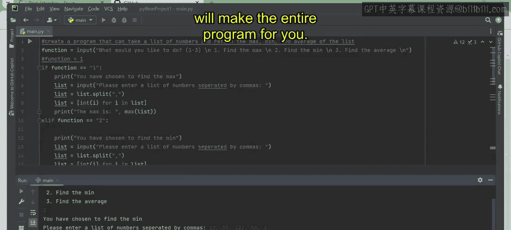
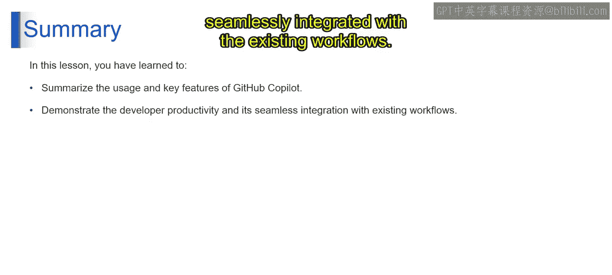

# Edureka《通过LLMs学习生成式AI（基础、应用开发、流行工具，第2、3、4课／共4课）｜Learn Generative AI with LLMs》中英 - P145：38_用户界面和功能演示.zh_en - GPT中英字幕课程资源 - BV1ym421V7gx

So let's now explore the progression from our previous discussion now I'll take you to the most elevated part of today's lesson that is the demo wherein we will understand the user interface and its features and also we see some examples where Gitthub Copi is giving suggestions。

😊。

This is how our window looks like this is Edbrains P charmm window you can code on any of the Windows visual Studio or P charmm you can also work on the Java file it is up to you but this Github Copit will give you the suggestions in a similar fashion whichever ID you are using now you might feel that sometimes when you are using when you are trying to use a Github copit at times it might not work this will happen and the initial stage the reason for this is that you have not enabled some of the functions for that what you will do whenever it's your first time when you are using this Githubcopi I will suggest you should first sign into Githubcopi it you can also see this on the side panel on the left side welcome to Github Copit this is appearing because I have sign here in case you have not then in that case you are supposed to sign in and what you will do let us open a new window and time www do Github。

comHere it is。 and then you will log into it。 I have already logged in。

 That's the reason my page is looking like this in case you have not logged it。

 you have not signed up and you are supposed to create an account here。

 So once you have created you will this kind of a link creating an account as a simple task it will be asking you an email ID they create a new if you want and then a strong password you are supposed to keep and then you will get this window So here when you will click here on this icon you will see then scroll down you will see this feature pre This is an important one once you will click on feature preview。

 you will see these colorblind themes come palpiter notebook project migration in all these you will see that in your case many of them must be so you are supposed to enable all of them click all of that and then you here you will see the enable button and you will keep on enabling it so you will should ensure that all seven of them should be enabled if you want to take。

Most out of Github Coil it So once this is done then you can come back to your window。

 which is this one。 If you want to close any of these windows。

 you will click on this minus kind of a so you will get the entire window to yourself alright now let us see how Giub copil it give suggestions to you for example。

 if you want to create an array of names so you can write it as comment。

So you can write create means area。And click on enter see get a compileil it just has read your comment and then it has given the suggestions like this similarly you can create an area of colors an area of numbers or anything now as I said numbers let us try to create a program just say for example I'm a developer and I do not memorize or recall and code but I want to use a certain a certain program as a part of my bigger program so let us say I want to create a program that can list some numbers and tell me the maximum minimum and average of those numbers。

So let us create a program。That can take a list of numbers。Okay。

 see it has given me suggestion also you can consider this if you want to consider this suggestion。

 I'll have to click on that tab button， just say so now I want to create a program。

That can take a list of numbers and return the maximum minimum and average of the list okay let's move ahead you'll have to click on the enter so it has giving me more suggestions and make sure your program can accept list of any length and on that。

Yes I'm not accepting it and I start typing function okay， if I want to accept this suggestion。

 then I will click on tab enter it is giving me another suggestion。Now， the program。Okay。

 like I just say if I'm a new program， I do not know what is to be like whether whatever it is showing me is correct or not。

 I can simply click on the tab button and check whether this program is running for me or not。

 so if you want to accept any of these you will have to click on the tab button。

That is it now let us try to run this program to run the program we will have to click on this green triangle which is there so it is asking me what would you like to do out of one two and three let us say like I want to calculate the minimum so websites option number two you have chosen to find the minimum enter a list of numbers separated by comm so let us type the list of numbers。

And都。See it has given the minimum is three that means this program is working。

 see how it easy it is even if you do not know the entire code you can just give your suggestions your prompts and then Gi a Coil it will make the entire program for you。

😊。

So in today's lesson we have learned the usage and key features of Github Copilate we have also seen how Github Copilate increases the developed productivity and how it is seamlessly integrated with the existing workflows thank you this is it for today's lesson we'll see you on the other side of the video next time thank you。

