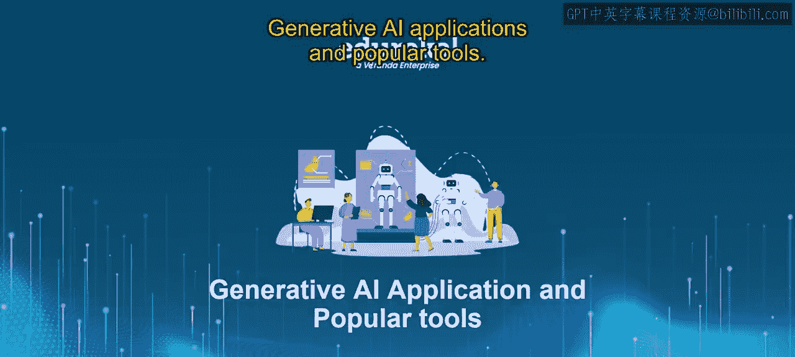
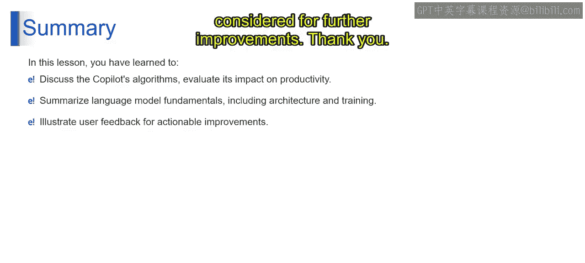

# Edureka《通过LLMs学习生成式AI（基础、应用开发、流行工具，第2、3、4课／共4课）｜Learn Generative AI with LLMs》中英 - P146：39_GitHub Copilot的工作原理.zh_en - GPT中英字幕课程资源 - BV1ym421V7gx

Welcome to the immersive journey into the world of generative AI applications and popular tools。

 Let us now see the topics that we are going to cover in this lesson。

 We will see how Gitthub compilepit interprets and generate code suggestions。

 That is we are now going to see the inner working and the impact of Github Coil it。

 we will also see that how Github compileil customized suggestions to match the coding style and preferences by using the training data by contextual analysis its statistical language models。

 It also considers the feedback given by the users and it customizes code suggestions and its future developments。

😊。

Let us now see the learning objectives By the end of this lesson you will be able to describe the Copit's algorithms you will be able to evaluate its impact on productivity you will be able to explain language model fundamentals including its architecture and training and we will also be able to see like how user feedback is considered by Github Copit for further improvements so let's unveel the magic behind code interpretation and generation Think about its inner working and the impact of Github Copit actually what happens Github Copit analysiss and interprets for snippets understand the patterns and the syntax to provide meaningful suggestions and completions。

Talking about the training data， Gitthub Copilate is trained on a diverse set of publicly available code from Github repositories which includes programming languages。

 frameworks and libraries this training data helps copillate， learn the structure。

 common coding patterns and the syntax which is used by the developers in real world projects further a contextual analysis。

 context analysis helps Coillate generate code suggestions that a contextually relevant and fits seamlessly into the existing codeb Sta language model。

 Github Copilate employs a statistical language model which is a variant of GPT architecture GT stands for generative retrain transformer Coillate is fine tuned to generate code snippets by predicting the next sequence of code which is based on the context and patterns。

Learn during training GithHub Copit also considers the feedback， which is given by the users。

And how it happens， Gitthub Copit actually understands and incorporates the feedback。

which is crucial part of its learning process， excepting or rejecting certain code suggestions by the developers also help cop enhance suggestions。

 that separate suggestions contribute to the model's understanding of what is considered code or inapp code whereas the rejected suggestions help it learn from mistakes and avoid suggesting similar patternss in the future。

 stizing code suggestions that is tailoring coding suggestions。

How to get the most out of Github Copilate there's a suggestion that you should write your code in smaller function that is smaller bits so that Github Copit can give you the suggestion simultaneously you should write meaningful names of function parameters as this will make it easier for the coppi to understand your intent that is the project or the program that you want to work on and last but not the least Github Copit is just a tool as a name suggests it is coppilate so you are still the pilot and you will remain the pilot Github Copit is just a tool it is on your hand that is on the developer's hand to accept the suggestions or to reject the suggestions which are given by the Github Copilate and accordingly make changes to your program moving on to the future developments。

For GitthHub Copilate， we can anticipate advancements in AI power tools including enhanced capabilities。

 GitHub Copilate aims to become more personalized and accurate in generating suggestions that match the unique coding style of each developer。

So in this lesson， you have learned to evaluate the Github score pilot's impact on the productivity。

 we have summarized language model fundamentals， including architecture and training。

And we have also seen how user feedback is considered for further improvements。Thank you。

 that is it in this lesson we'll meet again on the other side of the video， he'll then keep learning。

