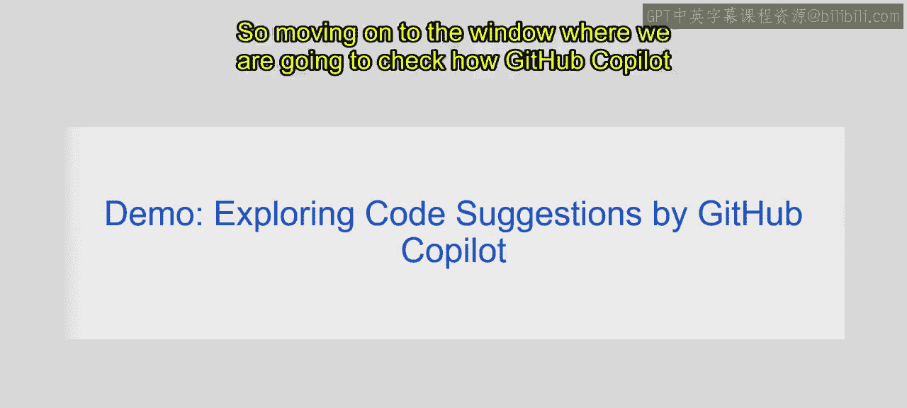
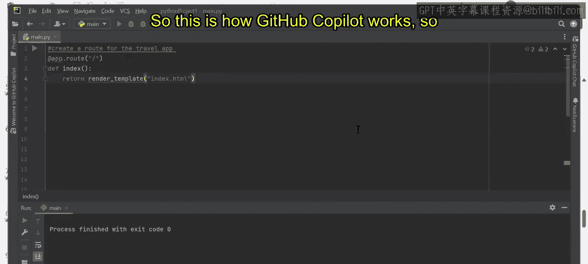
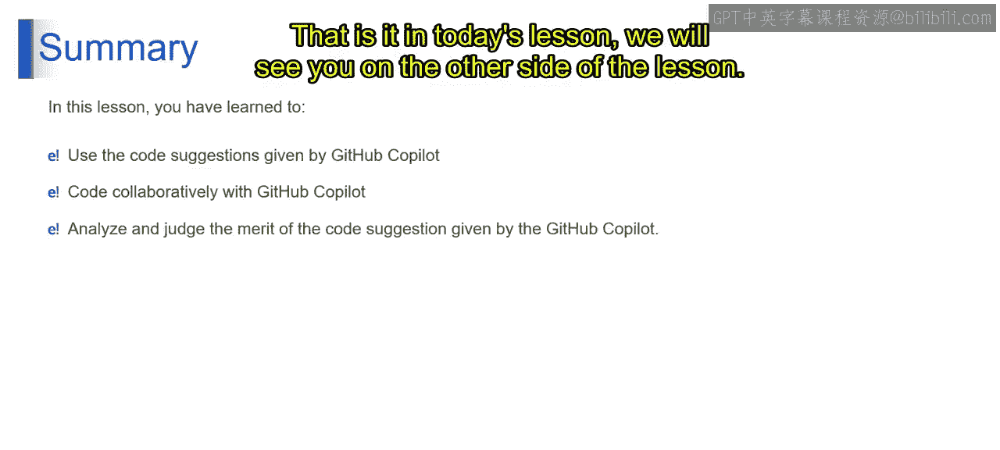

# Edureka《通过LLMs学习生成式AI（基础、应用开发、流行工具，第2、3、4课／共4课）｜Learn Generative AI with LLMs》中英 - P147：40_协作和版本控制.zh_en - GPT中英字幕课程资源 - BV1ym421V7gx

Welcome to the immersive journey into the world of generative AI applications and popular tools。

 Let us now see the topics we are going to cover in this lesson。

 That is collaborative coding with Coil it， handling conflicts and code reviews。😊。

Learning objectives are。By the end of this lesson， you will be able to create and modify codes using the Gitthub Copit。

 You will be able to write the codes collaboratively with Gitub Copit。

 You will also be able to analyze and judge the merit of the code suggestions given by the Github Copit。

 It is now C Giub Copis collaboration and version control。

Automatic code generation we know that writing codes is a time consuming and tedious task。

 but the Github Copit working alongside you improves accuracy。

 productivity and efficiency let us now explore the code suggestions given by the Github Copi。

So moving on to the window where we are going to check how Gitthub Copilate is giving us suggestions and making coding very simpler process。

As we know， that one of the coolest feature of getthub wholepi is its ability to take your comments and turn them into port for example。

 just say if you want to。Or list the names of all the Github repositories for an organization。

 let us see how do we do that， Let us start。So， let us import。UR L， L I D。

We are requesting so do request。😔，Just say， we are working on。This filed。It is to， get。

Reposit freeze。火机。Let's say we want this， we want to list。I'm writing it as a comment list。

 all names。Of Github repositories。Okay it is already giving me the suggestions depositositories for a giving organization If you want to accept the suggestion you'll have to click on the tab button and see and see how this the magic begins it is already giving you the suggestions so if you want to take the suggestion you will have to click on the tab button if you are looking for more options then you will have to click on alt and the open bracketet this one if you are looking for more options then you can either you can click on this tab if you are accepting this this will work if you want more suggestions then in that case you can。

Click on all plus this bracket All right， if you will click on this。

 you will get to see more options。I have written it so that you will get to know which are the buttons that I'm clicking so it is showing that no more gopit suggestions are available so this is the only one so this is how if you will click on this alt and this bracket open button then you will get to know the other suggestions which are available like in this case only one is available so now we know if you want to accept it then you will have to click on the tab button and this will work for you let's consider another example if you want to create a route for the travel app let's say。

You'll see if you do not know much about coding， but you want to create a route for the travel app。

 let us see it will help us， create a route for the travel app。

 let's see how GitHub Copit is going to help us Gi is giving the suggestion and import the necessary libraries。

See if we are not aware about the coding part for this， not a problem。

 Github will give suggestions and if you want to accept the suggestion。

 keep on clicking the tab button and then enter see it is ready to create the entire program for us。

So this is how。Git up Copi works。

So we have seen here how Gitthub is giving their suggestions to us。

 so Github Copit first understands the context， it gives real time suggestions and context diverse solutions。

Which reduces the manual effort， Copit adapts to the coding style and works towards continuous improvement and gives customized code options。

So in this lesson， you have learned to use the code suggestions given by Gitthub Copit。

You have also learned to code collaboratively with Gitthub Copit it is up to you if you want to accept some suggestions or if you want to reject certain suggestions。

 you have also learned to analyze and judge the merit of the code suggestion given by the Github Copit that is it in today's lesson we will see on the other side of the lesson till then keep learning。

