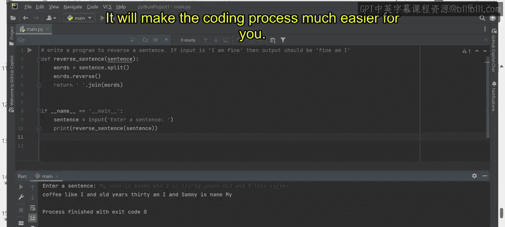
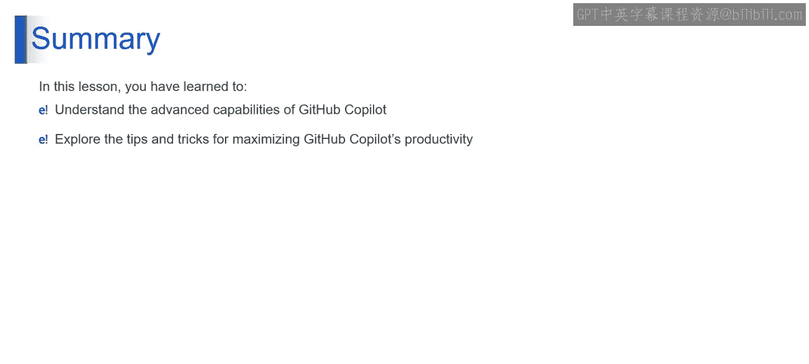
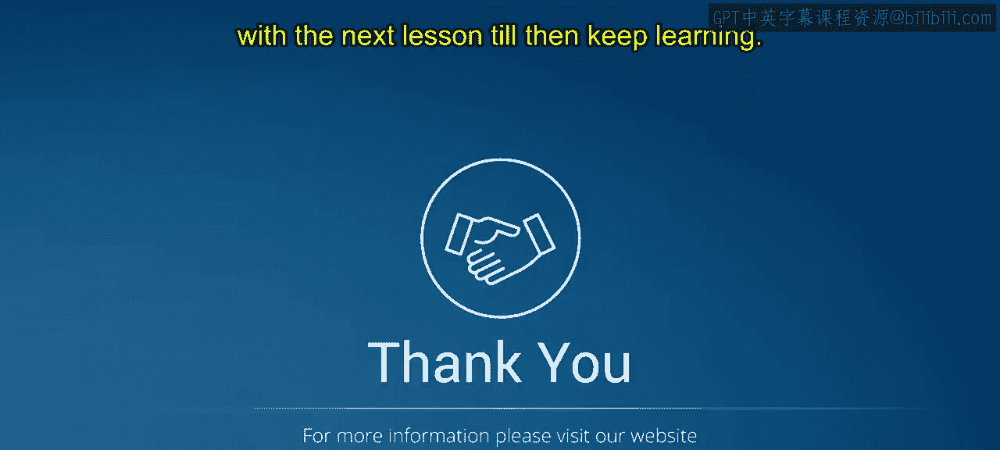

# Edureka《通过LLMs学习生成式AI（基础、应用开发、流行工具，第2、3、4课／共4课）｜Learn Generative AI with LLMs》中英 - P148：41_技巧和诀窍.zh_en - GPT中英字幕课程资源 - BV1ym421V7gx

Welcome to the immersive journey into the world of generative AI applications and popular tools。

 We will explore the advanced capabilities of Github Coil it and explore some p centrics for maximizing productivity。

😊。

At the end of this lesson， you will be able to explore advanced capabilities of Gitthub Copi it。

 and also you will be able to enhance your productivity with different tips and tricks。

Let us now understand the advanced features of Gitthub Copit。 First one is the language support。

 Gitub Copit supports multiple languages that helps developers to write code in different programming languages seamlessly。

 It enhances versatility that makes copil a valuable tool for working on projects with different programming language。

 domain specific language。Opepit can be trained on the domain specific languages。

 which enhances its ability to suggest relevant and domain specific code snippets for specific project needs。

Multiline suggestions Giub Copi generates multiline code suggestions when developers just write a single comment or a code this reduces the need for manual coding of repetitive steps。

Collaboration in fair programming Copit supports real time collaboration。

 making it suitable for pair programming sessions where two developers work together。

Code synthesis for documentation Github Copilate assists in generating code comments and documentation which enhances efficiency and reduces errors and hereby helps developers in maintaining a well documented code basis integrations with IDs and editors Gitthub Copilate integrates seamlessly with various IDs and code editors which boosts coding efficiency and reduces errors code exploration and learning Gitthub Copilate can also be used as a learning tool for exploring different codes This helps developers and learners understand coding concepts and best practices providing unit testkeletons Copit can assist in generating unit test skeletons for functions and hence promote test driven development practices with streamlines the testing process。

Let us see some tips and tricks to enhance productivity while using Github Copit here we have listed some of the tips and tricks that will be useful to you when you are making Github Copit work for you first one。

 if you want to accept the suggestion given by Github Copit then you should press tab。

Press escape if you want to dismiss the code suggestion。

 if you want to see the next suggestion given by Gitthub Copit。

 then press alt key plus the closing bracket if you want to see the previous suggestion。

 then press alt and the open bracket。And then if you want to trigger suggestion。

 then you should press all in this has， and this symbol。

 and then if you want to see the next 10 suggestions in a separate pane。

 then you should press control and enter there is one more tip that whenever you wont get a compile it to give suggestions to you try to be as specific as you can while writing the comment。

 for example。If you want to write a program。That reverses a sentence。

 so let us try to write it as a comment that is write a program。To reverse as sentence。

 if you will be more specific while writing this， it this will help getub Coil it in giving you。

The suggestion is that you can directly apply to your program。

 Let us make it more clear if input is just say I am。Find。Then output should be fine， am I。

 All right， Let us see。If Gitthub Copit is able to create that program for us or will it will be helping us in making the program。

We have not got any suggestions so far so let us start writing the program so let us define I have just typed the word D if I have not typed anything extra and see you can see while it is has already started doing its work let us giving me suggestions let us press tab to accept this and then enter。

If name is this， all right。This is the program， let us see if it is working for us or not。

 enter a sentence， so let us type any sentence， for example。

 my name is Sammy and I am just say 30 years old。And I， and I like。Coffee， let us see the output。Oh。

 great。 see。 it has changed it to coffee like I and old ears 30 am I and Sammy is name my wow。

 so it is working。 See， if we give specific suggestions to Github Coil it。

 it will work the way you want it to work for you。 It will make the coding process much easier for you。

 So in today's lesson， you have learned to understand the advanced capabilities of Github Coil it。

 you have also explored the tips and tricks for maximizing Github Coil list productivity。😊。

That is it in this lesson， we will see you in the next video。

 the next lesson till then keep learning。

