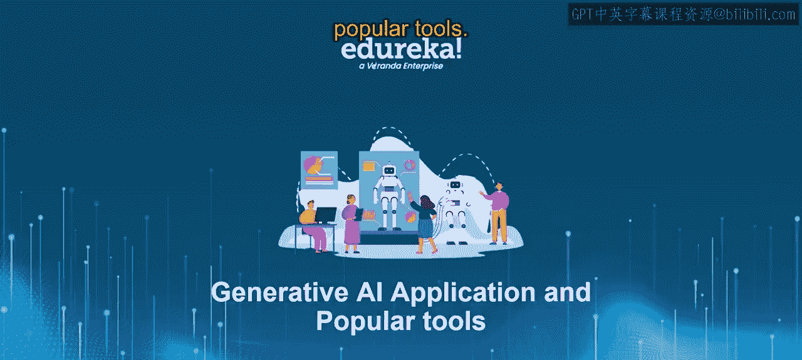
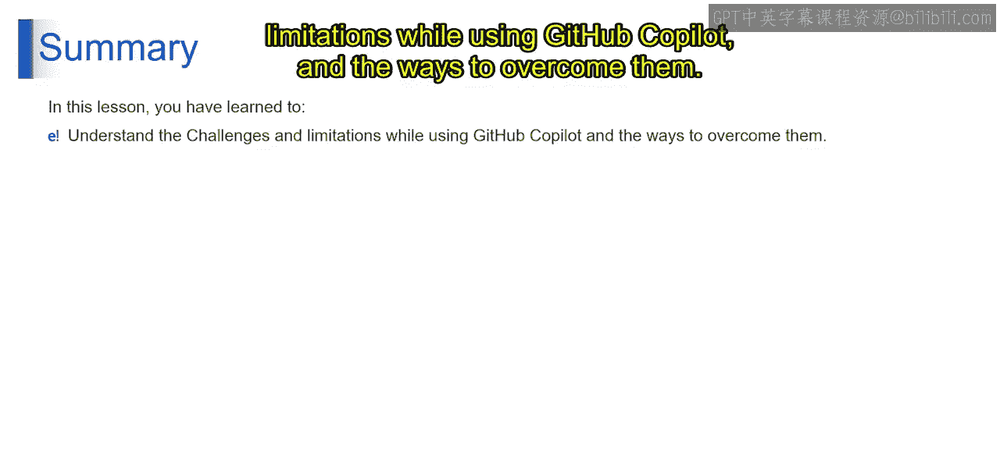

# Edureka《通过LLMs学习生成式AI（基础、应用开发、流行工具，第2、3、4课／共4课）｜Learn Generative AI with LLMs》中英 - P149：42_挑战和局限性.zh_en - GPT中英字幕课程资源 - BV1ym421V7gx

Welcome to the immersive journey into the world of generative AI applications and popular tools。

 So in this lesson， we will be discussing about the challenges and the limitations related to Giub Co pilot。

😊。

Let us now see the learning objectives。By the end of this lesson。

 you will be able to know about the challenges and limitations while using the Github Popit。

GitHub Copit challenges and limitations let's see what are these contextual understanding developers should carefully review and validate copit suggestions to ensure they align with the intended functionality and coding standard moving on the next is the business logic Copit looks knowledge of the specific business logic or domainspec requirements of a project which may result in code suggestions that do not align with project specific needs so here when developers are using the code given by the Gitthub Copit they should first check the logic whether it is as per the business requirement or not and accordingly they can tweak the same next coming on to over reliance on suggestions。

Over reliance on suggestions given by Github Copit leads to less critical thinking and understanding of the code being written。

 it is essential for developers to use Copit as an aid。

Rather than a replacement for their coding skills， because anyways it is just a copipi will still be you as the developer Com on to handling of edge cases Copit may struggle to handle complex or edge cases developers should be cautious while dealing with complex scenarios and thoroughly test Copit generated code especially in the critical parts of the application This is very important that the developers must check thoroughly the codes which are generated by the copit moving on to the last one that is the security concerns。

Security conscious development practices， including thorough code reviews and security testing。

 should be maintained when using Gitthub Copilots generated code。

 Copit generates code based on training data from public repositories which might lead to code ownership and potential licensing issues。

So in this lesson， you have learned about the challenges and limitations while using Gitthub Pro it and the ways to overcome them。

Thank you for now see you in the next video， willll then keep learning。

