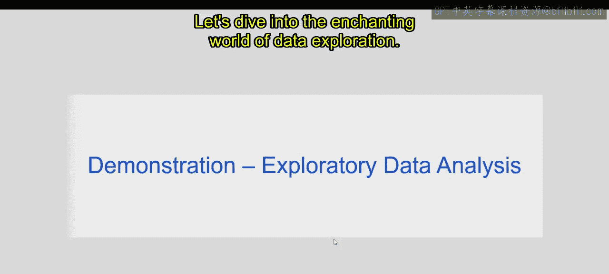
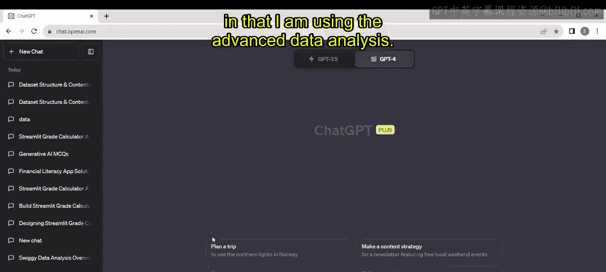
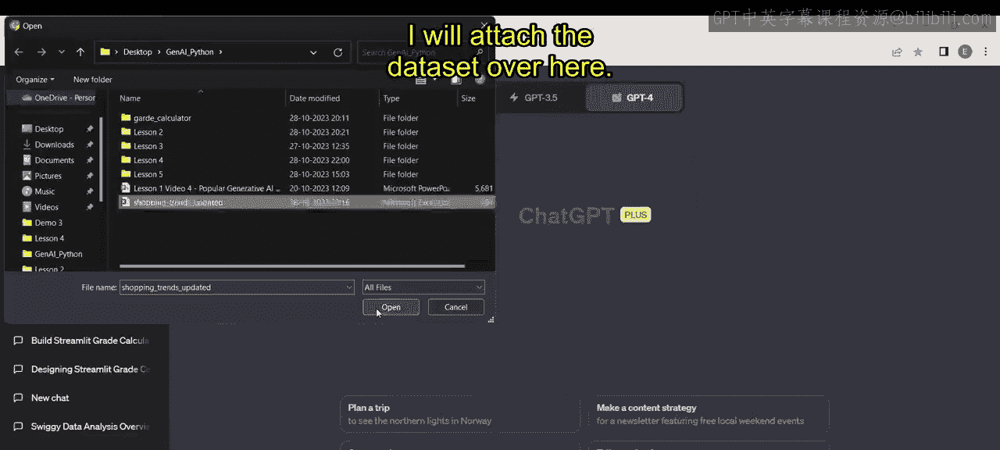
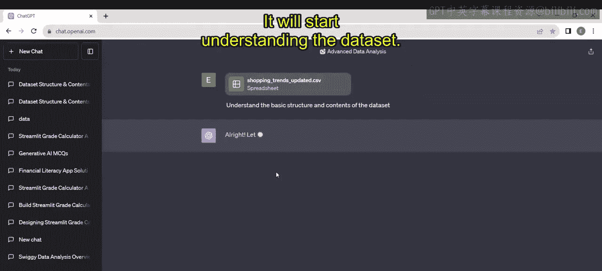
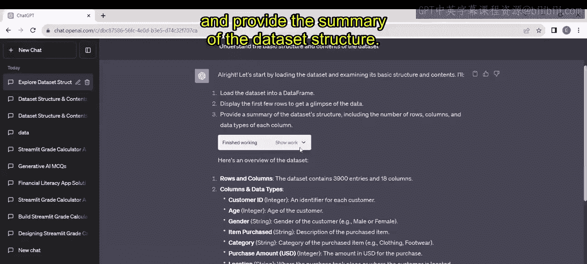
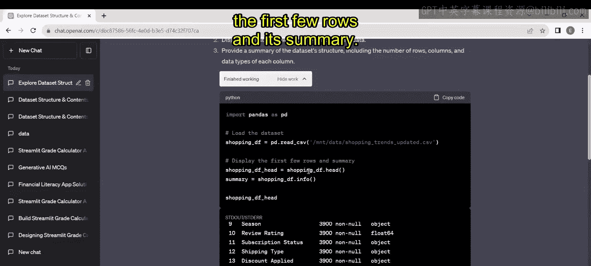
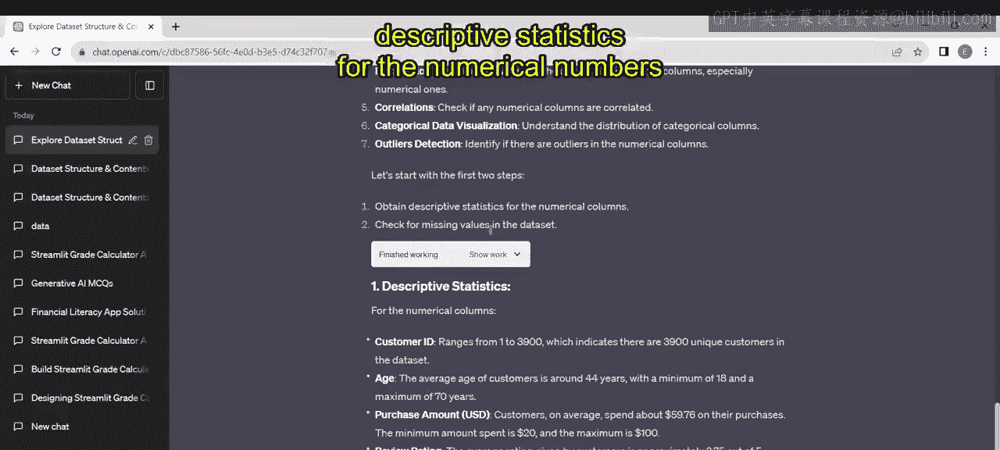
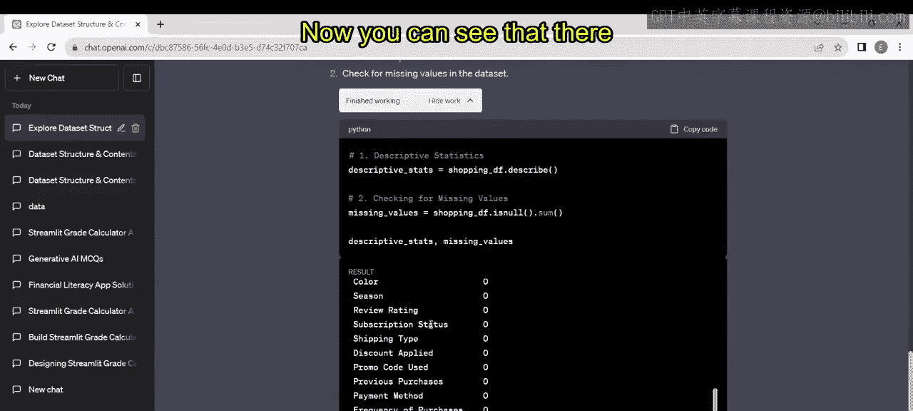
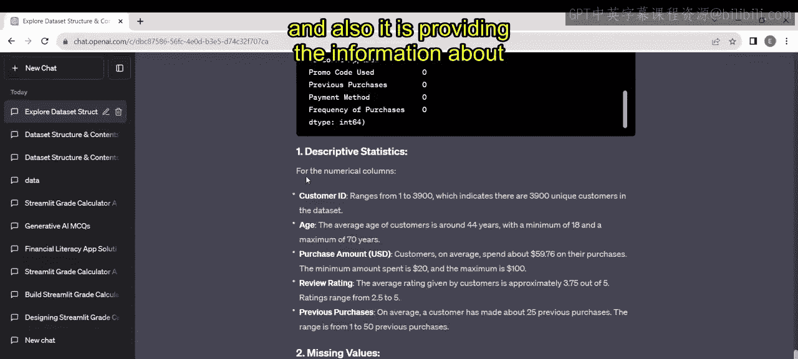
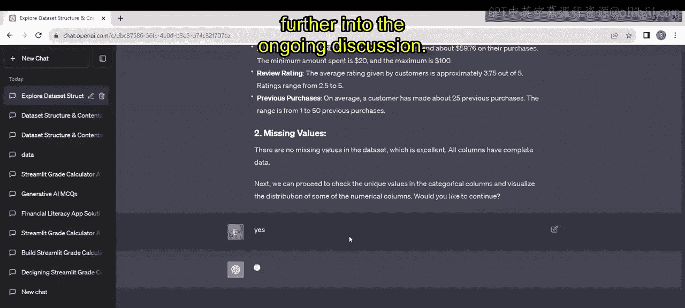

# Edureka《通过LLMs学习生成式AI（基础、应用开发、流行工具，第2、3、4课／共4课）｜Learn Generative AI with LLMs》中英 - P14：13_探索性数据分析.zh_en - GPT中英字幕课程资源 - BV1ym421V7gx

Hello everyone， welcome to Generative AI Foundations。Hello， everyone。

 Well come back to leveraging Cha Gputity to learn Python。 So what is exploratory data analysis。

 First of all， So let me take you on a journey into the fascinating world of data exploration where the ordinary becomes extraordinary Imagine you are your bookstore owner and you have collected sales data for ears。

 Now you want to understand which books are hidden gems in your store。 E easier treasure map。

 guiding you to uncover those hidden gems you can analyze customer preferences Discover trends and make data driven decisions to boost your business All thanks to E。

 Let's take one more example。 Think about the weather application that predicts the weather Be those daily forecasts lie massive data sets。

 E allows materiallogs to unveiled trends， patterns and outliers in the weather data with E they can make more。

😊，Cate predictions， helping you decide whether it is hot or cold outside or if it will rain so whether you are a bookstore owner or whether enthusiast or just someone curious about the world around you E has the power to unlock the stories hidden in the data and make your life better now let's explore how E can turn numbers into valuable insights that influence decisions and shape our world let's dive into the enchanting world of data exploration let's make use of chat GPT to work on E Now I am using the GPT4 version in that I am using the advanced data analysis and here you can see the plus symbol by this you will be able to attach the file Now I want to perform the E on shopping trends so I will attach the data set over here。

😊。

Now I am asking my chat GPT， understand the basic structure and contents of the data and click on enter it will start understanding the data set。

😊。

It is still generating the answer。Now you can see that it has generated answer for my query First it is telling load the dataset into data frame。

 displayplay the first few rows and provide the summary of the dataset structure。

 let's explain this and now you can see it is provided the Python code it is first importing the required libraries and then loading the dataset and displaying the first few rows and its summary here we go and here now it is explaining the number of rows and columns the dataset contains total 3900 entries and total 18 columns and here you can see the description of total 18 columns let's see whether it is correct or not。

 I will open my current dataset and will show you here we go now you can see the original data that it is having customer a gender item purchased category purchased amount locationation size and etc and you can even crossche in the chat Gp whether if it is provided the same content or not Now you can see all the。

😊。

Comon names over here now that I am having the data size features as well as common names now I am asking my chat GpT I want to perform exploratory data analysis Could you please assist me on this Click on enter it will start generating the code for you directly。

Now， you can see that it has generated。😊，The solution for me as to my query。

 it is telling AD is a critical step in understanding the dataset。 here is a plan to tackle it。

 first of all， it is telling we will have to perform descriptive statistics， missing values。

 unique values and so many extra based on this first it is performing first two steps that is obtaining descriptive statistics for the numerical numbers and checking the missing values in the data let's expand this here you can see the code for this to understand the descriptive statistics and checking for the missing values and now you can see that there are no missing values present in it and also it is providing the information about the descriptive statistics for the numerical columns individually that's great to see now it is asking next we can proceed to check the unique values in the categorical columns and visualize the distribution of some of the numerical columns would you like to continue I am telling yes and click on enthe so the upcoming。

😊。

Video will delve further into the ongoing discussion。

