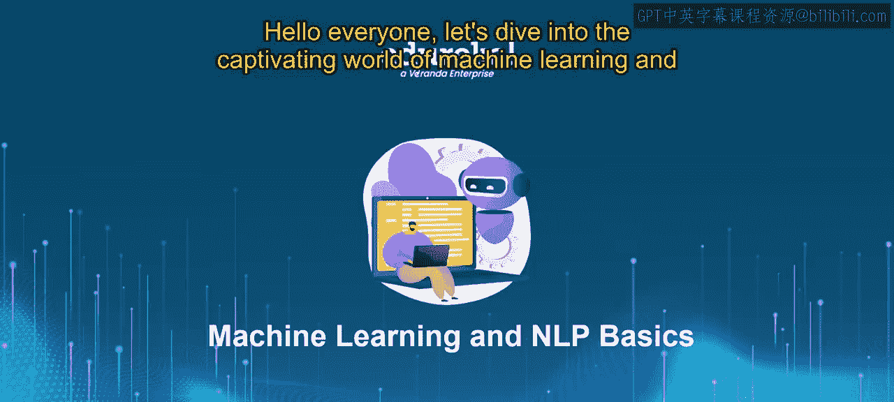
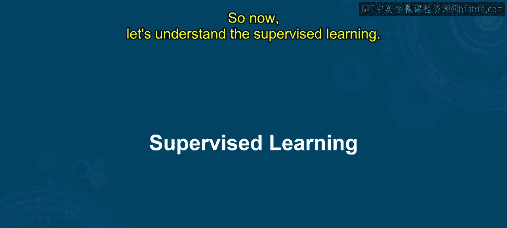
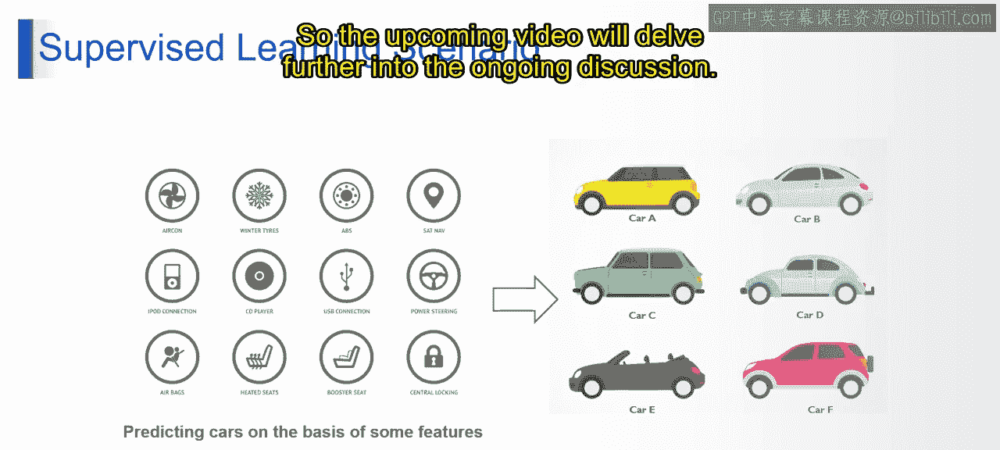

# Edureka《通过LLMs学习生成式人工智能（机器学习和NLP基础，第1课／共4课）｜Learn Generative AI with LLMs》中英字幕 - P14：13_监督机器学习.zh_en - GPT中英字幕课程资源 - BV1q4421Q7qh

Hello everyone， let's dive into the captivating world of machine learning and the foundational concepts of NLP together。

 So now let's understand the supervised learning in this。

 we are going to cover the introduction to supervised learning and what are the different applications of supervised learning and then email and news classification system。

 by the end of the session， you are able to understand how to predict the label data and how to use the label data in making predictions and implement a model for data categorization and then we are able to understand recognize the features to classify emails and news effectively。

 So let's get started。 first of all， email and news classification system Con from the previous lesson we will understand how supervised learning techniques are going to be implemented。

 Con from the previous lesson， let's understand how supervised learning is going to work。

 So an email and news。😊。

Spification system utilizes supervised learning technique to automatically categorize incoming emails or the news articles into predefined categories such as spam or not spam for emails or sports politics entertainment and etc for news articles so this system first collects a data set of labeled examples preprosses the text data。

 extract features and train a machine learning model to recognize the patterns and make accurate accurate categorizations Oncetrain the model is deployed to classify new incoming data in the real time streamlining the process of sorting and organizing the textual information effectively so by understanding this let's understand how exactly supervised learning will work。

 So introduction to supervised learning supervised learning is like teaching a computer to differentiate between the green colored。

😊，As well as redcolored apples， you start by showing a lot of pictures of apples。

 Some are labeled as green and the others are labeled as red。

 So the computer learns from these examples， understand the difference in color and shape once trained。

 it can look at new pictures of apples and predict whether they are green in color or red based on what it learned from the training data means supervised learning is a type of machine learning where the algorithm is trained on a data consisting of input features and corresponding output labels the labeled training data serves as examples further algorithm to learn the relationship between the input features and the output labels once the model is trained。

 it can generalize its learning to make predictions or classifications on new unseen data。😊。

By mapping input features to the output labels based on the patterns learned during the training。

 so this process entirely involves data collection， data preprossing。

 model selection and then training the model and then evaluation and then prediction so now let's understand supervised learning scenario for cars so it can be applied to predict the type of car based on a specific feature like for instance you might provide the algorithm with the data on various cars including the features like horsepower in size fuel efficiency along with the labels。

😊，Along with the labels indicating the cars type， whether if it is of the Seedan， SUV or truck。

 whatever it is means the algorithm learns from this label data to understand the relationship between the features and the type of cars once trained it can then predict the type of a new car based on its features such as determining whether a car with a Se hapower and the engine size is likely to be a Seedan SUV or a truck likewise you can use the supervised learning even in the car scenario also so the upcoming video will delve further into the ongoing discussion。

😊。

