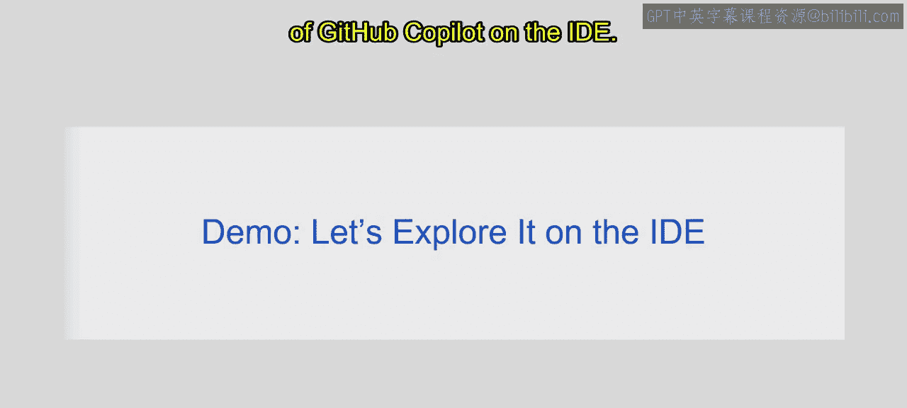
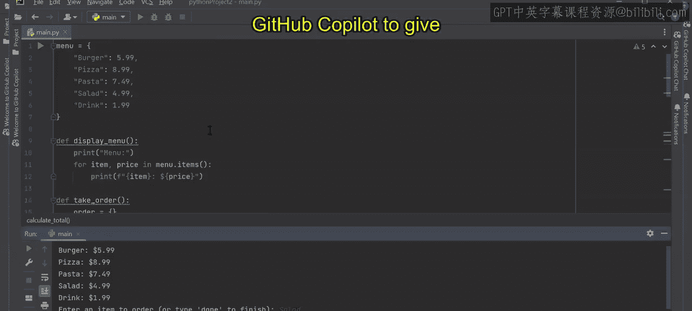
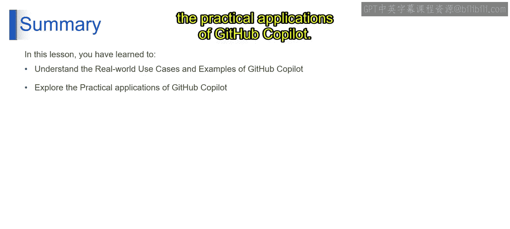

# Edureka《通过LLMs学习生成式AI（基础、应用开发、流行工具，第2、3、4课／共4课）｜Learn Generative AI with LLMs》中英 - P150：43_用例和示例.zh_en - GPT中英字幕课程资源 - BV1ym421V7gx

Welcome to the immersive journey into the world of generative AI applications and popular tools The topics that we shall cover in this lesson are rear world use cases and examples and the practical applications of Github Copit。

Learning objectives by the end of this lesson， you will be able to explore real world use cases of Gitthub Copilate and also understand the practical applications of Github Copit。

So let's explore the practical applications of Gitthub Copilot on the IDE。

Just say this is a simple program just say we are working on it and we have two dictionaries The first one has certain values like a4 C Dls and certain keys are associated with these other numbers just say we have the second dictionary that is for geeks just say  hundred0 is the key for the word4 it is 300 for l is just 400 for C it is 500 just two random missionaries are there and just say we want to add the values with the common keys that is what we want is that we should get a new dictionaries wherein this just save this4 is common then our output should be 325 that is the addition of after what we get by adding 325 that is 325 similarly if there is anything else which is common like here we can see this C is there in both of them so here the value of C is 9。

Here the key that corresponds to c is 500， so we want the output as 509。

Let us see if we want to add it， then if we do not know how this edition is to be done。

 we can write it as a comment。And let's see if Gitthub Copit is ready to help us so we can write just say。

Adding the values。With common keys。So it is giving us a suggestion。

 it is up to the developer if you want to accept it or not。

 maybe I do not want to express the new dictionary as REES its I can rename it let us see just say if we want to name it as CD I CTT dictionary okay now get a compile it is ready with another suggestion but it can add let us accept it this time。

Then press enter， which is showing like print see deck。

Let us consider this as well okay it is also giving another suggestion that if we want we can subtract the values with common keys。

 let us accept and see whether it will work or not。😊，Okay。

 let us run the program it is also giving the option of getting the intersection of keys。

 let us now just run what we have we want to add in this subtract the common keys。See。

 it is working if you see here。😊，This first dictionary that we are getting here it has added the values with the common keys like for C it was 9 and 500 so it has added and we got the answer as 500 for else it is 4002 because here the value it of this key was two and here it is 400 so it has added here all these values have been added and if we see the second one then we have subtracted the values with the common keys so only these two are left which did not have anything common okay so this is how it works let us see one more example of the same let us create a program to take a forward order and calculate the total be amount for creating such a program we must have a menu first then we should be able to display that menu we should be able to take orders just say I was working on this simple program now in addition to taking the orders just say。

One this program to calculate the total bill as well and just say I do not know to write the code for this。

 so we have just defined it and let us ask it co it。

Okay it is giving the suggestion that total is this much for item quantity in order should be this much。

 let us try this code if it will work for us if you want to accept this code then press tabab button we have done the same now let us try to run this program。

Whether this suggestion is okay for us or not， so when we run it is displaying the items that are available now to enter an item。

We can choose any of them， for example， just say they select salad。

It is asking how many salads would you like， just say three salads。

 then enter an item to order or type done to finish it' done。

See it is calculated the approximate pill that is equals to 14。97。

 so here in case like you are creating a program and if you are stuck at a point where you won't get a compile pilot it to give suggestions to complete the program for you。

 it will do the same for you。

So in this lesson you have learned to understand the real world use cases and examples of GiHub Copilate you have also explored the practical applications of GiHub Copilate that is it in today's lesson thank you for now we'll see you in the next video till then keep learning。

