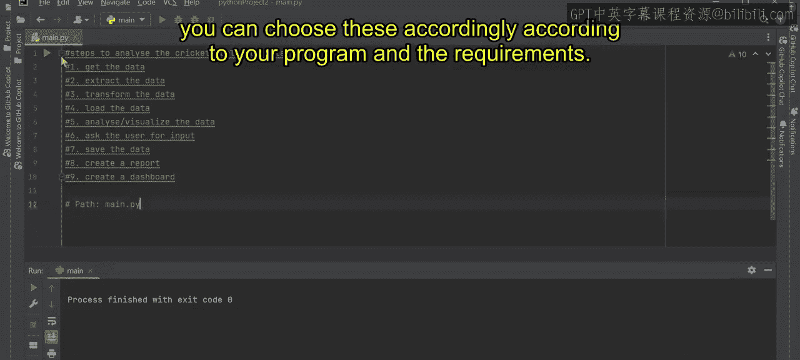
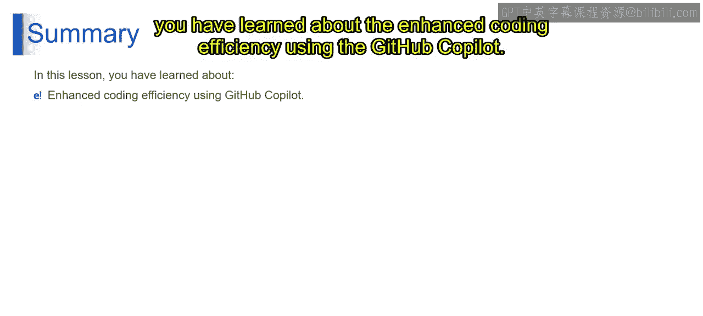

# Edureka《通过LLMs学习生成式AI（基础、应用开发、流行工具，第2、3、4课／共4课）｜Learn Generative AI with LLMs》中英 - P151：44_提高编码效率.zh_en - GPT中英字幕课程资源 - BV1ym421V7gx

Welcome to the immersive journey into the world of generative AI applications and popular tools In this lesson。

 we will be discussing about enhancing the code efficiency in real world projects。

 using the Github Coil learning objectives by the end of this lesson。

 you will be able to understand and explore more about the enhanced coding efficiency。

 using the Github Coil。😊。

So let us unleash the potential of AI driven core generation in real projects。

It is considered this program。Here I was trying to prepare a programme that can set alarm for me。

Just say like I have defined the play alarm sound， I have also defined like set alarm when it is true when it is supposed to break and now I'm struck here。

So that is the input format， what kind of format do I need so I have written it as a comment here whenever you are writing any comment you should always see putting it as a hash so this should not be a part of the program。

 It is just a comment so I have written validate the input format let say I'm struck here and I won't get a coil it to suggest so that this program should work so what we will do is let us press enter。

See， Gitthub Copit has already started giving suggestions to me that you can try this this is。

So it is giving my suggestion if I want to accept this， then in that case。

 we will be clicking on that tab button so let us。Accept this suggestion if we are accepting it。

Let us see whether this program is running or not。So it is asking enter the alarm time。

 just say I want to set the alarm for just say 5 a。

So here alarm is set for 5 am so it is basically like in case you are stuck in between the coding process。

 you can just write it as a comment and then Github Copit will give suggestions to you。

 you can accept the suggestion whichever is okay as per your program。

 you can select that and then you can run the program and check。

This is how Gitthub Copilate converts the comments to pull。

There is one more feature of Gitthub Copit that is it can auto fill the repetitive codes Gitthub Copit facilitates developers to write the repetitive codes faster so if you are writing larger blocks of code just you need to input a few examples of the pattern and then Copit will handle the rest for this let us consider an example just say if you are defining just say con。

though co it is suggesting us to take it as 60， let us take it as some other number。

 just say if you want to define it as thousand0。Then let us define minutes is equal to C。

 it is automatically giving the suggestions。If we want to write it as minutes。Is equal to 60。😔。

60 times seconds。See， I have not typed it yet， but Giub compilepi it is giving the suggestions looking at the repetitive pattern。

 so if we keep on accepting it。It will give the rest of the lines of code。If you want to go further。

 you can also try it， justse。Weeks is equal to this much and then months is this much and so on and so forth。

 So in this example， the constant variable start with seconds Once the second line shows the constant as minutes multiplied by seconds Gopit recognizes the pattern and auto completes the code for hours day weeks months and even years if you go ahead with this So this will shave a lot of time of your programming especially for the larger blocks。

😊，You can also use Github Copit。To navigate unfamiliar territories for examples。

 there are many examples you can take let us discuss one of those for example。

 if you want to analyze the Cri World Cup data and you do not know how to analyze so you can take help of Github compileil it you can just write it as a comment just say a random comment we can write steps to analyze the cricket World Cup data。

So this is how Gitthub Copit is helping us like follow these steps， get the data。

 then extract the data， then transform the data， load data， analyze it， then ask the user for input。

 so it will give you different suggestions out of these whichever way you want the data to be you can choose these accordingly according to your program and the requirement。

So in this lesson， you have learned about the enhanced coding efficiency using the Gitthub Copit。

Thank you， learners。 See you in the next video till then keep learning。😊。

