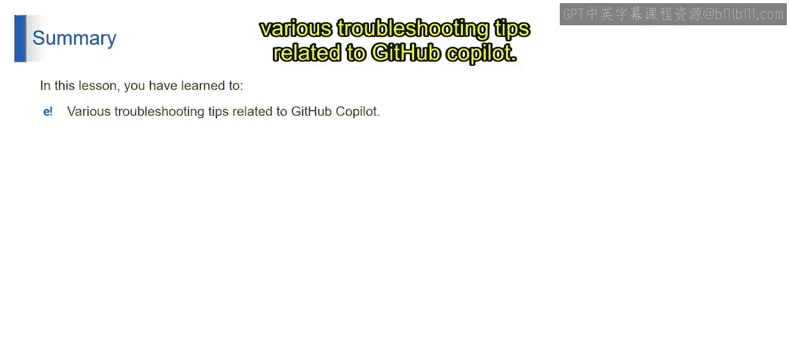

# Edureka《通过LLMs学习生成式AI（基础、应用开发、流行工具，第2、3、4课／共4课）｜Learn Generative AI with LLMs》中英 - P152：45_故障排除技巧.zh_en - GPT中英字幕课程资源 - BV1ym421V7gx

Welcome to the immersive journey into the world of generative AI applications and popular tools In this lesson。

 we will be discussing about some of the troubleho tips related to Github Co pilot。

 By the end of this lesson， you will be able to understand various troublehoot tips。😊。

Let us now discuss the troubleshooting strategies while using Gitthub Copit。

To start with first one is the internet connection Github Copit needs an Internet connection to fetch code suggestions from the cloud。

 ensure that your internet connection is stable Next is the check system requirements ensure that your system meets the minimum requirements for running Github Coilt and your code editor。

 whether it is Vi Studio code or piechar should be up to date。

Review documentation cancel the official Gitthub Copi documentation for any known issues or troubleshooting guides。

Ret Vi Studio code sometimes restarting your code editor can resolve intermittent issues check Github status visit Github statusus Page to check if there are any ongoing issues with Github services。

 including Github Coilage。Verify API rate limits API stands for。Application programming interface。

If you are making a large number of requests， you might hit API rate limits。

 Check Github's API rate limits and adjust your usage accordingly， updatedate Giub Copit extension。

 Check for updates to the Github Co pilott extension。

 The extension is regularly updated with bug fixes and improvements。

You can also check the language support， verify that Giub Copi supports the programming language you are working with while it supports many languages。

 some features might be language specific， temporarily dis other extensions。

In case there is any conflict， some extensions might interfere with GitHub Copit's functionality。

So it will be better if for some time， you can disable some of the extension。And as a last resort。

 in case your Github Copit is not working properly。

 then you can try uninstalling and reinstalling the Gitthub Copit extension to ensure a fresh installation and working。

In this lesson， you have learned various troubleshooting tips related to Gitthub Copit。

Thank you for now， we will see you in the next lesson， build and deep learning。

