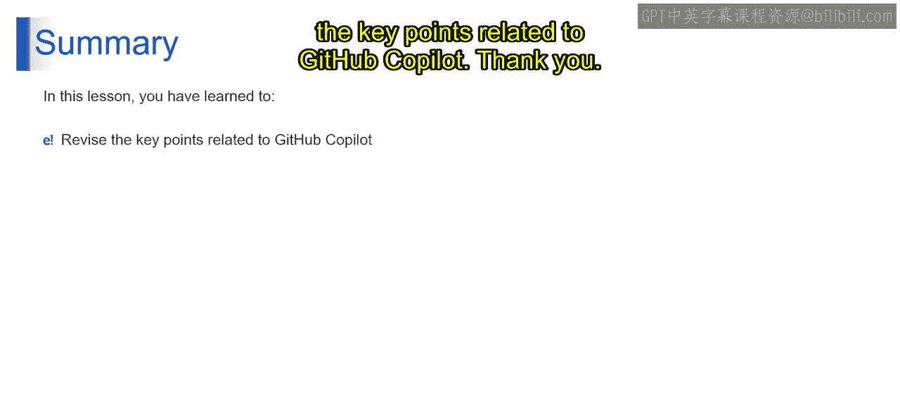

# Edureka《通过LLMs学习生成式AI（基础、应用开发、流行工具，第2、3、4课／共4课）｜Learn Generative AI with LLMs》中英 - P153：46_回顾和总结.zh_en - GPT中英字幕课程资源 - BV1ym421V7gx

Welcome to the immersive journey into the world of generative AI applications and popular tools。😊。

Gitthub Coil it， recapitulation of key points。In this lesson。

 we will recapitulate the Github Copit module。Learning objectives by the end of this lesson。

 you will be able to revise the key points related to GitHub Copit。

So what is GitHub Copit it is an AI powered code completion tool that helps developers write the code faster by suggesting whole lines or block of codes as they type it supports multiple programming languages。

 privacy and security is also ensure。Cd GPT versus Gitthub Copilate。

 the major difference between the two is that Chd GPT is designed for natural language understanding wherein you just type the prompt and it answers your queries。

In case of Gitthub Copit， it is basically designed for the code completion。Compatible IDs。

 the compatible IDs are visual studio code， P charm and intelligent idea intelligent idea。

Let us now see the role of Gitthub Copilate in enhancing the developer productivity。

Gitub Coil it auto completes the code。It reduces cognitive load。 That is。

 you do not have to memorize and recall the code。 It provides learning assistance。 It is consistent。

 It saves time by suggesting that code simultaneously as you type。

 time is saved in repetitive coding。 It works collaboratively with the developers and supports fair programming When you use the Github Copit code maintenance is easier。

Moving on to the advanced features of Gitthub Copit。

Its advanced features includes multilingual support。

 Gitthub Copit generates domain specific code snippets for specific project needs。

 multiline code suggestions。 This feature of Github Copilate reduces the need for manual coding of repetitive steps Copilate facilitates collaborative coding Realtime suggestions are provided to support a pair of developers working on the same code base Copit can assist in generating code comments and documentation。

 It integrates with various IDs and editors。 Gitthub Copit acts as a learning tool for code exploration。

 and it provides unit test skeletons and hence streamlines the testing process。So in this lesson。

 you have revised the key points related to Gitthub compilepi it。

Thank you。