# Edureka《通过LLMs学习生成式AI（基础、应用开发、流行工具，第2、3、4课／共4课）｜Learn Generative AI with LLMs》中英 - P154：47_DALL-E 2.zh_en - GPT中英字幕课程资源 - BV1ym421V7gx

Welcome to the immersive journey into the world of generative AI applications and popular tools understanding daily too。

 it's a creativity that can be unlasshed because this is an image generating AI tool。

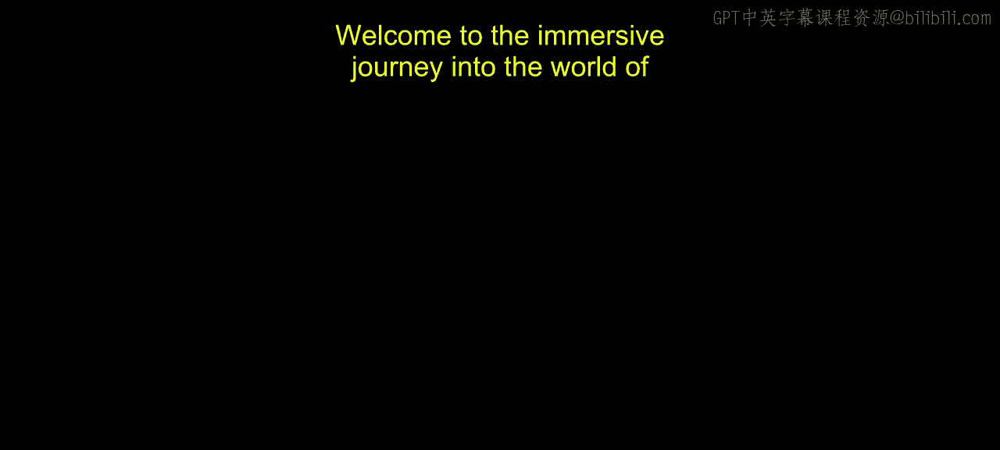

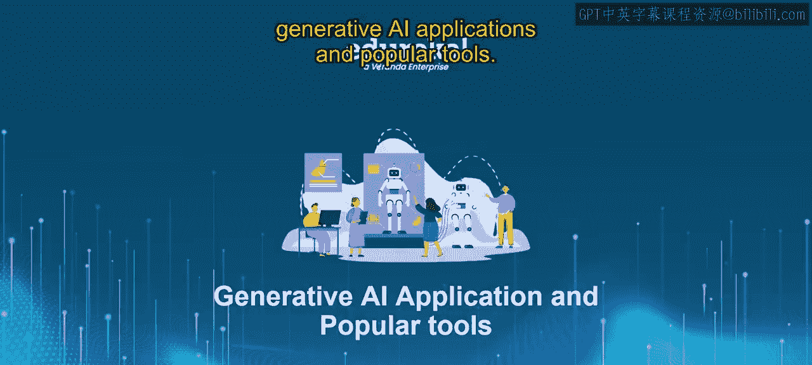

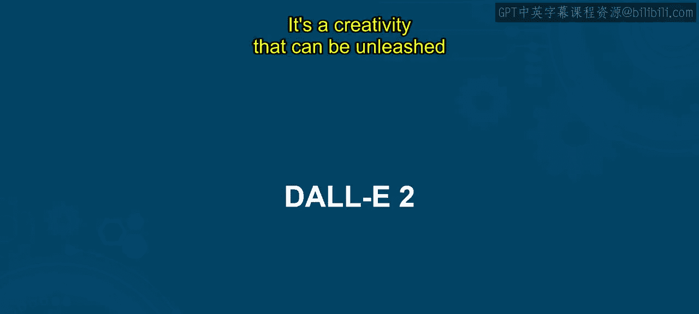

So Dli is for generating images it can understand technologies so let's understand how I can use Dli so it can understand the return descriptions and create corresponding images OpenaiI claims that Dli2 is approximately four times improved over the first version of D which can produce high quality images and involvement of the diffusion model the details and the context resulting from the images are really beautiful and we will see it all。

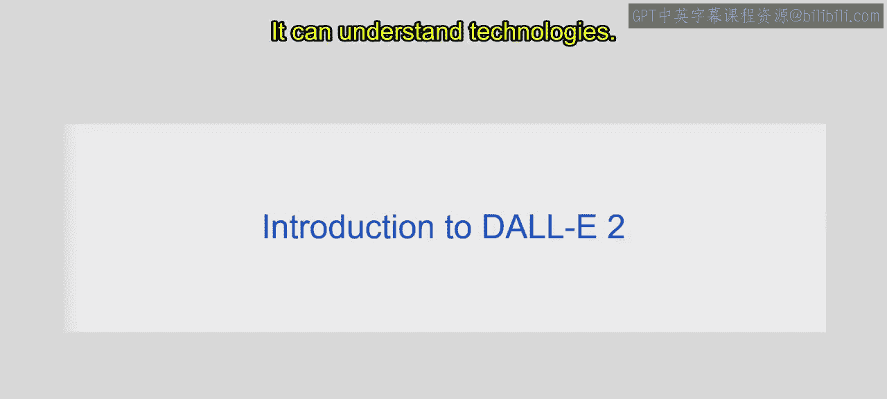

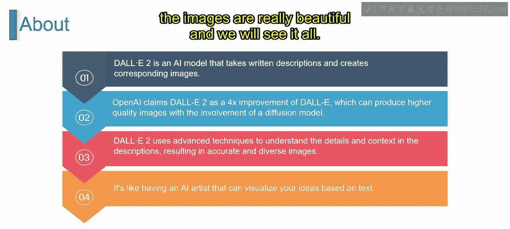

So open AI has created this model and it has enhanced in the image generation capability。

 it is significantly an advancement in AI image synthesis and currently whenever you're going to websites you're going to link in you're seeing some of the YouTubes。

 you're finding that there are different images which have been created which don't exist and that is happening using AI。

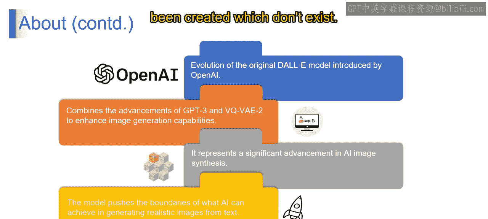

So in January 2021， OpenaiI introduced Dli which was the first version and in April 22 D2 was created after almost a year class of effort in May 2022 it released it to the thousand test users to see how it's working and they worked on their feedback it entered into a beta testing phase in July 2002 where with more than 1 million users in September 2022 released open beta version for everyone and in November 2022 it became public so how do I access so you give a text input or a prompt it explains the query with constraints。

And chooses the most accurate generation and improves and saves the problem so I would have a screen where I can put the images and it starts generating let's see it practically So if I go to Google and say dad tool it gets me to the open EI page of D2 I click on Dli try Dli and it gets me to this page I need to be logging it with my Gmail ID or with my login ID that I would have used for creating my Chad GP account so let's say I first want to understand how it can surprise me so it says 3D render of a cute tropical fish in an aquarium with a dark blue background and digital heart let's generate。

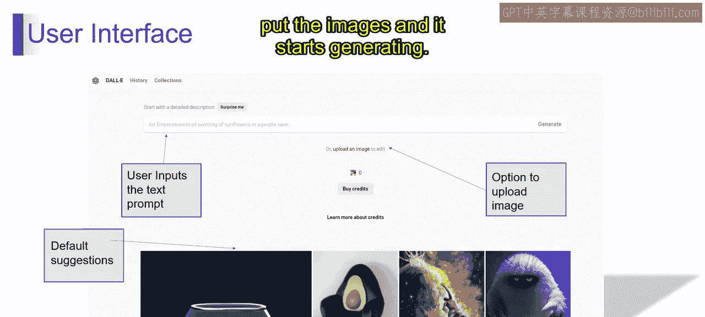

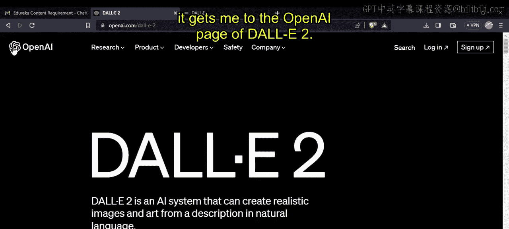

So this is not the image， it is generating the images， but it just telling me a tip。Right。

 and the images are coming up Can you see it has created a 3D image。

 the background is blue and it' very cute tropical fish It has created it very， very beautiful。

 I can go ahead and change it。

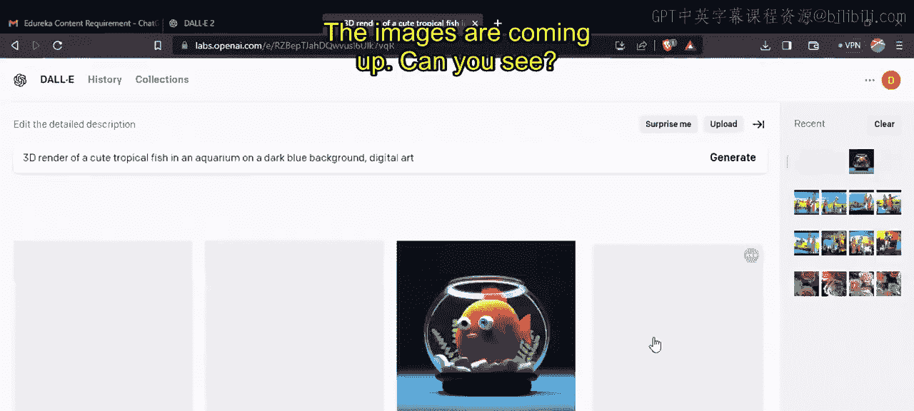

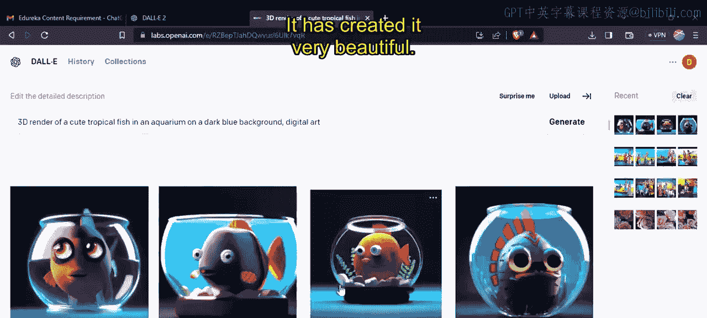

I can go ahead of a cute Krishna with the cows in garden。And I'm saying this is a lot， that's simple。

So this is not the image it's just giving me an idea but it's generating different types of images for me right and it understands okay Krisishna it's an Indian figure and it has generated different images if I like a particular image I can click on the three dots and I can see I can edit the image I want to generate variations in this or I can go ahead and download let's first generate some variations。

So it understood that that image needs to be regenerated in three to four different formats。

And let's see how it comes up。 So this is my original image。

 and it has created by changing some background and it's giving me I can go ahead and open this in a new tab。

And choose it right I was not very specific about the details， but the more specific I get。

 it loves constrain and it can generate very beautiful images。

So there is a good collection also which you can see I can go ahead and keep my favorites and create a collection but let's see what's there in the public collection so I don't think so I have saved anything but I have the options of collections private collections and public collections so what I have which the others can see so you could see that by giving text prompts or by uploading images or by giving some sample prompts it can generate images for us I can be more specific that I want humans and rockets around it would do that and if I was telling that I want Krishna with the cows it did that so storytelling and creative writing can be enhanced because of the support of daddy too it can help students enhance their storytelling skill their creative writing ability because many times we have a lot of thoughts and we want to communicate the same。

Applications in business is that you can generate content using copy dot AI get some pictures with the help of Dli2 and upload it in Facebook or my social media as a campaign so advertisement marketing all these departments can make use of different AI tools in combinations to get the most out of it D too can also be used for gaming and animation because I can create different characters and environments and make the game or the movie very interesting so to summarize I would say that please go and explore these tools even if you're not from the content marketing team because you will understand how these different AI tools are working Thank you so much and I'll see you in the next class。

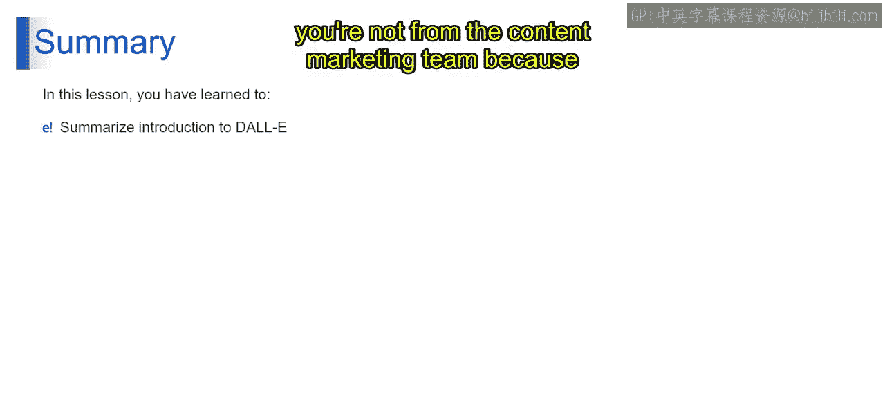

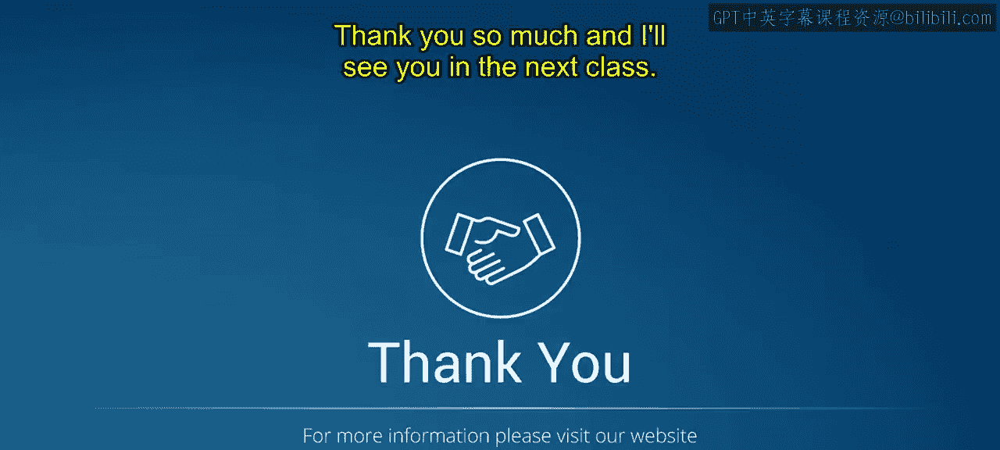