# Edureka《通过LLMs学习生成式AI（基础、应用开发、流行工具，第2、3、4课／共4课）｜Learn Generative AI with LLMs》中英 - P155：48_Bard.zh_en - GPT中英字幕课程资源 - BV1ym421V7gx

Welcome to the immersive journey into the world of generative AI applications and popular tools。 Pre。

 We are going to learn about Google Bod。😊。

You might have heard a lot about Bd when you would have started exploring about Chad GPT and other AI tools。

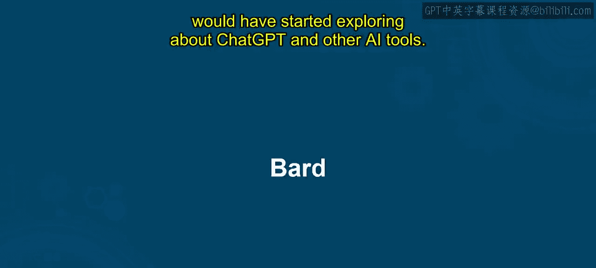

So let's understand what is Google Bd just like the way we have Cha GPT which is a large language model which can answer different types of questions Bd is also on a similar line it is an early experiment by Google and it's based on the concept called pathways language model Basically it is also capable of telling you stories composing music and giving you answers to all the questions that you might have So on Feb62023 Google announced that development of Bd and on March 21 it opened up a waiting list some of the people have started getting access to the Google bard from March but May 10 was the day when Google decided to make it public and free of cost。

So Bd is based on the concept of palmm as I said， and it is strain on 540 billion parameters these parameters helps it to come up with various types of answers。

 it can help you in summarizing language translation helping you in codingding and no matter what question you might have for bar So how does bard work。

 it works on the simple process of input process generate and out。So the user gives a question。

 and that gets processed by bar where it tries to understand the prompt searches for the database for the relevant information。

 It generates an answer and then displays it。 The user has a feedback loop which says that did I like the answer。

 Did I not like the answer or change the format of the answer。

 We will be seeing all of this in detail when I show you a practical application。

While the flexibility of a large language modeling allows the creativity。

 it also leads to hallucination and the presentations of inaccurate information。

 hence we guys as us prompt engineers have to ensure。That when I'm asking a question。

 am I getting the correct answer by cross questioning AI tools like Ch GpT and Bo。

So how do I access bard I can just go to Googlegle and say bard。google。

com and click on Tribar so let's get started so I am at Google and I have typebar or I can say bard AI so it takes me to bard。

 google。com let me click on Tribard。

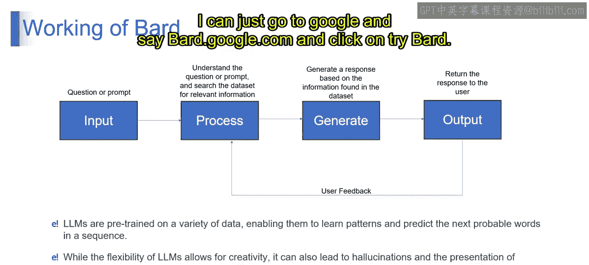

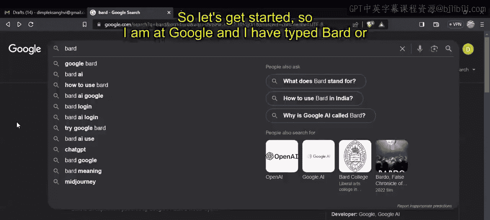

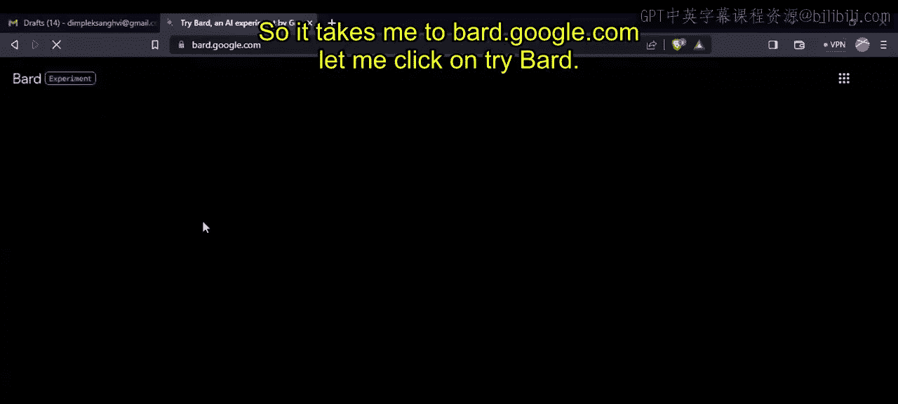

So the only requestqui I have is that I need to be logged in with my Gmail account。

 then only I can access it。 It has told a very important notice for all of us that there are some humans who are reviewing the conversation to improve the quality hence don't enter any sensitive information like your social security number。

 other card number pan card number are anything that's sensitive to you So let's get started I can say bard write a poem on nature。

 So the bar starts generating its thinking， searching and generating and you get an output now here you have a concept called as view other drafts So when bard is generating the output。

 it actually generatings three different drafts and out of which it's。

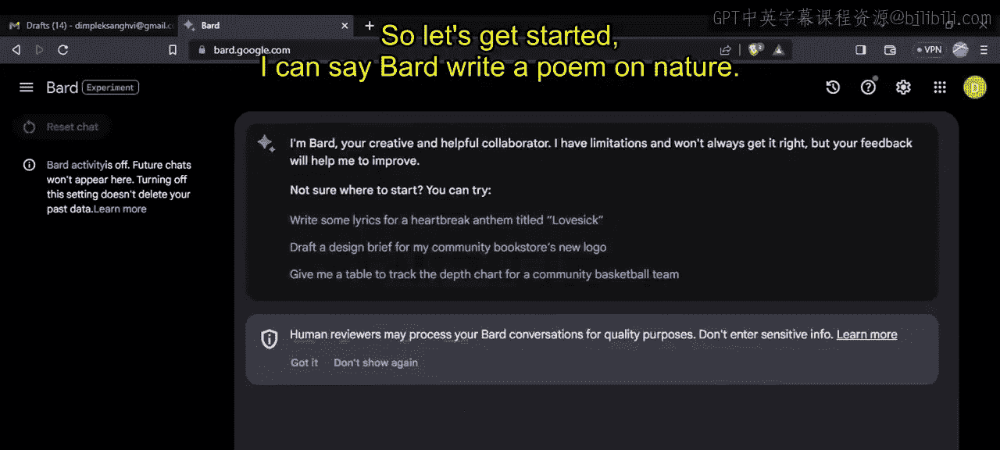

Reproduces one on the screen。 If I want to change it， I can click on the second draft and read it。

 I told you about the feedback loop so I have a thumbs up button to say that I like the response。

 I have a thumbs down button to say it's a bad response。 I have a concept called modify response。

 let's see I can reduce this poem to become a shorter poem。 a longer poem。 a simple language poem。

 make it more casual or make it professional。 So let's try it all。

 So when I click on shorter you will find that it is making the poem maybe two or three paragraphs only Oh so it has made it as a two paragraph。

 If I go ahead and say I want a longer poem it goes ahead and makes it as56 paragraph you can see right It's a longer poem。

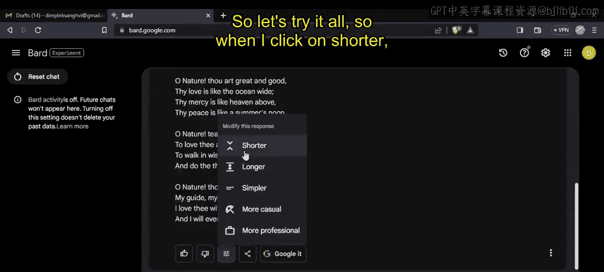

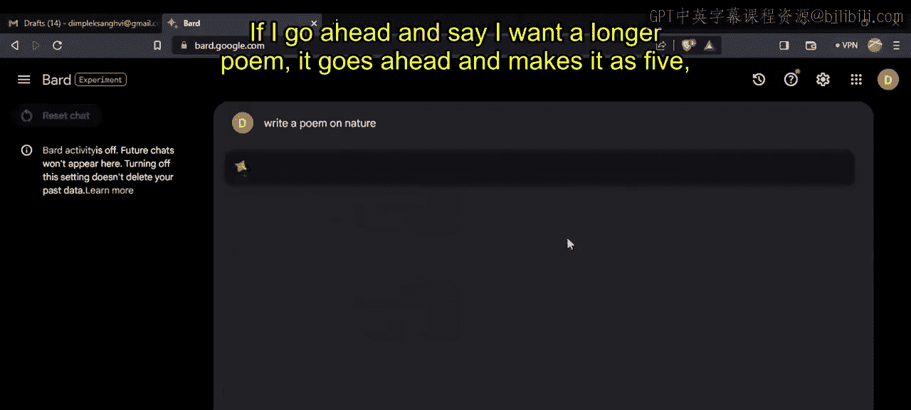

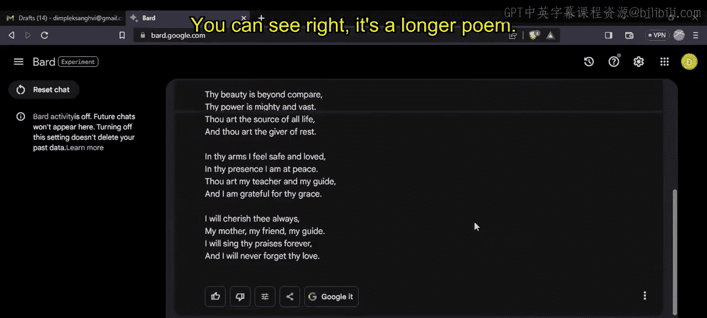

I might want to use a simple language so I can click on simpler。

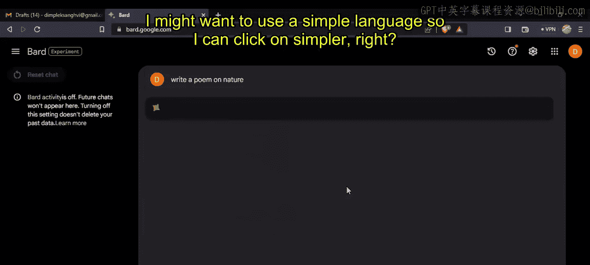

RightThe choice of words become very simple and I can make it professional by clicking on professional so you have these options instead of rewriting the promptm you can just click on it and do it there is another thing called as share and export I can export this as a draft on a Gmail and once I do this it says drafting an email and I can open the G and you find that the entire poem is copied over here and it says right the prompt is over here I can decide to whom I want to send the poem and send the poem off or else I can even send it to my Google Docs so by clicking on this it creates a copy in my Google Docs and when I open it you find that it's saved in my Onerive right so I don't have a copy paste it's very easy when it comes with bar suppose I like the concept and I would want to research it further then I have the button call as Google it which helps me tell that what type of related search people。

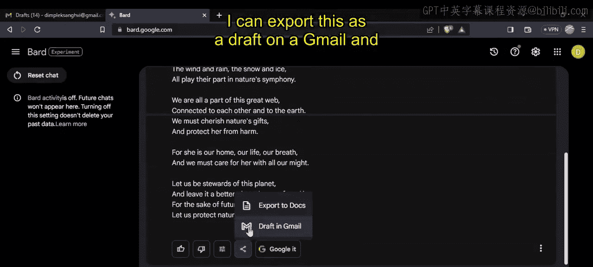

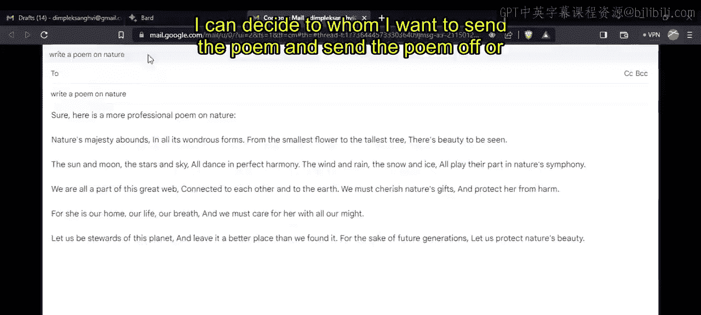

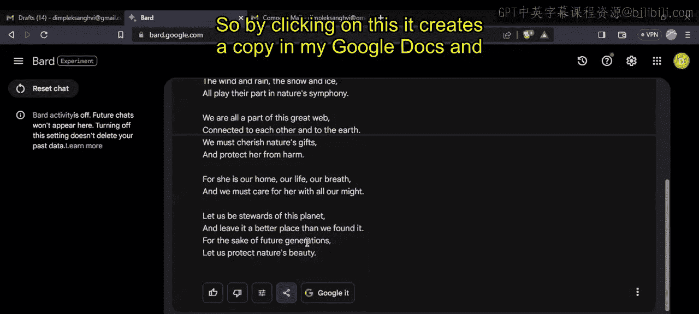

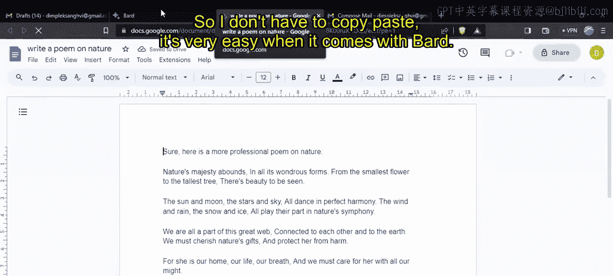

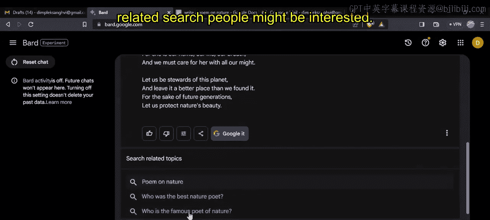

Be interested so who is the famous poet on nature so I can click over it and it says William Wordsmith is a famous poem。

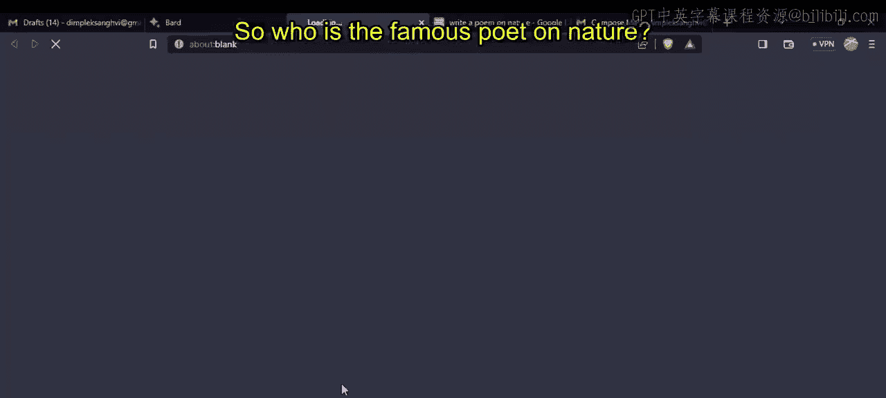

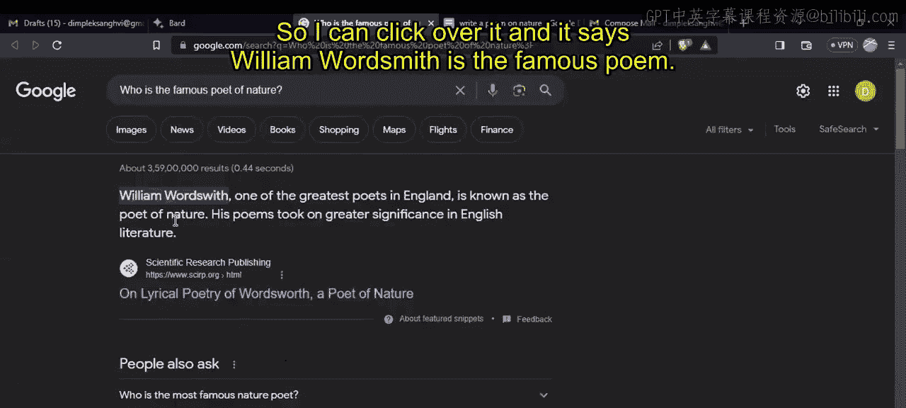

Not only with poems， I can go ahead and create different articles also。

Write 200 words article on Geneative V and you can see that it started working on it and it starts writing yes。

 and it has return an article I can go ahead it is also showing me that what is the link it has left to give me the answer here now you find that again I have this option of making it shorter longer simpler and so on I have the option of exporting it to Google or to the Gmail。

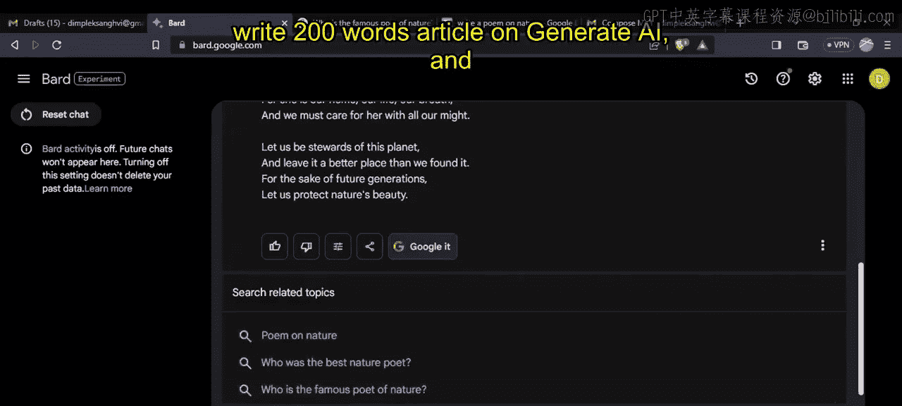

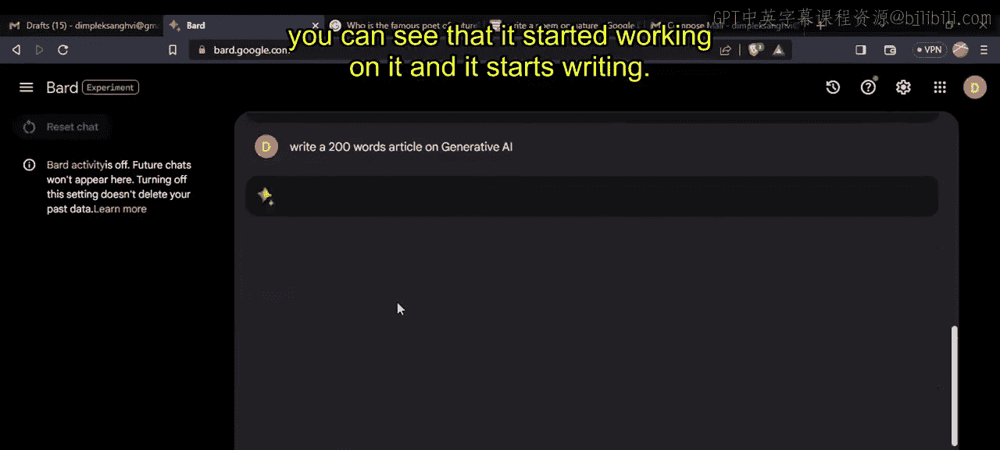

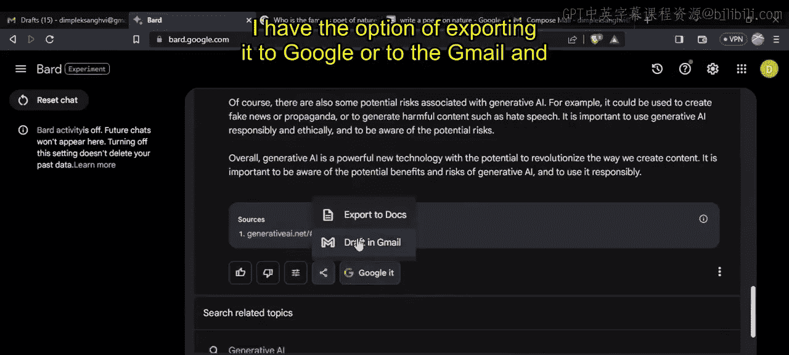

And it also helps me what are the related search that are possible。

You can see a simple microphone button over here so I can click on it and write the prompt。

Let me just allow this。Right， okay， there is an issue one second I'm using an AI tool so that's interrupting over here summarize the article because I'm recording this my microphone is busy or there but I will definitely want you to explore this microphone option which allows you to record the conversation and that becomes as a prompt which makes it easier So with that we understood how to use Google Bar in different ways So let's understand what's the difference between Bard and G So it's made by Google whereas this is made by openaiI it's based on the concept of Pam whereas this is based on the concept of GP bard is trained on 540 billion parameters G is trained on 137 billion parameters text and code from internet Gmail data train on real time data whereas Cha GT is trained till September 2021 and it was trained using the articles from the internet。

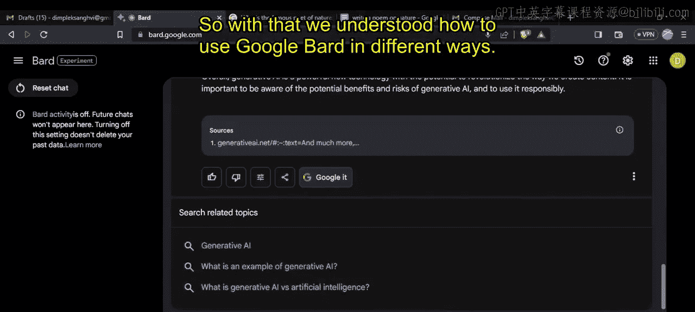

It is good for generating creative text formats like poems， code， snippets。

 music emails and so on This is good at understanding and responding in a natural language questions I can export my details into Google Collab Gmail Google Docs and sheet I can export this only via hypermails Bard is free for all the users while Cha GT is free for all if I want the G plus I need to paying $20 a month so application is writing text messages。

 technical documentation business plan marketing material and I would want you to explore all the things that tued in the chat GT session try it out with bard as well it can give you product ideas sales pitch business strategies。

 some personalized contents like the birthday cards and anniversaryy messages so we tried out generating some output and we also saw that how I can export it to Docs and draft it in。

I can say that can you go make it shorter， longer simpler we have already seen this I can also use bard for code generation so I can say write a Python code to find the pal room and it was write it and I can export this code because it's a Python code it can easily be exportd to Koab it can help me in bug fixing writing the code writing the documentation which makes it very easy for me to send this output to the respective ID so to summarize we understood how bar works we saw some practical applications we saw how I can share content of the output from the Google bar and what's the difference between Chad GT and Google Thank you so much and I will see you in the next class。

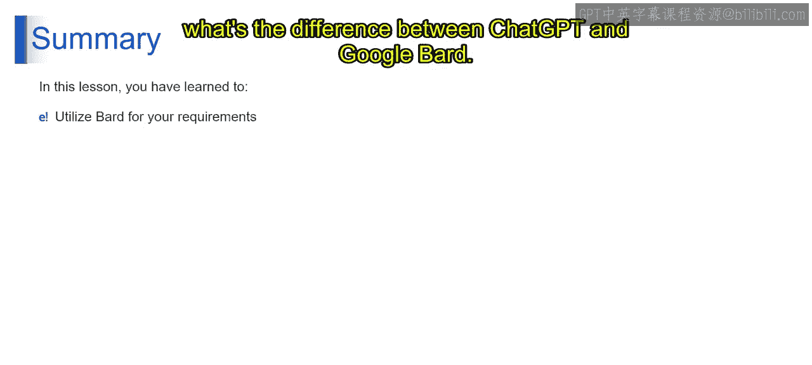

