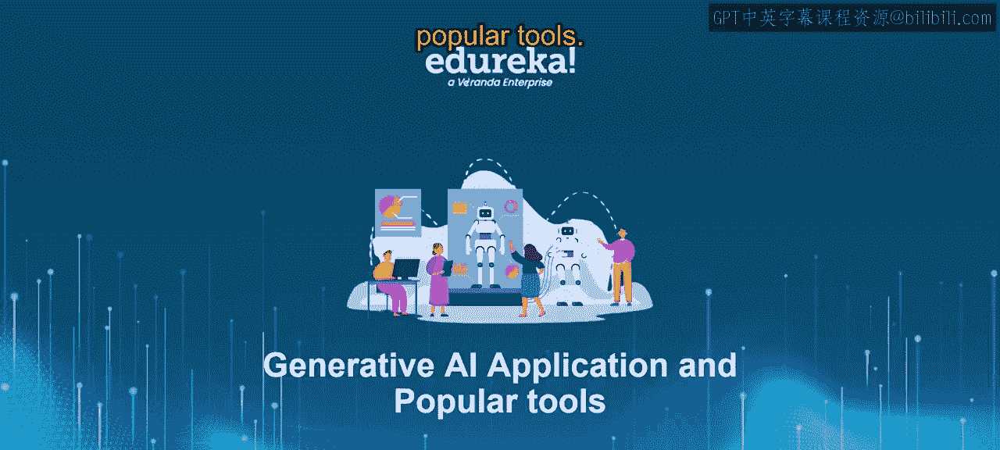
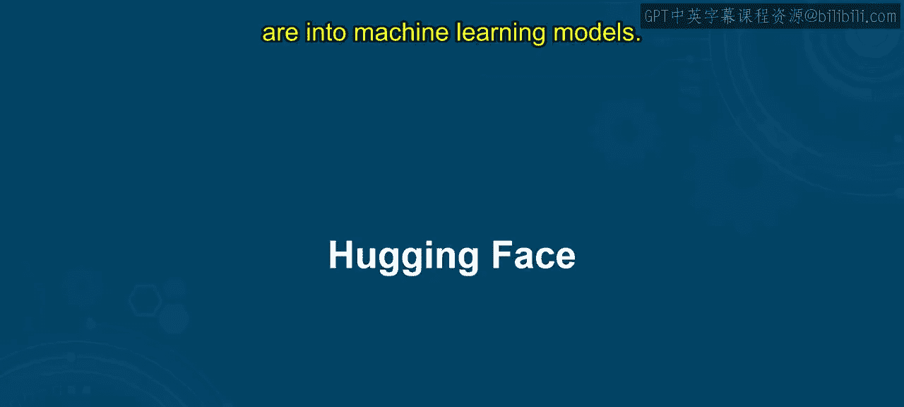
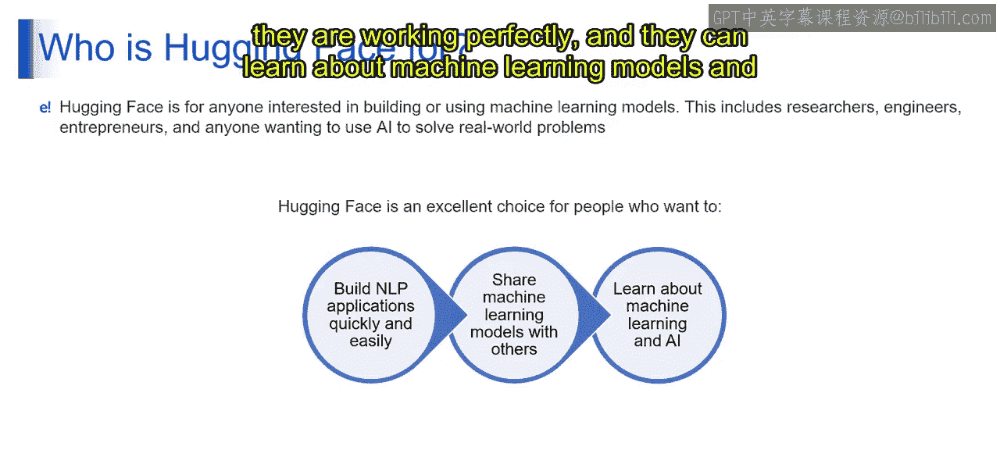
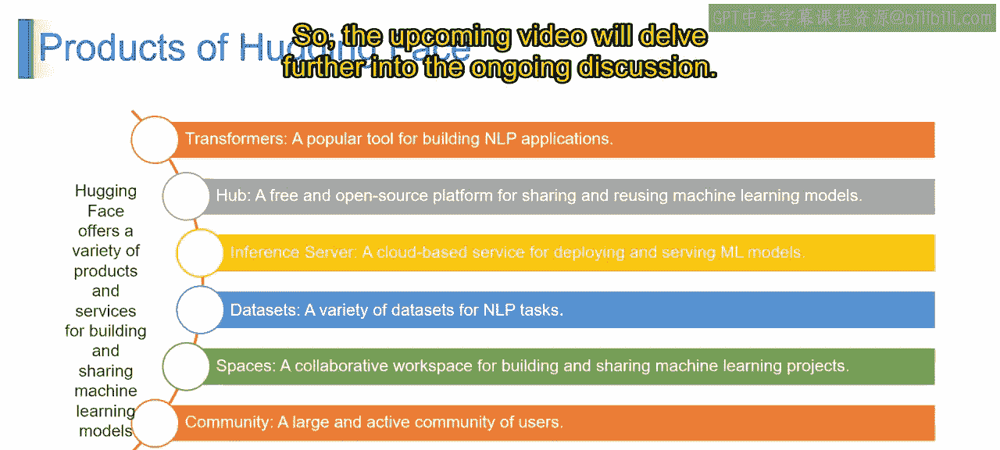

# Edureka《通过LLMs学习生成式AI（基础、应用开发、流行工具，第2、3、4课／共4课）｜Learn Generative AI with LLMs》中英 - P156：49_Hugging Face.zh_en - GPT中英字幕课程资源 - BV1ym421V7gx

Welcome to the immersive journey into the world of generative AI applications and popular tools Today。

 we are going to talk about hugging fees。 It's a new AI tool which will make your life very easy if you are into machine learning models。

 Let's understand what is this platform。 So this is a platform that is specialized in NLP that is your natural language processing。

 and it is a very good product because it helps lot of researchers。

 developers and business to work on NLP more effective。 It was founded in 2016。

 and the company's aim is to democratize artificial intelligence through open source and open science。

 So this platform provides a state of art research for developers specialized in NLP toolss。

 So we are going to build machine learning algorithms。 machine learning models。

 and you can share it with the community。 So it's a product where。😊。

people who can come forward with their models。 you can build your own models and share it with the public。

 and it's very good because this company has a very good transformer library。

 you can see the icon of hugging phase over here。 Why is it important Because as we have seend G it's also an transformer based language。

 it's built on the concept of natural language processing because when we are giving prompts。

 it's using English on the natural language and thed G or bar is responding back to us So when we want to build something that is customized to my business or I want to do some research and development relating to the models of NLP not exactly like G but something on a similar line。

 then this platform helps to create means it gives you access to a vibrant community and this community is where you can get help So you。

Get more creative， more innovation is possible because you're getting all the people who are willing to support you on your NLP model building journey and we can very clearly see that there's very beautiful feedback loop everybody is encouraging others to build and if you have built something you can easily share it with the so the people who are interested in building their own NLP applications quickly and easily this is a solution for them they can search for machine learning models from the others who have built and their working perfectly and they can learn about machine learning models and AI in the real world type of problems。

What it can do it's a transformer language， it's a hub of free and open source platform。

 it has a big database and you have a concept called spaces which is a workspace for building and sharing your projects and you have a very large community of active users who can help each other in this process。

So the upcoming video will delve further into the ongoing discussion。😊。

