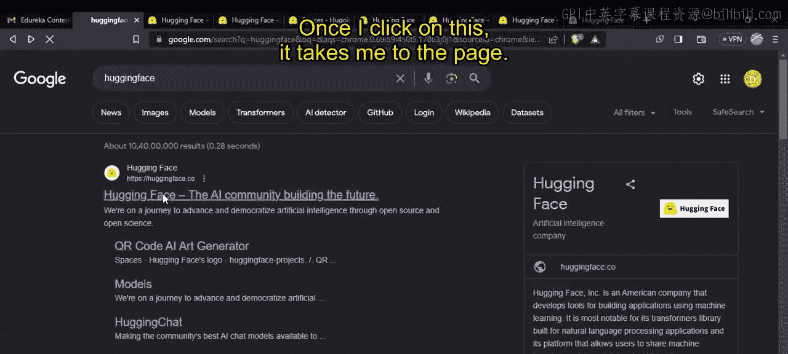
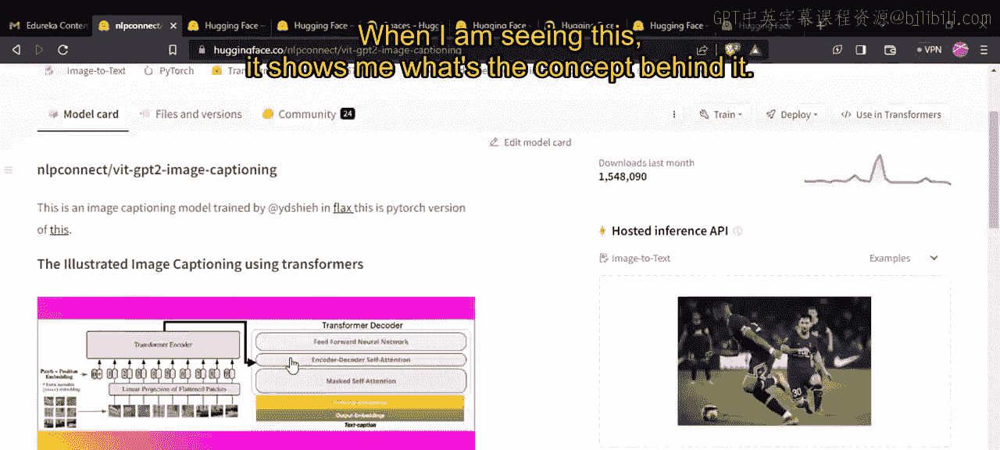
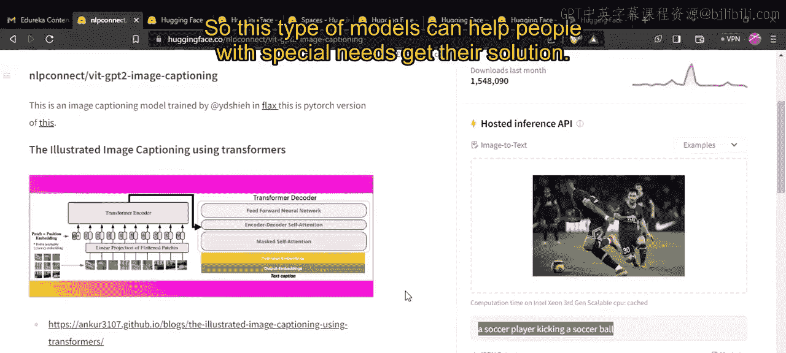
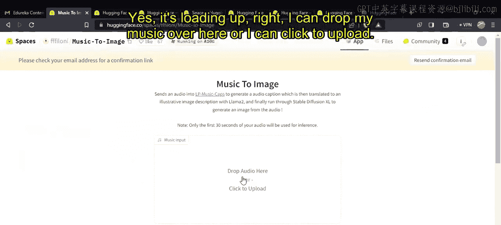
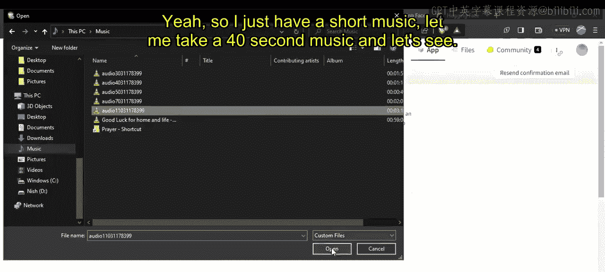
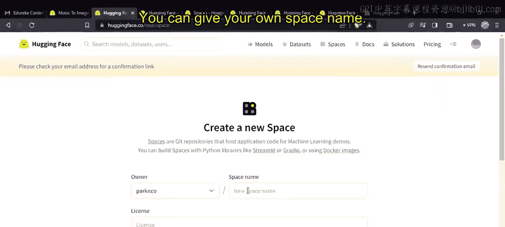
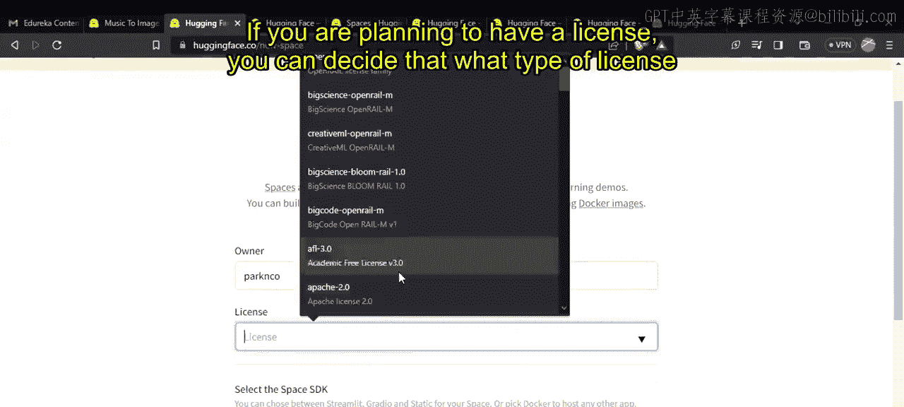
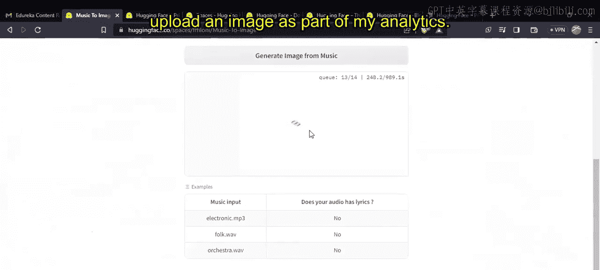
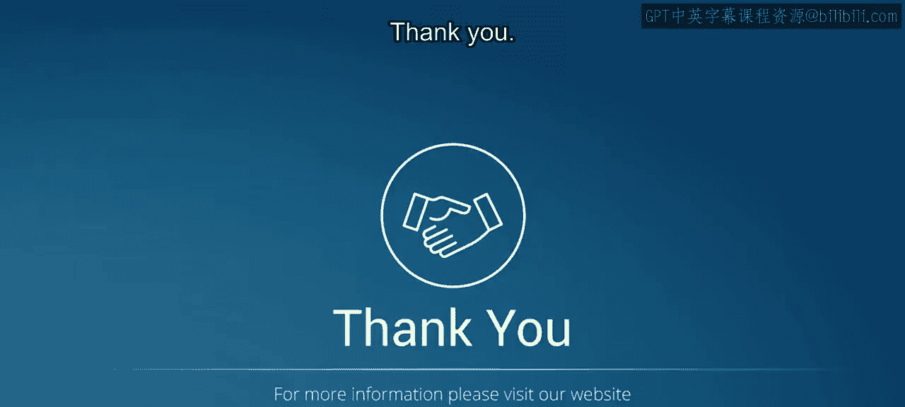

# Edureka《通过LLMs学习生成式AI（基础、应用开发、流行工具，第2、3、4课／共4课）｜Learn Generative AI with LLMs》中英 - P157：50_Hugging Face界面.zh_en - GPT中英字幕课程资源 - BV1ym421V7gx

So let's now explore the progression from our previous discussion so let's go and see the hugging face from the so just go to Google and say hugging face the first option you see is hugging faces do co you can recognize the icon once I click on this it takes me to the page I have already created my login ID you can create yours right so you can see it's a beautiful workspace you have concepts like models you have databases spaces docs solutions pricing and you can create your own profiles you can have your forums task and so so let's understand one thing at a time so in the model section I can go and search for models so suppose if I'm planning to create my image to text not text to image image to text I can click over here and it will tell me that what are the different models that are available and I can go ahead and see it。

s see this NLP connect when I'm seeing this I it shows me what's the concept behind it it is seeing an image and by seeing this image it is converting a text from this image that what's happening in this image it's a soccer ball play kicking a soccer dog the concept over here is you might be aware of people who are blind so there are special type of glasses which you need which these people can wear and they can still see the world around。

And that is a place where image to text will play a role so this type of models can help people with special needs get the solution Similarlyly。

 I can come back to my models and find another models which are suitable for me right maybe I want to do feature extraction maybe I want to do document questioning maybe I want to do text to video because if you are a YouTube influencer then you might want to build a model from here So what I would invite you is go and search different things that will help you there are different languages also it can support so maybe you want to do it in English Hindi Per and so on and you have different example datas which you can pick up and practice from there you can find multiple datas by clicking on the dataset option you can pick the data relating to the models that you want you have computer vision you have natural language processing audio you have tableular So what if I want to do automatic。

Speech recognition or text to speech so I can just click over here and it shows me that what are the different types of dataset sets that I have。

 You can see that I just saw that there are some marati voices right so part marati voices it is helping you it's about having in different languages right when I come to spaces section of hacking face it shows that these are the different types of models different types of things people have made and they've made it public So this is a music to image about 20 hours ago tool benchnch leader about six days ago and so on so whichever you want you can go ahead and use it So for example I want to do music to image Yes it's loading up right I can drop my music over here are I can click to upload so let me just do you right I should be having some good music me just see this so。

I just have a short music。 Let me take a 40 second music。

And let's see， so it's a simple sound。🎼Yes。🎼You want活。🎼I say yes。 Now I'm seeing from this image I。

🎼Generate images from from this screen We unknown。🎼ErickBut Nancy see what with them。🎼，IS this music。

It is still generating。🎼Or you can keep yourself entertained with this movie。

🎼Okay I'm in the queue my position number is 15 out of 15 and it's going to take some few seconds so I'll come back to this output little later while it's still doing it right four。

And we'll come back to it after a thousand seconds to see what's the output it can generate。

So we saw about models dataset spaces， you can create your own spaces by going ahead and saying create new space you can give your own space name if youre planning to have a license。

 you can decide that what type of license you want to use and you can select the space SDK that you are going to work one space hardware that is required do I want to keep it as public or private and I can go ahead and create some space It means that whatever model I built Im going to create it as public and make it available for people to use Yes so while it's still happening let's come back I have a concept called as docs inside hunting spaces which can help you create documentation across so you have documentation for all the things that are available tokenizer server data Safe Tenor auto train Amazon sage makers so you can go ahead and explore this what is important。

For you is that how you can optimally utilize so let's just see tokenr so all the documentation relating to how tokens work is easily available over here within solutions you can see enterprise hub expert acceleration program endpoints auto train and hardware so you are getting a roadmap for all of it right so you can request a demo people who are already using it what are the different types of machine learning experiments so it's a very good place for you to explore that how you can create demo at your work right wonderful。

So let's come back， let's also look at the pricing before we go back and see that so it has a three different few models so we am using Hf hub which is a collaboration of machine learning which is free forever where I have unlimited models unlimited datas and spaces I can create unlimited organizations and private records and community I can upgrade myself to a pro account where I will get access to all the things plus higher tire autotrain free interface API and getting access to new features more quickly and it's at a very nomininate amount of9 per month if I'm working in an organization enterprise hub would be a better option where it's $20 per month per user and it will help you in building and managing your APIs space hardware its 0。

05 per hour interface end。0。06 per hour auto train is free at this point of time right？

And you can see that you can create your models， you can collaborate with others。

 you can learn and play and you can build your own machine learning portfolio。

 so this is definitely a good option for you to explore don't forget to create your own account and start playing with。

This is taking really long。I will definitely come back and upload an image as part of my analytics。

So with that， I will see you in my next class， thank you。

