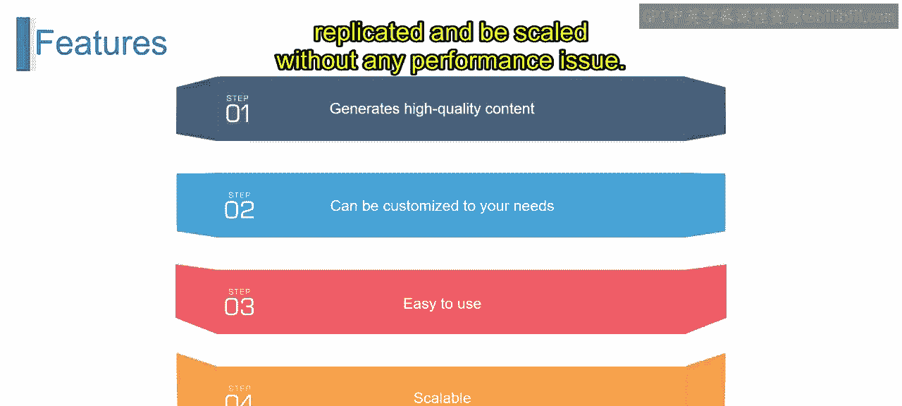
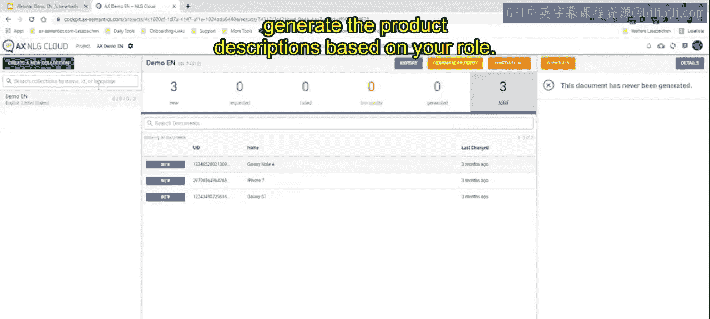

# Edureka《通过LLMs学习生成式AI（基础、应用开发、流行工具，第2、3、4课／共4课）｜Learn Generative AI with LLMs》中英 - P158：51_NLG Cloud.zh_en - GPT中英字幕课程资源 - BV1ym421V7gx

Welcome to the immersive journey into the world of generative AI applications and popular tools。

 Let's explore ax semantics energy cloud。 What does this do。

 So its a natural language generation platform which generates high quality content at scale。

 It uses the large language model to understand your needs and generate text that is both informative and engaging。

 This makes it an excellent tool for creating blog post articles and product descriptions。

 features generate high quality content。 a semantic cloud can go ahead and use the large language model to generate text that is very informative and engaging I be showing you some examples and use cases。

 This makes it as an excellent tool for creating blog post articles。

 product description and much more。 It can be customized for your specific needs like you can customize the tone style and ensure that the text that is generated follows。

😊。

Structure the cloud is very easy to use because once you enter your requirement。

 it generates a high quality content within minutes。

 It's a scalable platform because the content can be replicated and we scale without any performance issue。

 Let's understand some of the benefits of using this platform。

 It increases the productivity as you can save a lot of time and effort by automating the content creation process。

 and the team can now focus on tasks such as marketing and sales improve brand consistency because I am able to customize it to the minute test detail of the voice and style。

 I can ensure that the brand reputation is maintained。 It increases customer engagement。

 the cloud can help you create more engaging content that will give customers returning for more。

 It is an improved Se。 So this cloud reveal content which is for the search engine and can help you attract more visitors to your website。

So I have over here created three products， Galaxy Note 4， iPhone 7 and Galaxy S 7。

 So I have mentioned the name， the brand， the color features， categories。

 weight of the processor display site operating system and all the details with reference to Gal iPhone 7 it's iPhone 7 Apple color is goals。

 it's a smartphone， these are the features， This is the weight and so on。

 So I have entered all the details for different products at one go and now I come and say analyze when I come to analyze。

 I have different details which I can modify like the display inch。

 I have for two of the data points， not for all the three So I'm getting that which are the features。

 which I have forgotten to mention and which all products have all the details Once I'm there。

 I can click on the right on the manuva and it will start generating the content I'm setting up the rules that Samsung Galaxy Note。

16 G， This is how I would want the statement1 the statement2。

 it's taking the smartphone Galaxy Note4 from Samsung and is equipped with the operating system and thanks to the3" display on the content and this I am writing the rules which I' am dragging from left to right。

 this will set up the rules for me for the system to generate the content for me。 Yes。

 so I'm saying this is a large model 3" of display and so on。 So when I'm setting up these rules。

 it will pick it up and write the stories for all the different products at one go Let's now go and click on publish So I have different sentences which can be tweet According to to the values that I have provided and accordingly the output will get generated whether it is larger or smaller or there is any other branch or any deviation that I want in my content I it a model is it a device Is it big。

It's small and those will act like the fill in the blanks。

 which would be taken up from the data points that I have given。

You can review that we have created multiple combinations of it for Galaxy Note4 and if I click on Galaxy S 7。

 we find that some of the details are automatically getting quantified depending upon the values that we have already provided Yes。

 it's a larger phone when compared to the earlier model it is still S 716 gb Now I can click on transform Once I click on transform。

 I can go ahead and set up my rules， I have a condition that if it is large what should happen And if it is small。

 what should happen So I' am setting up some parameters and certain rules which I can go ahead and tweak and write it So from the transform it's going ahead and writing the content So if it is large then what needs to be done if it is small what needs to be done So you can see that the data that has been provided has been customized transformed and now it we will go ahead and publish。

Genrate our content。Right so I click on stories， I click on review and we can see that the data has been converted into a story so the data is names and I have a beautiful galaxy note for 16 gb and write up which has come up if you click on the next product you will see that it has been generating content for all the three products that I have generate all and it will generate the content for all of it So if you have hundreds of product this is a good tool for you to generate the product descriptions based on your own。

If you have any questions， don't worry， please reach out to us and we'll be happy to help you out。

Thank you。