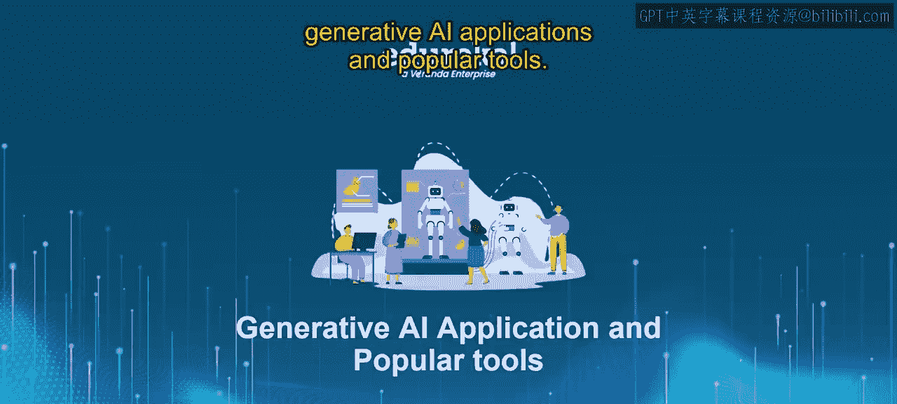
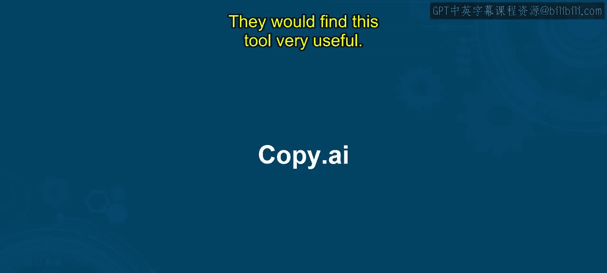
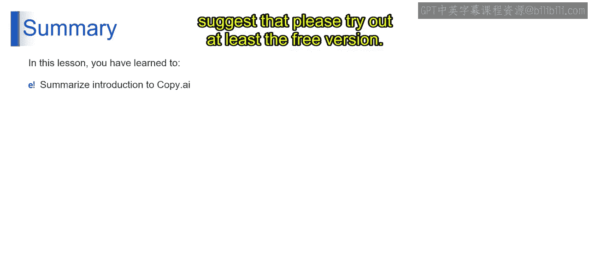

# Edureka《通过LLMs学习生成式AI（基础、应用开发、流行工具，第2、3、4课／共4课）｜Learn Generative AI with LLMs》中英 - P159：52_Copy.ai.zh_en - GPT中英字幕课程资源 - BV1ym421V7gx

Welcome to the immersive journey into the world of generative AI applications and popular tools Today we are going to learn about copy dot AI It's the future of copywritinging people who are in marketing field。

 they would find this tool very useful。

So let's understand what is copy do AI Most of you would be into marketing and would be writing copies which makes it more attractive and generate leads so you can use this AI power tool to write a better marketing copy The beauty of it is that it can help you write better marketing copies it can help you generate more leads and it's based on the op AI language prediction model it helps the browser extension of copy dot AI includes templates tools extension plagiarism checking and paraphrasing tool so I can use one of means I have more than 90 templates which are available on the marketing copies like blog post social media ads email campaigns and landing pages the people who are interested in this can make use of these templates the AI writing tools for writing beautiful headlines generating product descriptions copy AI。

This extension will help you There's a browser extension which can help you generate copy directly on the web browser plagiarism checker helps instead of going ahead and checking it again on a plagiarism checker Co out AI already comes in with a built in plagiarism checker and a paraphrasing tool because we are using AI tools for writing the content paraphrasing becomes an important part so the benefit of using a copy AI is that it improves your marketing copy generates more engaging content it saves a lot of time and money for generating this and it can generate more leads and sales because the marketing copies can convert your prospects into your leads。

To get access to copy AI just go to copy。 eI and create your login ID you can log in with Google or Facebook account its it might ask you a question like what's your job role and just select whatever you select does not affect the quality of the output will still remain the same and you have different options so currently the demo that I'm showing you is using a free plan where I have access to 2000 words per month and it's a seven days free trial。

25 languages it can support and 90+ tools I have。If I go on a pro plan， I'm paying $432 per annum。

 unlimited words， I can use all the 90 templates， a blog writing tool up to five users can access using the same login ID 25+ languages same like the free one。

 but you have a support system that Popi doAI provides if you are a pro plan member。

So the benefit of using copy dot AI because people who are working in the marketing field are aware that you need to create blog posts。

 social media posts， email marketing， product descriptions these things can be very easily be generated using copy do AI because it's based on the model of open AI the quality of the output that it generates is really beautiful this you have sales copy which focuses on sales and landing pages。

 what type of emails you can send to your clients you have web copies to design your home pages and other contents that you can generate using copy dot AI so to summarize this copy dot AI is a tool。

Especially designed for marketing team whose job is to generate marketing copies to generate leads and get conversions this tool is very useful and I would suggest that please try out at least the free version Thank you so much and i'll see you in the next class。

