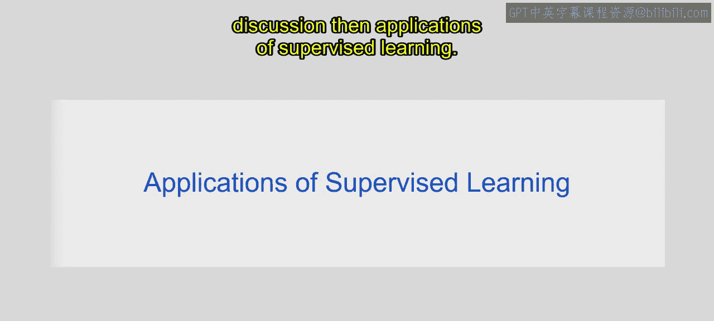
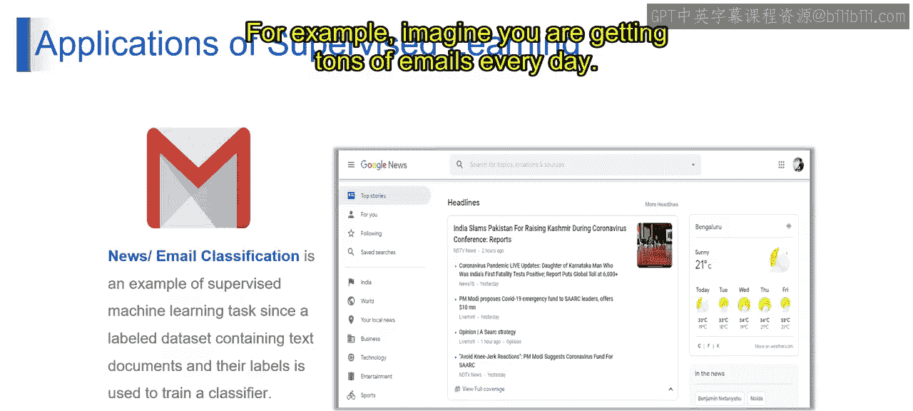
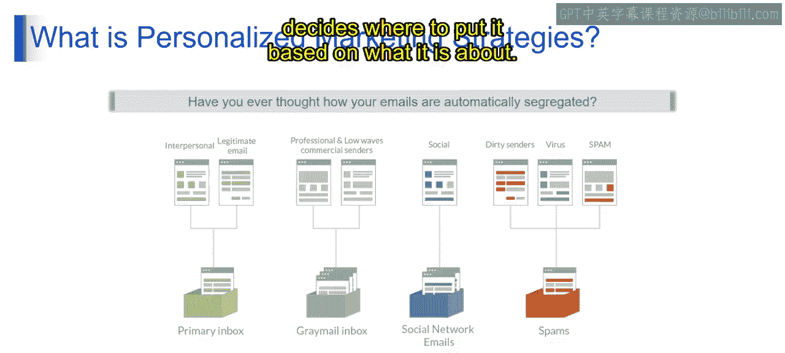
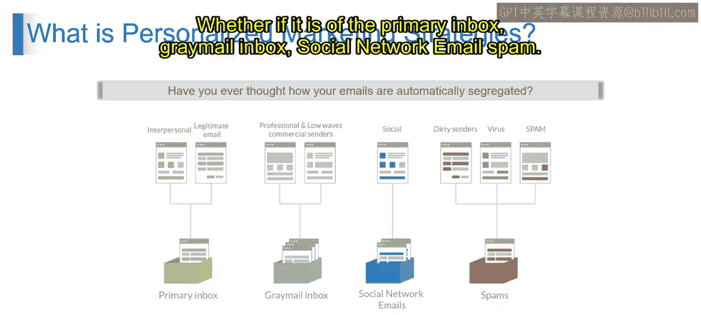
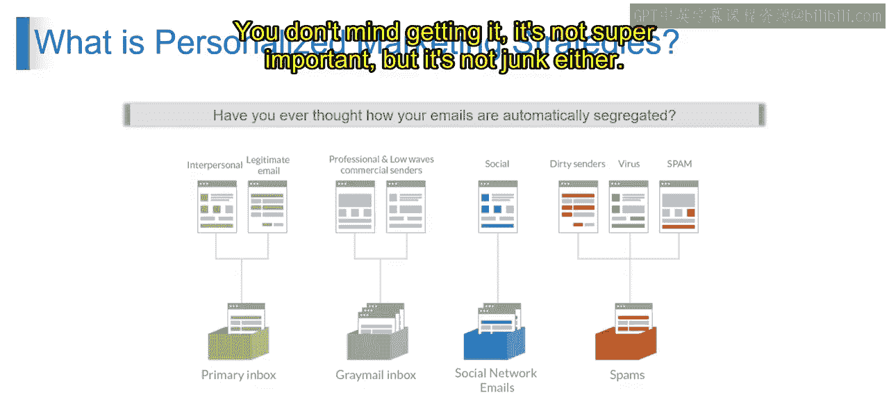
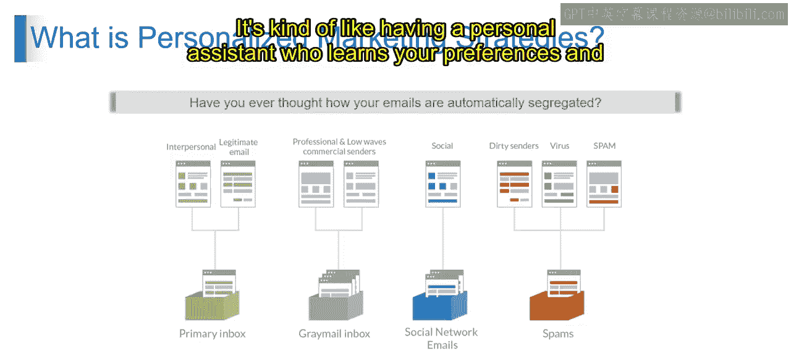
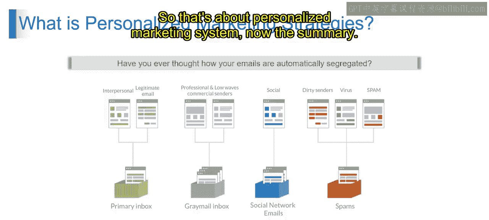
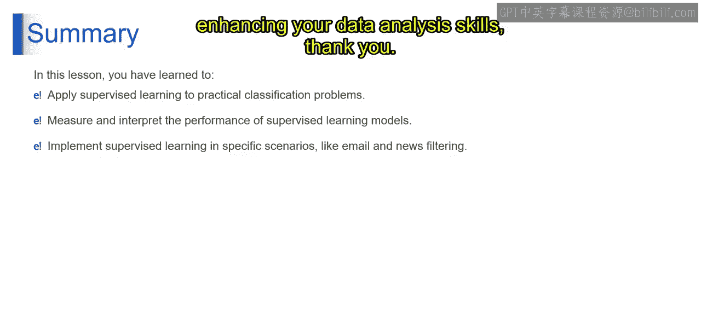

# Edureka《通过LLMs学习生成式人工智能（机器学习和NLP基础，第1课／共4课）｜Learn Generative AI with LLMs》中英字幕 - P15：14_监督学习的应用.zh_en - GPT中英字幕课程资源 - BV1q4421Q7qh

So let's now explore the progression from our previous discussion then applications of supervised learning so application of supervised learnings are diverse including tasks like news or email classification where the supervised machine learning model is trained using the dataset containing the documents with the emails along with their corresponding labels means whether if it is of you know news articles like sports politics and if it is of emails whether if it is of the spam or not spam means the model learns from this labeled data to classify new uny text document into predefined categories based on their content enabling efficient organization and retrieval of information。

 for example， imagine you are getting tons of emails every day。

 how do you keep track of them all we will think of your email inbox like。😊。

A big storing mission。 It looks at each email and decides where to put it based on what its what it is about。

 So now let's take a closer look at how your email get sorted。

 whether if it is of the primary inbox graymail inbox social network email spam。

 So when we say primary inbox。 This is where you find the emails from your friends family and official information important businesses。

 you deal with regularly。 it's like your VIP section then coming to the graymail inbox here you will find the stuff from the work contacts or those occasional promotional emails。

 you don't mind getting it it's not super important but it's not junk either So that's about the graymail inbox。

 then coming to the social network folder。 So ever get the notifications from the Facebook or Twitter or linkednkedIn into your email so they go。

Here it's like your social media corner then the next one is going to be the spams This is where all the junk mail goes those weird emails from strangers potential viruses and those annoying ads and even promotional emails so behind the scenes what exactly happens there are smart computer programs using the fancy math to figure out what each email is about they look at the things like who send the email what words are in it and even how you have reacted to similar emails in the past these programs learn from all these info and get better at sorting your emails over the time it's kind of like having a personal assistant who learns your preferences and helps you keep your inbox organized without you lifting。

A figure so that's how personalized marketing strategies work by using clever technology to understand your interest and behaviors and then delivering the right messages to you at the right time so that's about personalized marketing system now the summary in this lesson you have learned to utilize supervised learning for classification tasks and evaluate model performance Additionally you have understood supervised learning in the practical scenarios like email and news filtering enhancing your data analysis skills Thank you。

😊。

