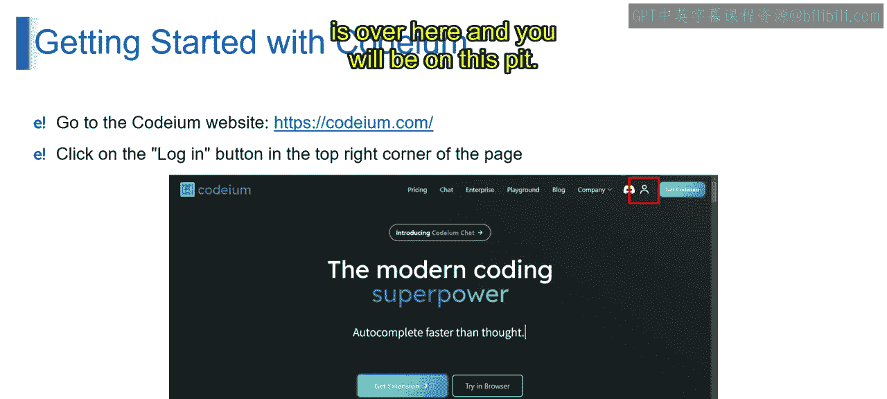
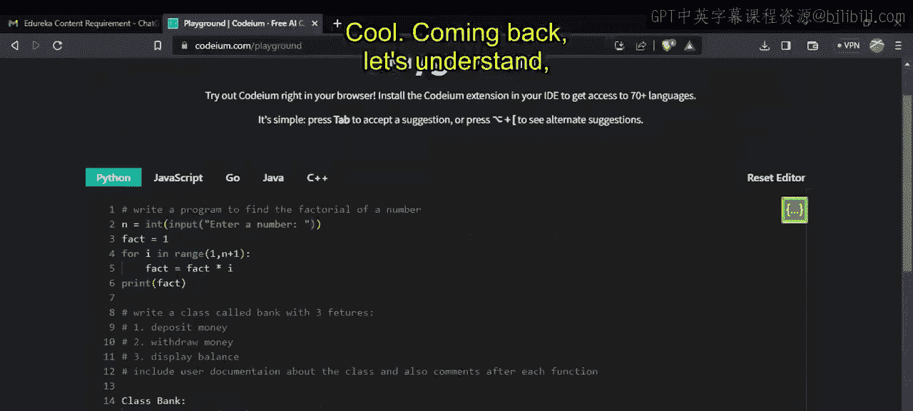
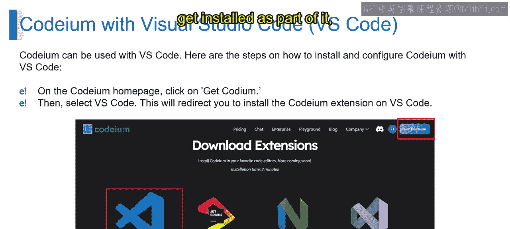
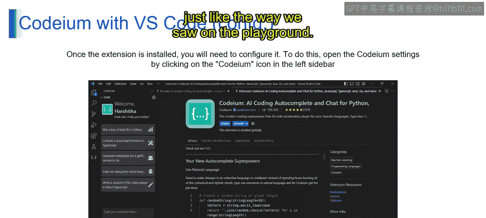
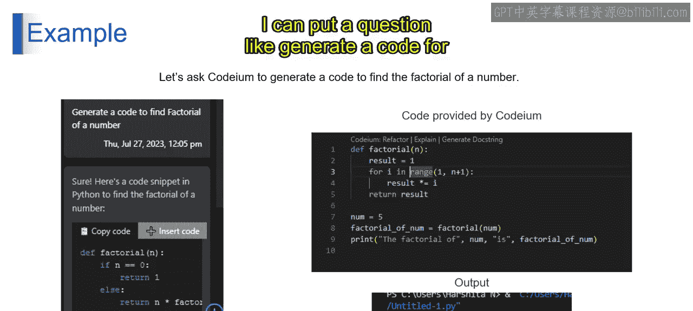
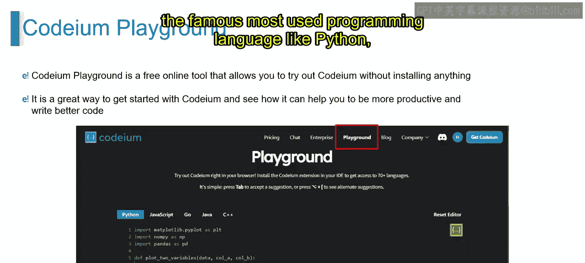
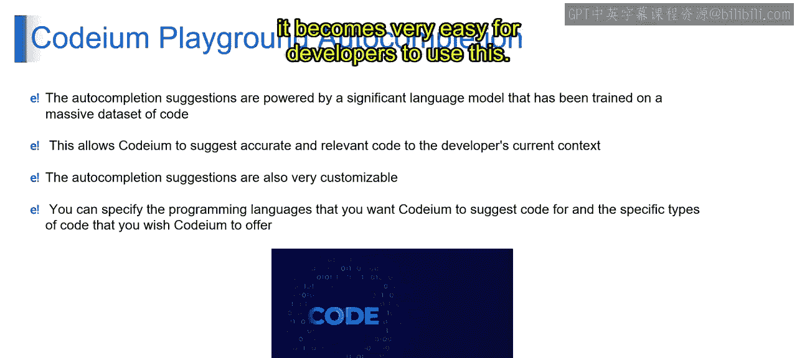
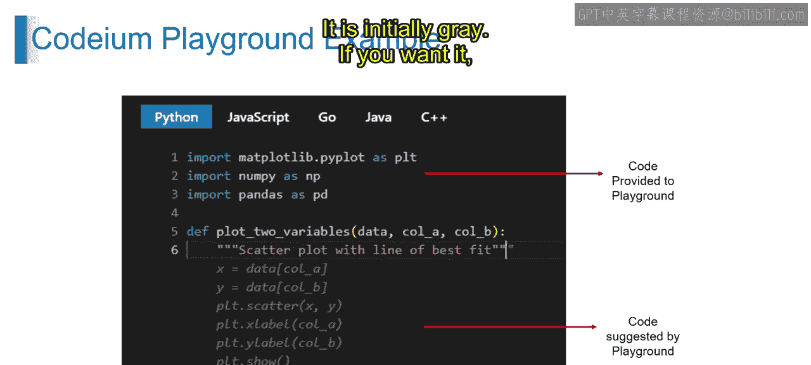

# Edureka《通过LLMs学习生成式AI（基础、应用开发、流行工具，第2、3、4课／共4课）｜Learn Generative AI with LLMs》中英 - P161：54_Codeium.zh_en - GPT中英字幕课程资源 - BV1ym421V7gx

Welcome to the immersive journey into the world of generative AI applications and popular tools。

 Today， we are going to learn about the new AI tool。 that is。😊。

fulm。This is the way it's going to change the world for the programmers and the people who would like to write codes and complete it。

Socodium is a new AI tool which helps work with 20 different programming language including Python Java。

 Java Sc C++ and much more the beauty of this is it's in free AI toolkit which helps developer in code completion it helps you write different ways of completing the logic and we are going to see it all so it's trained on a large language model just like the way charge GT and bar is the beauty is that it has been trained more accurately from a developer's point of view and not from a content creation。

So Hoium has a search functionality which is powered by AI。

 which helps more from to the developers in completing the files and the coding that is required。

 so it helps in increasing the productivity， the quality of the code because it is more bug free。

 you don't have to worry about syntaxes， you don't have to worry about the logics and it reduces the onboarding time because people know how to use。

So how do I access quodium， I can just go to quoium。

com the link is over here and you will be on this page， right so。

I currently it's available for free so I can just log in using my login ID and I have a very beautiful concept called as browser so playground I can come to the playground and then start writing so I can use simple like Python JavaScript go Java and C++。

So click anywhere and you can get started so I can just go ahead and I'm deleting everything right program okay。

 so it's giving me an idea right to find a factorial of a number。

The minute I say it is going ahead and giving me the options I just have a press tab that's a fact equal to one and you can see that it started writing the code for me I can go ahead and say right class called bank with three features right let me explore the website more。

Patures and you will find that it's given me various answers tools like deposit money withdraw money and display balance plus bank。

 de in it， and you can see that it starts to do things very quickly。

And I'm just pressing tag and it's going ahead and working on it。So it becomes much more easier。

 I can come here and also include one more thing include documentation about the class and also comments after each function the minute I complete that and I come here again it just starts helping me so let's redo it。

I'm in class bank。This is a bank glove。And it will immediately say that this will not work。

 so it suggests that I should be putting cash right I can go ahead and as soon as I say de deposit iss giving me pass。

Doation and it right this is the deposit function Yes so you can see I am getting an option and if I press a space bar it's getting deleted because maybe I want to write my own thing but it suggests that what should be there it's giving me a proper documentation this is a withdrawal method this is a deposit method and so I can go here and say write the main function it can easily guess what I want to do and once this is done。

 it's easy for me to just copy this and send it to the Google So coming back let's understand what else can I do withdium So once I log in with my email ID I can also use this different with different types of Is like visual Studio code Google Chrome Jupyter notebook visual Studio and so on so I just have to click on the extension and say getdium and it will get installed as part of it as an extension。

Your code and once you are inside the visual Studio code visual Studio LD this will start helping you just like the way we saw on the playground right so I can put a question like generate a code for a factorial of a number and it starts generating the code we just saw a demo over there I can go ahead with the codeium extension it's possible to refract explain and generate talk to。

So I can go ahead and use these functionalities which will make it much easier for me as a developer to do this we saw the use of playground which helps us do with the famous most used programming language like Python Java and C++ and we saw that just because of its auto completion feature it becomes very easy for developers to use this it is more very customizable and it can suggest as the course that can help right so you this can be provided with playground and the code is suggested by the playground it is initially gray if you want it just press the tap function and will take you down。

So to summarize it's a very good extension which is available for the developers to make their life more productive writing good codes and more quickly thank you so much and I'll see you in the next class。

