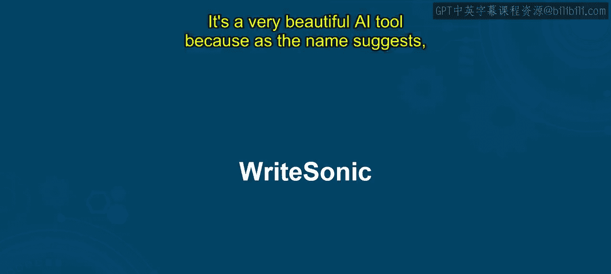
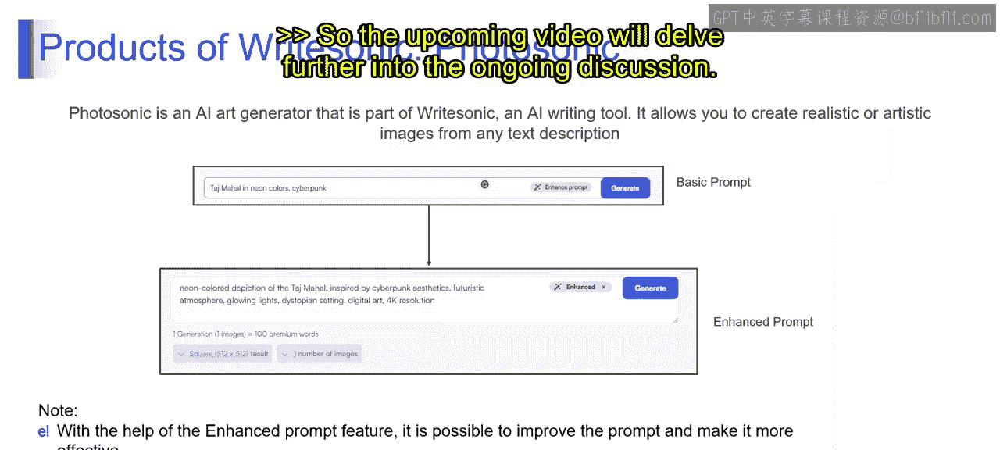

# Edureka《通过LLMs学习生成式AI（基础、应用开发、流行工具，第2、3、4课／共4课）｜Learn Generative AI with LLMs》中英 - P162：55_Writesonic.zh_en - GPT中英字幕课程资源 - BV1ym421V7gx

Welcome to the immersive journey into the world of generative AI applications and popular tools。😊。

Today we are going to learn about the next AI tool that is write Soonic。

 It's a very beautiful AI tool because it's as the name suggests we are going to learn how to write a lot of things。

 So this AI tool called right Soonic is an AI writing tool that can help you create a variety of content。

 including blog post articles。

Social media post， add copies and much more。 This uses artificial intelligence to generate content that can be both original and of high quality。

This is very easy to use and I'm going to show you a demo in some time so when you go to write Sonic it is powered by chat Soonic botsonic。

 photosonic and more than  hundred different AI writing features on the web app。

 this innovative product and features result from training AI models using thousands of real life examples from leading brands。

As you can see the screen on the right hand side， you have multiple options which you can use to get things done。

Witesonic is built on the concept of generative AI and this model is fine tuned on specific use cases like Google Ad blog posts so on so that it can learn the patterns of writing you log into rightsonic you just need to go to the website of Wsonic。

 co log in with your Gmail account because you will get 10000 free words you don't need any credit card after which you will have to pay 16 per month which is still cheaper than chat GPT that's what they are advertising about so they have different types of pricing one free pricing where it is free of cost it uses GPT3 model it gives you access to chat Sonic botsnic and other00 plus AI tools。

It's available in 25 plus languages， you can upgrade to an unlimited plan where you're paying $16 per month and it can vary up to $160 depending upon the number of users again you have the access to chatsnic and 00 plus AI templates。

Appgrade to the next plan。 That is business for those who are an enterprise version where they need multiple license。

The prize is varying anywhere from 2。67 per month to 666。

 for which you can request for a demo The enterprise for large business is 00 per month and it has a custom package SS and many other development and onboarding support that they give today if we are going to use the free version of chat Sonic write Sonic to understand what it can do So before I dive deep into it。

 please understand what can it do it can write articles for me it can generate social media post add copies landing pages。

 product description and blog post and much more So when you go to the write Sonic library。

 you find that there are lot of prem content that is made available to us the library includes a variety of content for blog post articles social media landing page and so on this makes it very easy for a content developer to use this tool。

For high quality output， the different products within the right Sonic is AI writer。

 which can help you in writing。You have paraphrasers which can help you in rewriting to improve the readability。

 you have text expander which saves time for expanding short snippets of text sentence expander shorter chatsonic botsonic and Photosonic so if you see things like shorter it is very important because when sometimes we want to remove unnecessary words and phrases without losing the meaning chatsonic helps in creating chatbots without having to code and it can be customized with your data with your PDF document you will need a paid account if you want to use this botsonic it can easily integrate into chatbo of your website using Cha GT trained AI model。

Photosonic is for generating images using the text description。So Cha Snic。

 it's a conversational AI similar to Cha GT stands apart with its enhanced range of capabilities。

In addition to get generating text chatsonic is remarkably good while generating images as well。

 it can respond same like the way Si Google assistantant response。

 you can include it as a Chrome extension which makes it very easy for you to work with it。

The interface of Chasonic looks like this on the left side you have the concept of new chat ask the questions and you get the answers you have a list of prompt libraries which are prewritten prompts which makes it easy for you to leverage the features of Chadsonic to the most so give some examples of Canada and it is telling Namascara which means hello and it is giving different words in Canada and it's doing a translation in English。

I can go ahead and create a bot using bot sonic the topic is about creating a bot in less than a minute。

 click on the new board and create a bot。So on the left hand side you can see bots on it you click on create and give your bottom name once you give that you can either enter the link from where you want to generate the bot or you can upload the files which you can use for this so here I have used the link of Wikipedia and then I'm asking a question what is India based on the link it reads up and creates generates the answer so the upcoming video will delve further into the ongoing discussion。

