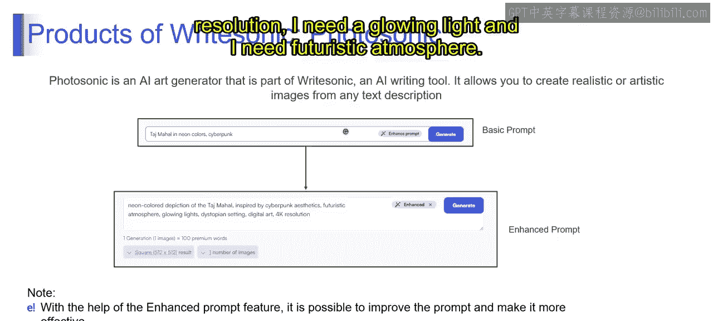
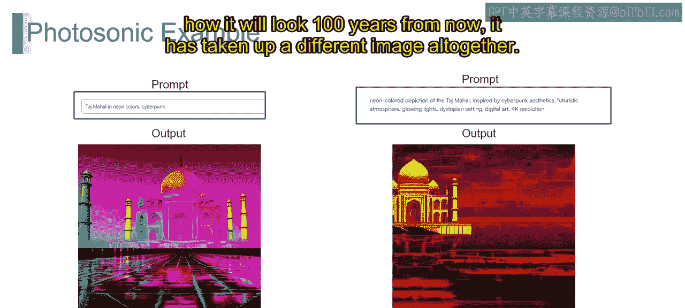
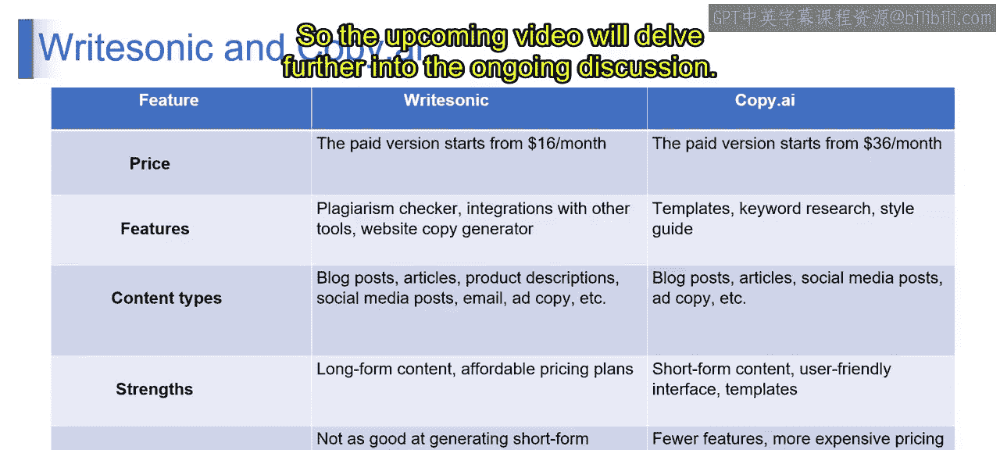

# Edureka《通过LLMs学习生成式AI（基础、应用开发、流行工具，第2、3、4课／共4课）｜Learn Generative AI with LLMs》中英 - P163：56_Writesonic产品.zh_en - GPT中英字幕课程资源 - BV1ym421V7gx

So let's now explore the progression from our previous discussion。😊。

Witesonic also has a concept called as photosonic as the name suggests it is for generating photos and I can use my basic promptm to enhance promptm which can make it more easier for me to generate the photographs but remember currently I only have thousand words as free it will take one image will take up at least the credit of 10 premium words so let's see the example over here so I have written down Tajmahal and neon colors by cyberpo。

I can enhance the prompt by writing it down in more specific that I need a4K resolution。

 I need a glowing life， and I need futuristic atmosphere。

The more clear you get， the more clarity it generates when it's generating the image。

 so you can see the output of both the commands is quite different。When we said neon colors。

 it has come out in a very beautiful neon colors， but when I said that I want it to be with glowing lights。

 future is thick and how it will look 100 years from now。

It has taken up a different image altogether so you can use all this creativity to use within rightsonic again。

 if I have to compare writesonic with copy AI which we covered little earlier rightsonic is at $16 per month copy dot AI is $36 per month flagarism checker integration with other tools and website copy generator is possible using writesonic copy dot EI has templates keyword research and style guide when it comes to the content type both of them are capable of generating blog post articles。

Product description add copies etc write Sonic can write long form content affordable in the pricing plan if you're thinking about short form content or use of friendly interface and templates copyro AI is a better option The weakness of right Sonic is it is not good at generating short form content hence only for long form content right Sonic is good copyro AI is more expensive when you think about generating long content So hence you should decide what type of content you want to generate and accordingly pick the tool。

So before I even go to the summary， let me just show you how does R Sonic look like so the upcoming video will delve further into the ongoing discussion。

