# Edureka《通过LLMs学习生成式AI（基础、应用开发、流行工具，第2、3、4课／共4课）｜Learn Generative AI with LLMs》中英 - P164：57_Writesonic界面.zh_en - GPT中英字幕课程资源 - BV1ym421V7gx

So let's now explore the progression from our previous discussion。

 so when I go to the Google and I type or Google or Bing and say rightsonic EI。

 you will get the website called us rightsonic。 Ei。

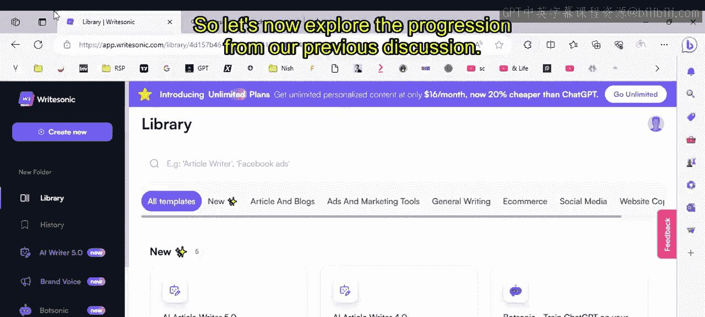

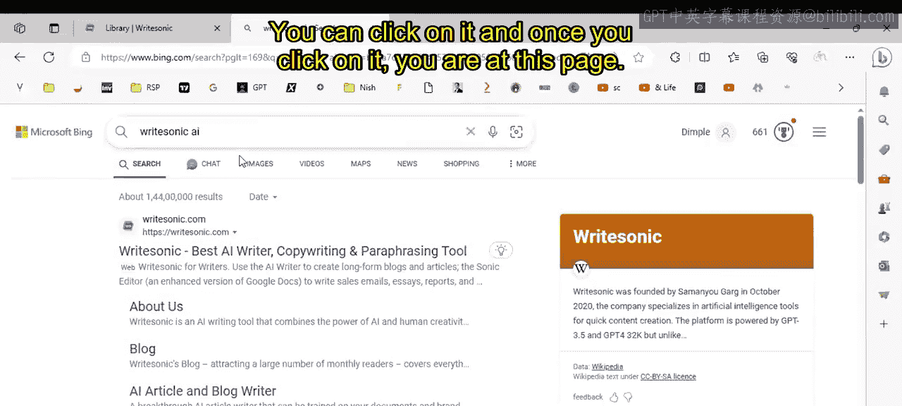

You can click on it and once you click on it you are in this page I have already logged in with my login IDvy and I'm inside it as I told you there are a lot of templates so AI writer AI writer 4。

0 bot Sonic。Chad Sonic same like chat GPT， so let's just try this first。

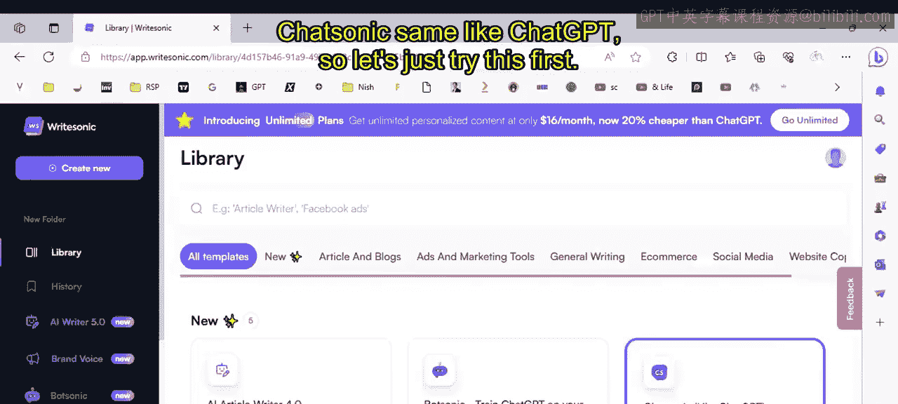

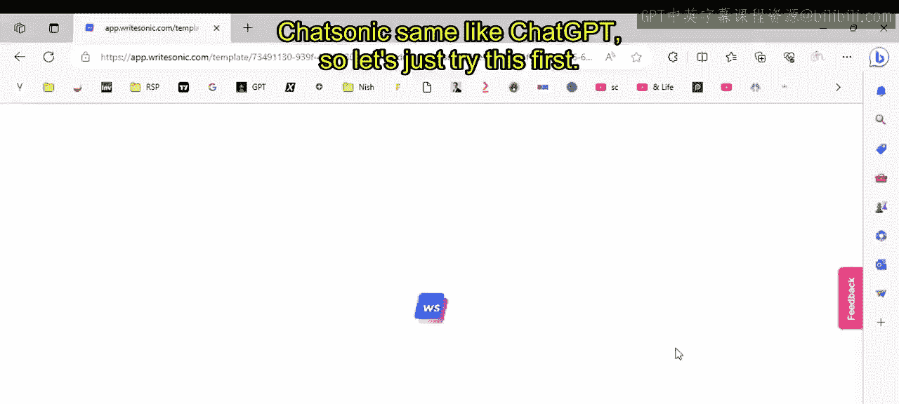

Yes， I click on this。😔，So you can see just like Cha GPT on the left hand side it has chats。

 I have already used few words because I have only 10，000 words that I can use for free。

And I can go ahead and ask the questions who won the Academy award in the latest one。

 So I'm just clicking on it in 2023， can I enhance the prompt once I click on it。

 it is rewriting the prompt for me It beauty with chat Sony is I don't have to write It will enhance the prompt So please provide the information of the amy award for the best original song winner in the year 2023 it is taken up0。

Characters from here。 I click on enter。 It is searching online because it is searching online2 x of the words will be gone。

 and I have clicked on search the latest Google data。

And enable memory right and it said not to not to whence the what are references it has picked up to generate this output has been very clearly given。

And for this output I have been charged few words， so if you are looking at some latest content which should be powered by Google。

 then you can go ahead and make use of chats now come back to the main page again in my library I have if I'm looking at writing some blog articles I can make use of AI article writer I can come here and type the topic that I want to talk about so let's say generative AI prompt engineering the minute I type this you will see and I search articles it will start searching those articles from the net so I have listed down it has listed on multiple articles and I can select any of them six skills you need to become an AI prompt Engine I can go ahead and click on getting started with prompt engineering This is a course from plural side。

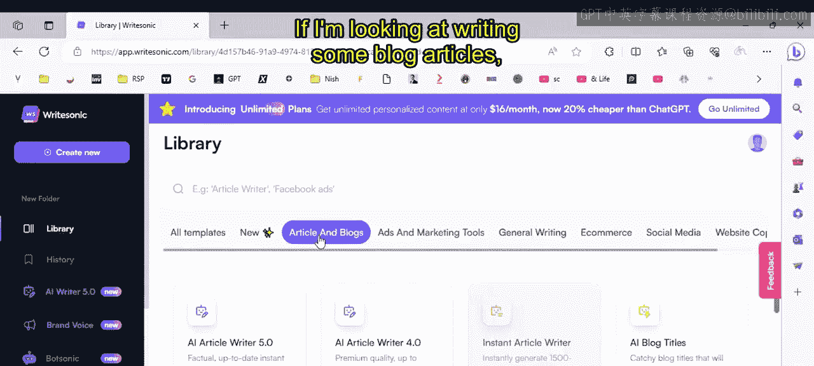

And I can do next。Now， it's trying to analyze my data。

And it has detected some words because it is trying to generate it right so currently I have a balance the reason I'm saying this initially maybe you are using the free words。

 that is why once I click on generate articles。

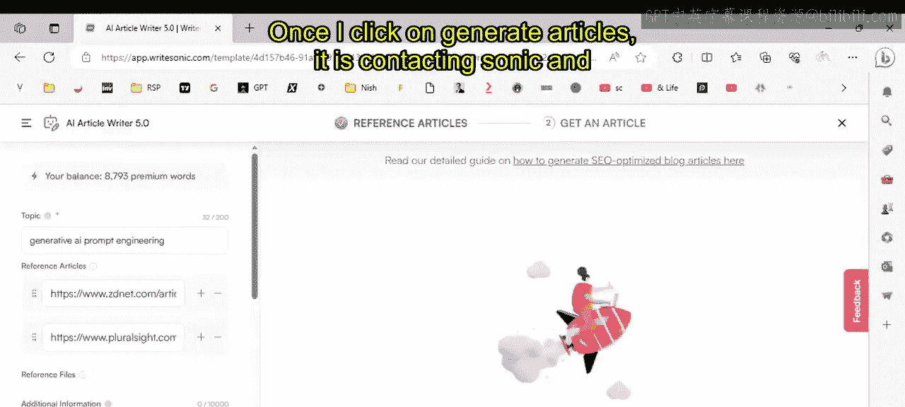

It is contacting Sonic and it is analyzing the articles。Yes， sweet says。

One third of the input words will be counted and it is decided that this is a total 1461 words will be counted as a confirm。

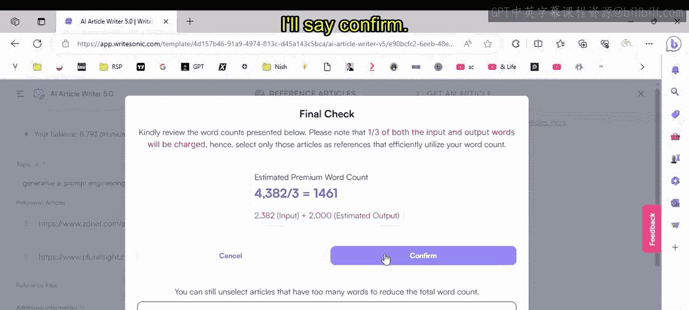

So it has started generating the output for me so it from where did it pick up the image what is prompt engineering prompt engineering can be defined as a process of creating an interaction with Geneative AI skills for AI prompt Engine understanding AI MLl and NLP defining problem statements and queries clearly so one of the core skills of an AI prompt engineering is the ability to clearly ask the prompt clarity is the key it has very clearly given me bullet points references to the other in link format it is using the paragraph style writing。

And it is generating text， which is making it very easy for me to generate the output， right？

I might decide patience and sense of humor， prompt engineering is like other fields requires patience and resilience。

 additional consideration for best practice。It's really thinking well to give the answer and we are at the conclusion stage。

 it has gone ahead and created the output for me。Congratulations。

 you can your scratch 50% officially use the product hand。Let's come back now what else can I do。

 I can take this article， share this document in a word format。

So I'm now downloading the output in a words format let me just show it to you so I don't have to sit and copy and paste it will automatically be done right and we can see very clearly my entire document has come out in a very easier format right so all the details have been properly prompted up now coming back what else can I do with right Soonic so let's go back to the main screen。

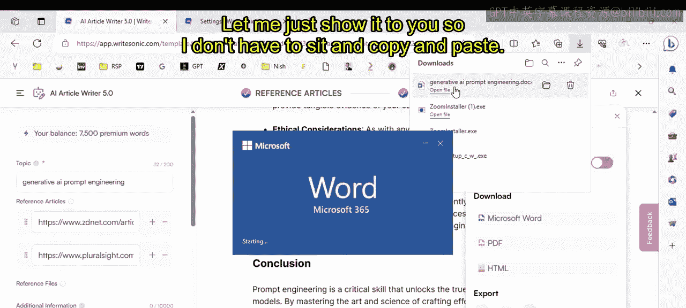

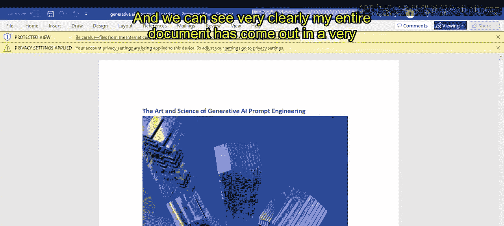

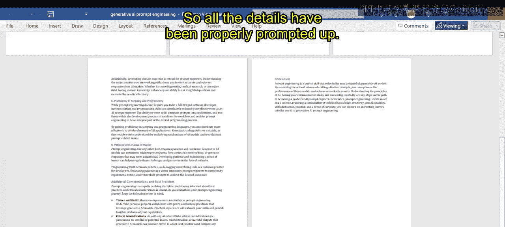

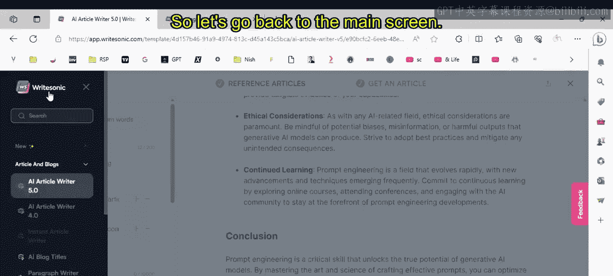

I have options of creating brand voice。 I can create my own bot。 I can create my photoson。

 So as I told you earlier， we saw the photograph of。Tj Maheel， in our exercise。

There are a lot of images which have been created and we can go ahead and use them if we want't or we can go ahead and create our own prompts to generate new images so give you a prompt over here and generate the image in Sa Sony we saw that we can ask questions and we'll get the answers。

So we have bots only， which can help you create bots within a minute。

So I can just come and click on create a new give the name of my bot a say continue okay because I'm on the free trial version only one bot is allowed you can upgrade to a free plan okay so I can go ahead and preview this bo What did I do I have used how can I help you I have used a data set to generate this bo I can ask questions relating to it for is data。

While creating this bot I actually uploaded document relating to data analytics and it is using words from my sheet。

 so that's the beauty of using the bot sonic because I can go ahead and train it on my sample data if I go ahead and see on the top the settings。

I can go ahead customize it to show what it is possible so I can change the color visit positioning colors etc The inbox talks about all the service that I have executed the subscription embedding about the things and analytics let me just hide this analytics talks about the different analytics how many words were used how many messages were given and so on let's go back to our write Sonic again so you can see I have options to write brand voice boards chats photos if I'm very clear that I want to create addd copies for marketing tool I can come here and start using it What if I want to create a Liedin ad I can come here give my document name write the words。

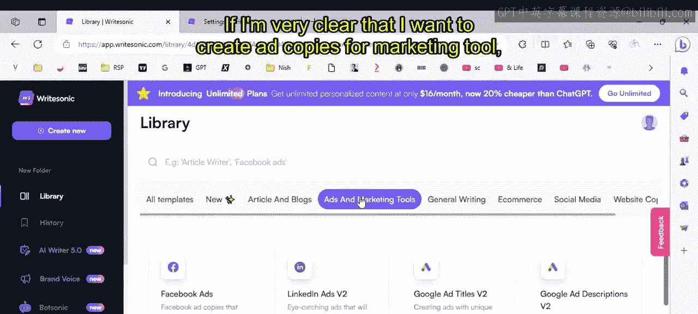

Descriptions， some keywords， and I can go ahead and generate it。

 So the option for you are unlimited with ride zoning。

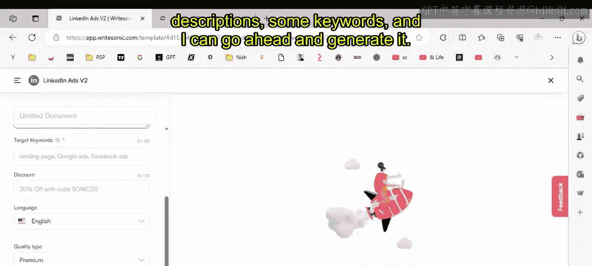

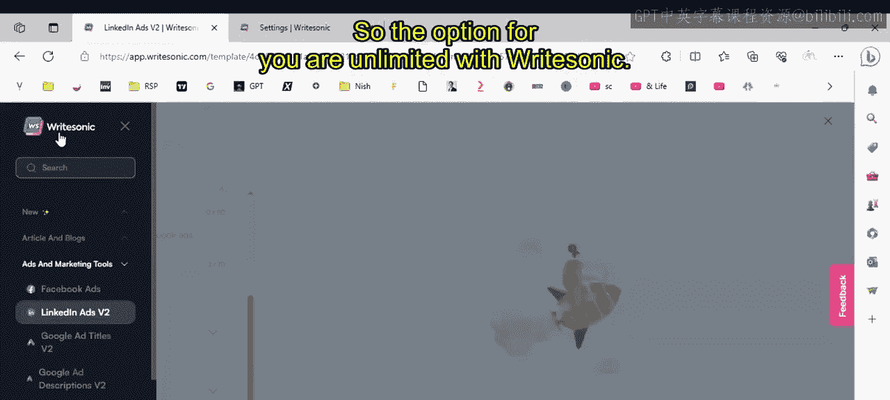

My invitation to you is go ahead and leverage this tool， you have ecommerce。

 you have general writing， you have social media post， Twitter， social media content， LinkedIn。

 Instagram caption， and if I scroll down you will find that I have Twitter YouTube intros hooks。

Picktok YouTube out YouTube titles I can decide my landing page SEO metada call to action features of benefits and so on so it's a very good tool for you to explore and if you find it beneficial you can go ahead and decide to pay the subscription and leverage it what I have found personally is that all the AI tools are really worth the money that you spend on them。

Because it's increasing your productivity much more than the amount we are spending on this This is my opinion at then the call is yours Thank you so much。

 I will see you in the next class。

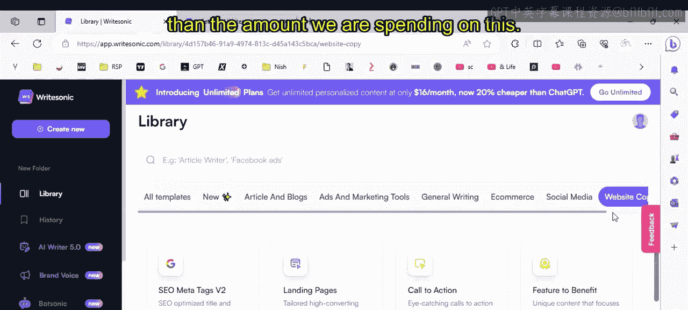

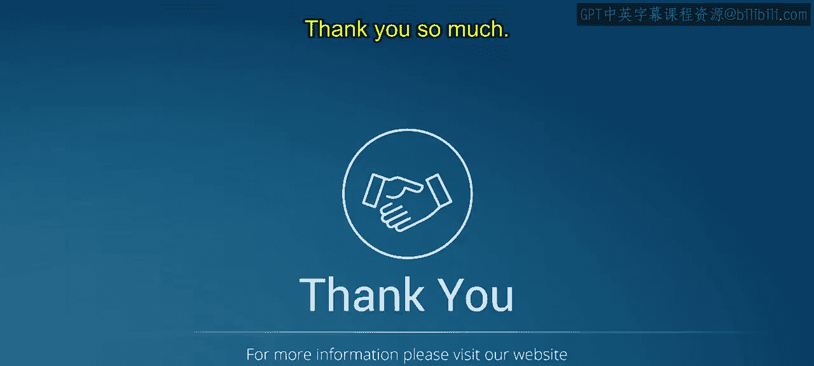