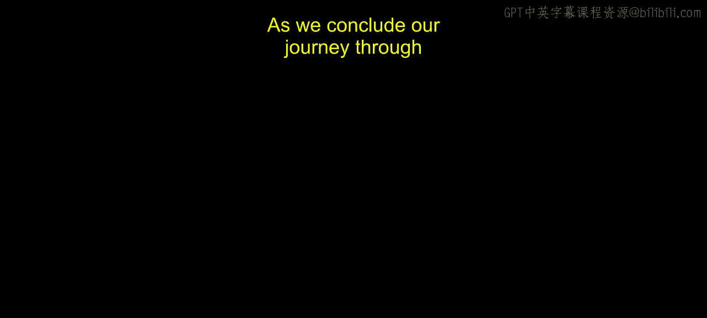
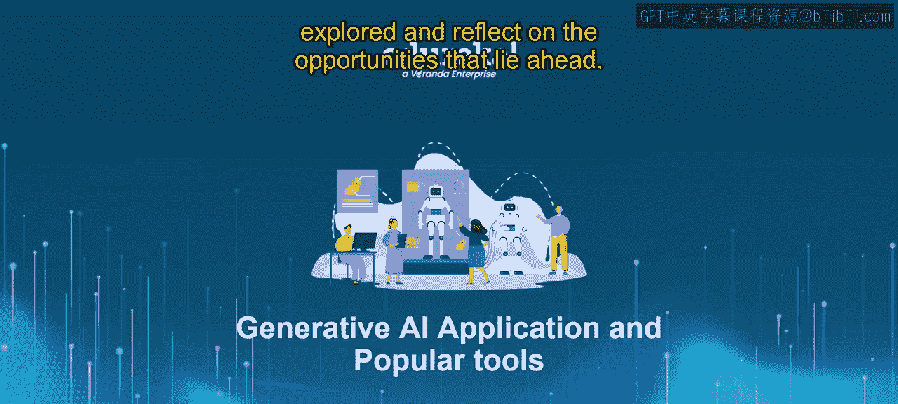
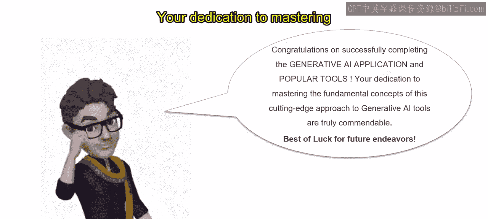

# Edureka《通过LLMs学习生成式AI（基础、应用开发、流行工具，第2、3、4课／共4课）｜Learn Generative AI with LLMs》中英 - P165：58_课程完成视频.zh_en - GPT中英字幕课程资源 - BV1ym421V7gx

As we conclude our journey through generative AI applications and popular tools。

 let's recap the key topics we have explored and reflect on the opportunities that lie ahead。

We kicked off our course by understanding the foundational concepts of generator AI and its profound impact on marketing analytics。

 We then delved into the fundamentals of generator models。

 learning how they generate new data instances based on patterns learned from existing data under data preparation for generator AI in marketing。

 We learned the importance of data preparation in ensuring the accuracy and effectiveness of generator AI models in marketing analytics。

Under applications of generative AI in marketing analytics。

 we explore diverse applications of generative AI from personalized content creation to predictive analytics and creating automation in marketing strategies Under implementing generative AI models in marketing analytics lesson。

 we gain hands-on experience in implementing generative AI models。

 enabling us to optimize marketing campaigns and drive business growth through real world case studies and practical examples。

 we witnessed how leading organizations are leveraging generative AI to achieve marketing success。😊。

Under future trends and emerging technologies， we looked ahead to future trends and emerging technologies in geneative AI。

 preparing ourselves to stay ahead of the curve in the dynamic field of marketing analytics。😊。

Finally， we wrapped up each module with the comprehensive assessment of our learnings。

 ensuring that we are well equipped to apply generative AI principles in real world marketing scenarios。

Completing this course opens up a myriad of exciting opportunities。

 whether it's implementing cutting edge marketing strategies。

 exploring new career path in AI driven marketing analytics。

 or pursuing further education and research in the field， the possibilities are endless。😊。

Congratulations on successfully completing the course on Generative AI's application and marketing Ana。

 your dedication to mastering these fundamental concepts is truly commendable。😊。

Best of luck for all your future endeavors， remember the world of Gene AI and marketing analytics is full of possibilities and I can't wait to see where your journey takes you。

😊。

