# Edureka《通过LLMs学习生成式AI（基础、应用开发、流行工具，第2、3、4课／共4课）｜Learn Generative AI with LLMs》中英 - P16：15_借助ChatGPT进行探索性数据分析.zh_en - GPT中英字幕课程资源 - BV1ym421V7gx

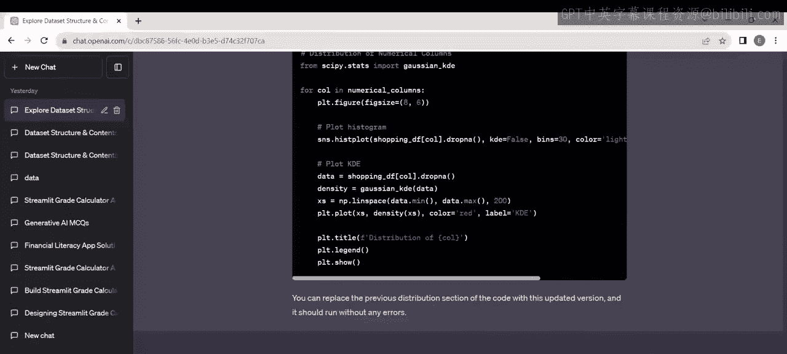

Hello everyone welcome back Now if you are going for the individual stepile strip you can even go with that but it will take so much of time so in order to consider the time efficiency end all now I am asking my chat GT to provide the end to end code for E analysis with the provided data set I want to execute it in a Jupyter notebook I am clearly telling this and click on enter let's see what it is going to generate。

😊。

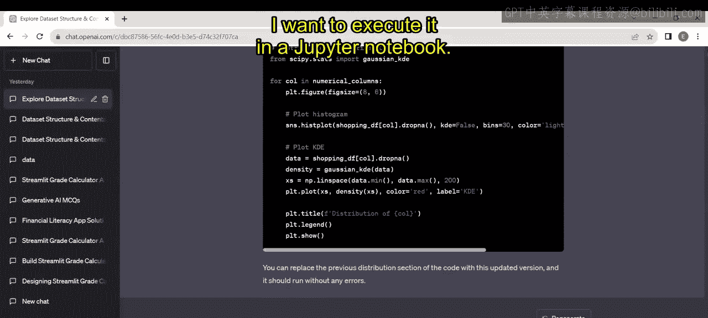

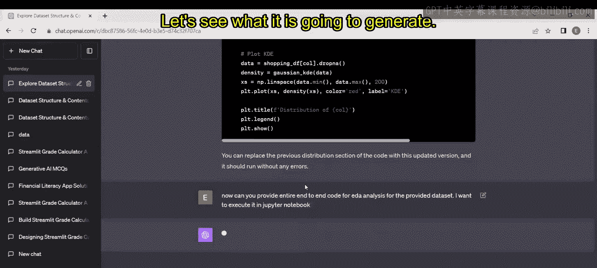

Now that you can see it has generated quote n to n。

 let's copy this and go back to your Jupiter notebook。😊。

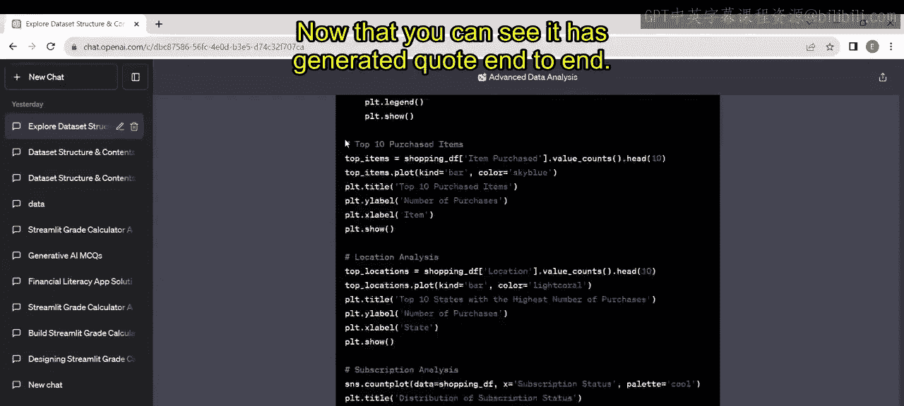

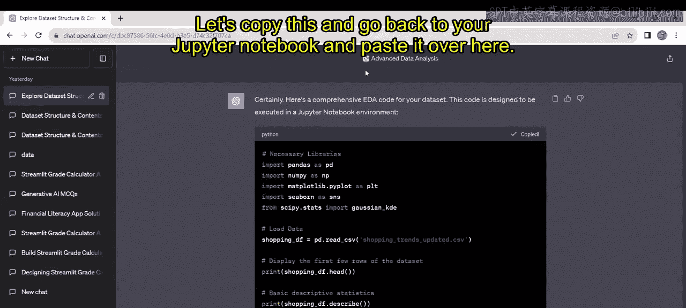

And paste it over here。 And this。You will have to notice that。😊。

We will have to change the path over here。I'm changing the path。

I know that the data set is in this location， so Im giving this， let's click on enter。

Let's see what we are going to get。 It started executing。

 It is providing me some warning panda's required version。 Okay， it's a warning。 That's all right。

 Now you can see。😊，The output of your E everything like null values， outliers。

 distribution of individual columns， numerical columns you can see distribution of previous purchases and also topped1 purchase items and top 10 states with the highest number of purchases and distribution of subscription status and distribution of size preferences and top1 popular colors and distribution of review ratings and distribution of frequency of purchases and frequency of purchases with the different plots and average purchase amount by gender now we are getting some error message let's see okay so it is providing me the color map error that's okay so let's copy this error and go back to your tragedy and paste this error message。

😊。

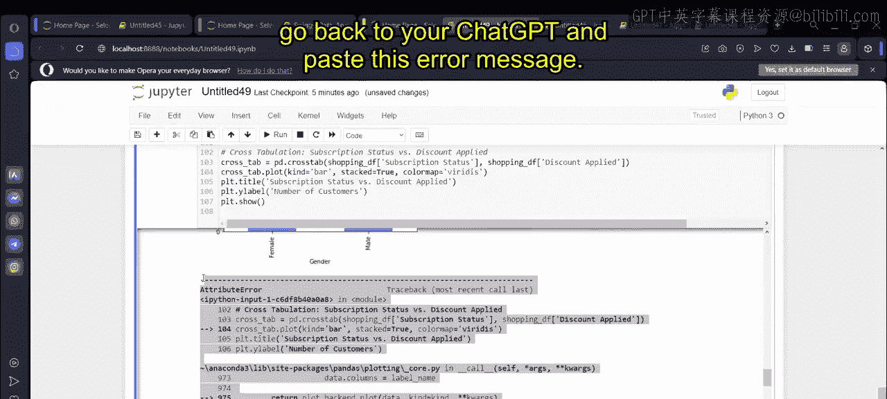

Now it will start generating the solution for you。

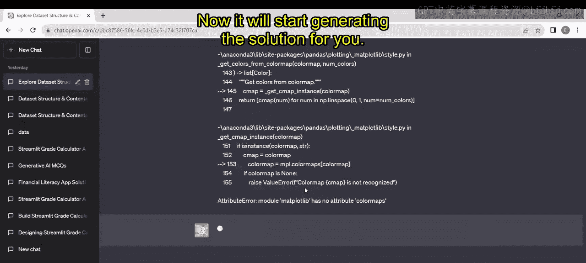

Now lets see what it is suggesting， it is telling it seems there is an issue related to the color map handling in the specific version of the pandas library。

 so it is telling replace the line with us lets see what we are going to get I am opening my Jupiter notebook。

😊。

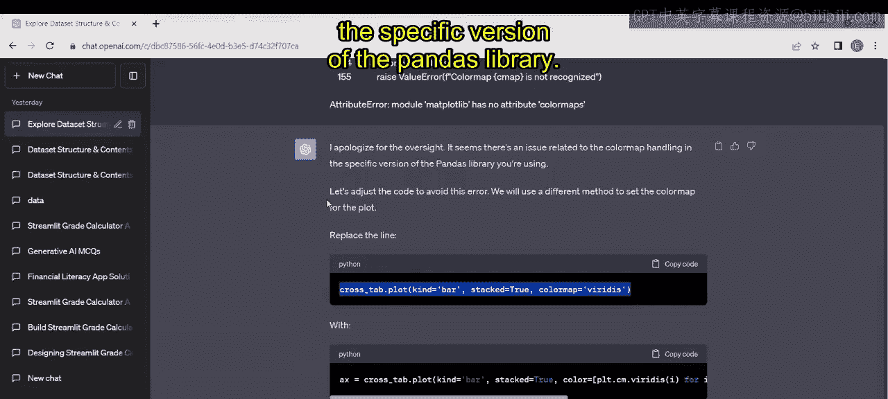

And now you can see this is the line。 Now， I want to replace those width。😊。

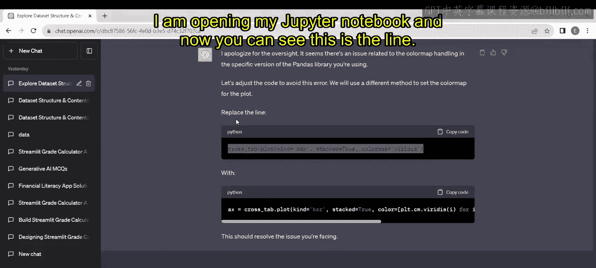

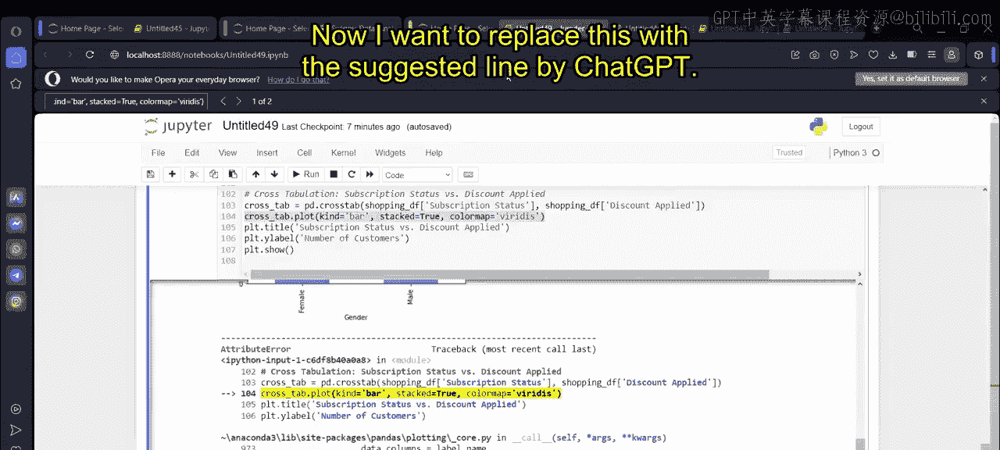

The suggested line by Chadgiputy。I'm going back here。

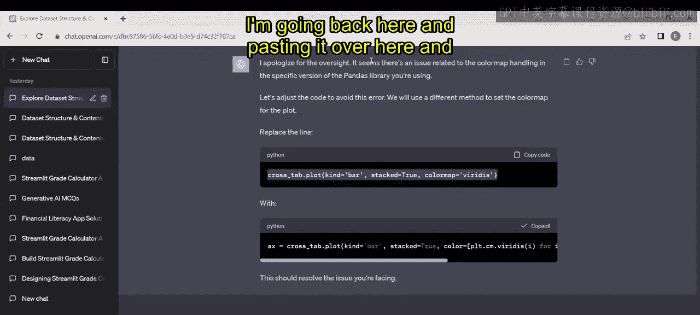

And。Pasting it over here and let's click on enter Now you can check the output。

It started generating everything again， distribution of previous purchases and review rating。😊。

And top 10 purchased items and top 10 states with highest number of purchases and distribution of subscription status and distribution of size preferences and top 10 popular colors and distribution of review ratings and distribution of frequency of purchases。

😊，Then pairvis relationship of numerical columns。 Now you can see the plot an average purchase amount by the gender male and female subscription status versus discount applied。

 so now you can see entire E step by step now that you are good with the coding。😊。

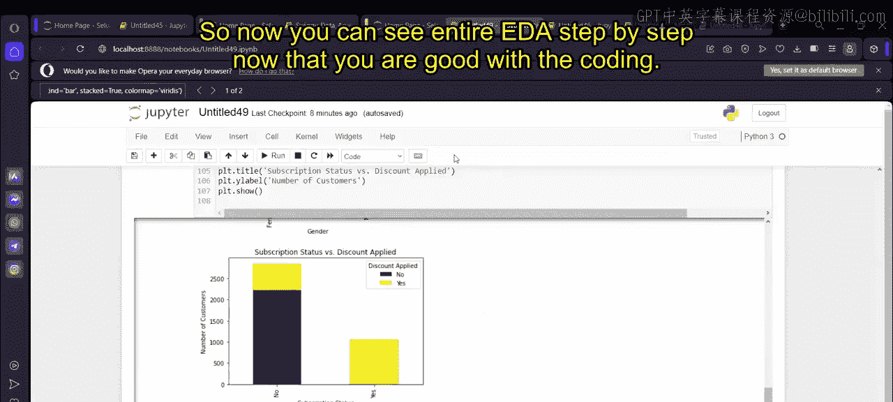

Now， I am asking my chagiputy， could you please provide me the key takeaways。😊。

From the E analysis now I am asking my Cha Gp。 could you please provide me the key takeaways from the E analysis and let's click on enter。

😊。

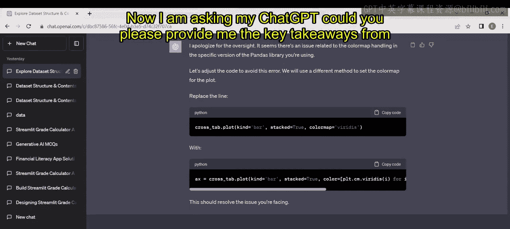

Let's see what it is going to generate。😊。

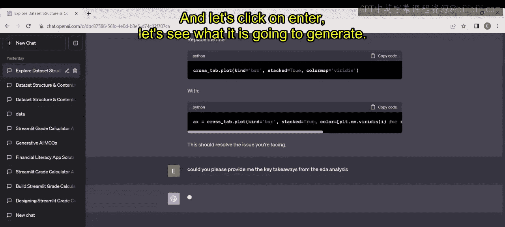

So now that you can see the key takeaways from the E analysis。

 it is providing the data structure machinecin data numerical data distribution and top purchased items。

 location analysis subscription analysis and size and color preferences and review ratings and everything it is filling these are broad key takeaways and the depth of the insights can be expanded further with more indep analysis。

 hypothesis testing or by integrating external data sources the primary goal of E is to understand the data structure identify anomalies or outliers and find patterns which can then be used to inform further analysis modeling and business decision Now I am good with the conclusion of the analysis Now I am asking my charge based on our insights what marketing or sales strategies do you recommend Let's click on enter Let's see what it is going to。

😊，And。Now， that， you can see。It has provided the solution， based on my question。

It is providing it is providing the sales strategies。

 It is telling targeted marketing for middle aged customers and loyalty program focus on popular items and expand in high sales states and tailored inventory and engage occasional buyers and enhance the review system。

 Genspec marketing， discount strategies， engage with infrequent buyers and feedback loop and expand digital presence。

 At the end， it is telling implementing these strategies can potentially boost sales enhance customer satisfaction and improve overall business performance。

 However， it's essential to continuously monitor the results and adjust strategies based on real world outcome and changing market conditions。

 Now I am asking my chagity。 What potential future analysis or data sets could enhance our understanding of shopping runs。

 Let's click on enter and see what it is going to generate now that。😊。

can see it has provided the output for my question What potential future analysis or data sets could enhance our understanding of shopping trends Now you can see it has generated time series analysis customer segmentation market basket analysis and data set to construct and these all are the suggestions that it is given at the end it is telling by integrating and analyzing these additional data sets and conducting the suggested analysis business can achieve a more holistic understanding of shopping trends make data driven decisions and tailored their strategies for optimal outcomes that's a beauty Now you can witness the incredible power of tragedyg it has effortlessly generated a detailed analysis report for our data all without us having to write a single line of code。

 it even drawn powerful conclusions and efforts。😊，And also offers valuable business suggestions this showcases the true beauty of performing data analysis using the plus version of ChagbT where complex tasks are made simple and inside flow effortlessly in a summary we can say that in our data analysis journey with Chag+ we have seen the remarkable capabilities of automated analysis and report generation it's a testament to the simplicity and efficiency of leveraging the tool for data driven inside that's about the demonstration of exploratory data analysis Thank you。

😊。

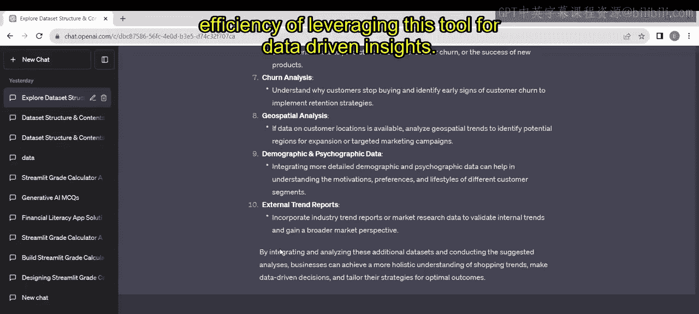

