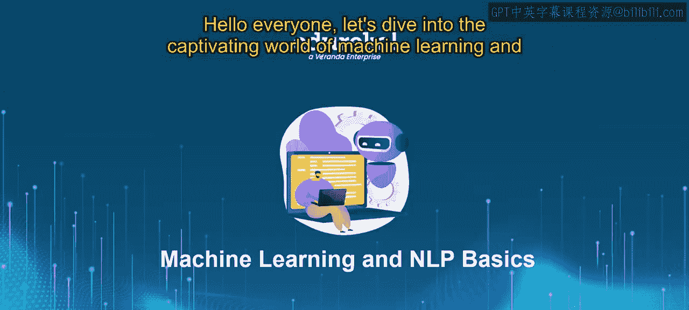
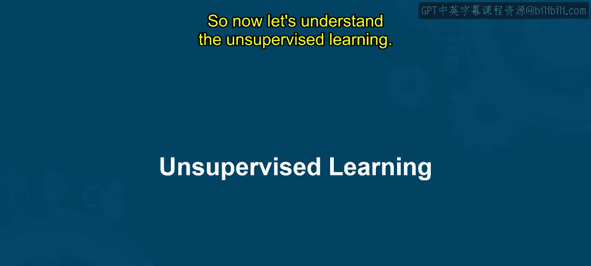
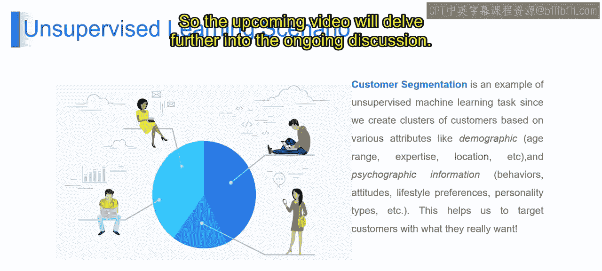

# Edureka《通过LLMs学习生成式人工智能（机器学习和NLP基础，第1课／共4课）｜Learn Generative AI with LLMs》中英字幕 - P16：15_无监督机器学习的市场细分策略.zh_en - GPT中英字幕课程资源 - BV1q4421Q7qh

Hello everyone， let's dive into the captivating world of machine learning and the foundational concepts of NLP together。

 So now let's understand the unsupervised learning in this we are going to cover what is market segmentation strategies and introduction to supervised learning and applications of supervised learning by the end of the session you are able to understand and explain market segmentation and criteria for segmenting markets。

😊。

And you are able to describe unsupervised learning basics and differentiate from supervised learning and you are able to utilize unsupervised learning to identify customer segments in market segmentation so let's get started market segmentation strategies first of all So what exactly it is imagine you are planning a party and you want to group your friends into smaller。

 more similar groups to plan activities that everyone will enjoy this will like market segmentation where companies group their customers based on similarities to better understand their needs and preferences means market segmentation strategies a concept in business involving dividing the customers into smaller。

 more similar groups used unsupervised learning techniques like clustering algorithms companies can automatically group customers based on。

😊，Shared characteristics or the behaviors such as purchase history or demographics without needing the predefined labels。

 This helps companies tailor their marketing strategies to target the specific customer segments more effectively leading to better customer satisfaction and business outcome。

 For example， think of a large group of people at the theme park。 Some are elders。

 Some are younger and some are children and some are others。😊。

So customer segmentation is like grouping these people based on their age ranges means technically customer segmentation is a crucial strategy in business involves categorizing the customers into groups based on common characteristics as they mentioned age preferences。

 buying behavior using unsupervised learning methods like clustering algorithms。

 We can group the customers without predefin labels。😊，But how does it work， So first of all。

 we need to collect data like companies gather the data on their customers。

 which may include demographics， as I mentioned， age gender purchasing behavior like what kind of products did they buy and frequency of purchases frequency of purchases。

 interactions with the website visit social media engagements and any other relevant information That is about the data collection。

 Then the next one is of feature extraction from this data。

 companies extract relevant features that can help distinguish one customer from another for example。

 age spending habits and prefer products could be important features for segmentation then coming to the clustering So using the unsupervised learning techniques like clustering algorithms example came in clustering the data is grouped into clusters based on similarities in the chosen features each cluster represents。

😊，A segment of customers who shared similar characteristics。

 then once after we perform the clustering， we need to perform the segment interpretation means companies analyze the characteristics of each segment to understand the unique traits and behaviors of the customers within them which helps in identifying patterns and trends that can guide the marketing strategies then the next one is that strategy development So based on the insights gained from the segment companies develop targeted marketing strategies for each segment this could include personalized promotions tailored product recommendations or communication strategies designed to resonate with the specific needs and preferences for each segment Once after we perform strategy development we need to work on the implementation and evaluation means the segmented marketing strategy。

😊，are implemented and their effectiveness is monitored and evaluated over the time means companies track key performance indicators。

 that is nothing but Kpis such as sales， customer satisfaction and engagement mattresses to assess the impact of their segmentation efforts。

 segmentation efforts and make adjustments as needed means overall customer segmentation allows companies to better understand and engage with their diverse customer base by grouping them into meaningful segment and tailoring their marketing efforts accordingly。

 This leads to improve customer satisfaction， loyalty and ultimately business success。

 So the upcoming video will delve further into the ongoing discussion。😊。

