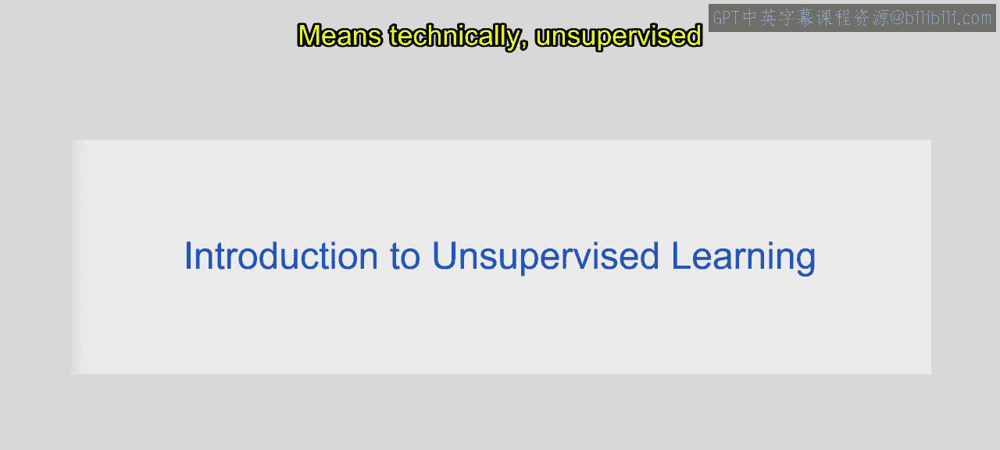
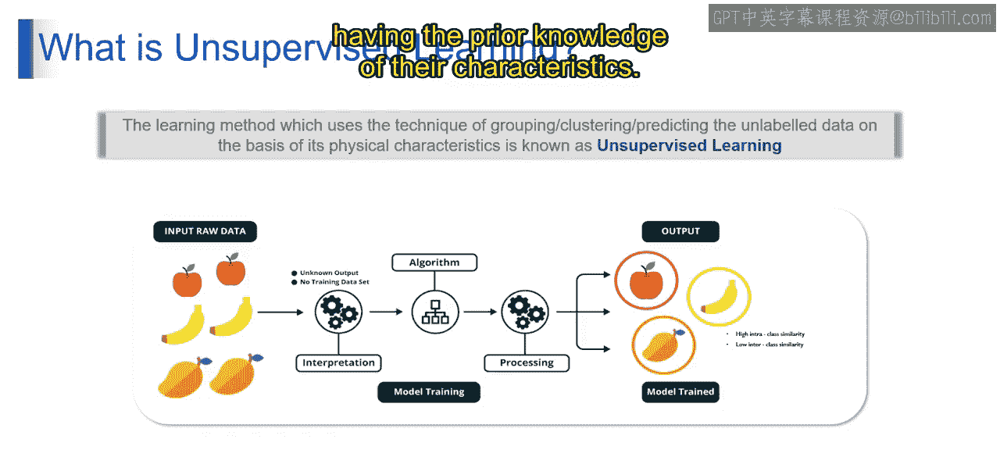
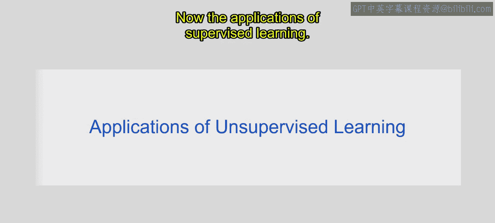
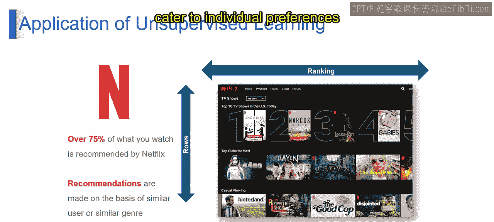
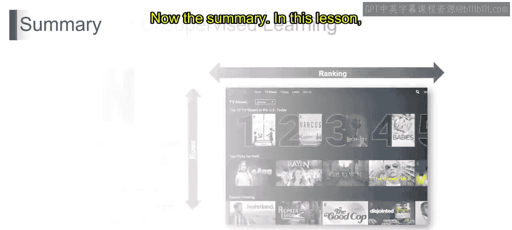
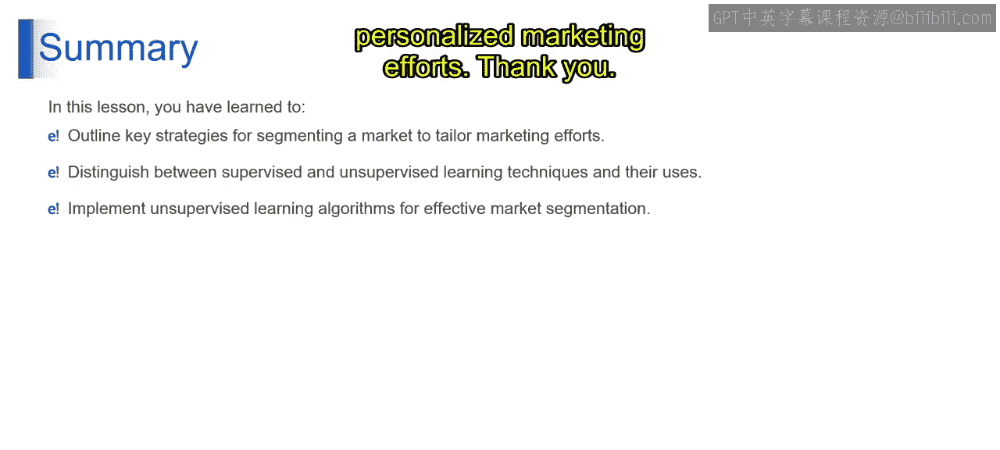

# Edureka《通过LLMs学习生成式人工智能（机器学习和NLP基础，第1课／共4课）｜Learn Generative AI with LLMs》中英字幕 - P17：16_无监督机器学习介绍.zh_en - GPT中英字幕课程资源 - BV1q4421Q7qh

So let's now explore the progression from our previous discussion。

 so now let's understand based on all these factors what exactly a unsupervised machine learning is all about so considering the other example imagine you are organizing a photo album but you are not sure how to group the pictures so unsupervised learning is like a magic sorting the computer looks at all the photos and automatically groups similar ones together without you telling it how to do it for instance it might group all the beach photos in one file and all the mountain pictures in the other means technically。

😊。

Unsupervised learning is a type of machine learning where the algorithms learns to find the patterns and structures in the data without explicit supervision or labeled examples。

 it does this by identifying similarities or relationships between the data points and grouping them into clusters or detecting underlying patterns This allows firm exploratory analysis and understanding for complex data sets without predefined labels facilitating tasks like clustering dimensionality detection and anomaly detection。

 So that is all about the unsupervised machine learning。

 So now let's understand this example with the input raw data as some fruits they are not labeled here in our example we start with raw data consisting of different types of fruits as we know that they are apple。

 banana and mango。😊，But the model will not understand because they are not labeled here then the next part is interpretation in unsupervised learning there is no predefined output or labeled data we are dealing with the unlabeled data so the algorithm does not know the categories or the types of fruits in advance then it will perform the next step is going to be the model training so we can use an unsupervised learning algorithm such as clustering algorithm to process the raw data the algorithm analyze the physical characteristics of the fruits such as the shape size color and even the texture to identify the patterns or the similarities between them then it will perform the processing step means the algorithm processes the data and identify the natural groupings or clusters based。

😊，On the similarities observed， for example， it might group together roots that are round and elo into one cluster and fruits that are elongated and grained into other cluster and so on means based on this understanding the model will get trained after processing the data the model is trained in the sense that it has learned to recognize the patterns and grouping in the data without any explicit labels or the guidance then the segregating the output。

 Finally， the algorithm segregates the output by assigning each fruit to its corresponding cluster or group based on its physical characteristics this allows us to understand the inherent structure of the data and identifying the similar items without having the prior knowledge of the characteristics Now the applications of supervis。

😊。

Duringning？So applications involves customer segmentation。

 anomaly detection and image and document clustering。

 market basket analysis and dimensionality reduction and clustering in healthcare and even recommendations systems here in our example we are showing the recommendation systems as Netflix it makes recommendations。

 So how exactly it will work first of all， it will understand the similar user recommendations Netflix analysis the viewing history and preferences of millions of the users to identify the patterns and similarities in their behavior。

 For example， if you enjoy watching action movies and documentaries then Netflix will recommend other titles that users with similar taste have enjoyed this personalized recommendation approach ensures that you are presented with the content that aligned with。

😊，interest and viewing habits then it will work on the similar gender recommendations In addition to considering the individual user preferences Netflix also recommends content based on general similarities for instance。

 if you have watched several science fiction movies or TV shows Netflix may suggest other titles within the same gene this approach broadens the scope of recommendations by introducing users to content they may not have discovered otherwise but which align with their general interest overall Netflix recommendations system leverages unsupervised learning techniques to analyze user behavior and content characteristics enabling it to deliver personalized recommendations that cater to individual preferences and enhance the overall viewing experience Now the summary in this lesson。

😊。

You have grasped the market segmentation strategies for the targeted marketing and differentiate between the supervised unsupervised learning techniques。

 Additionallyly， you have effectively understood the unsupervised learning algorithms in market segmentation tasks enhancing personalized marketing efforts。

😊。

Thank you。