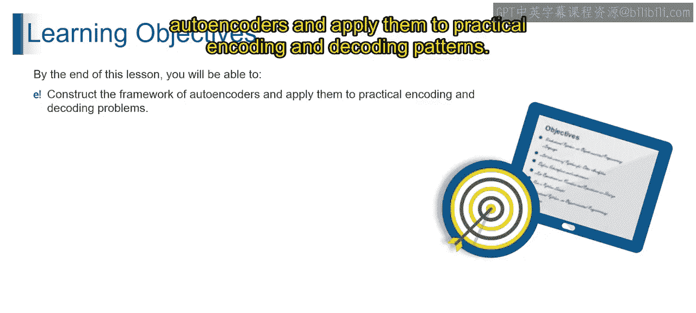
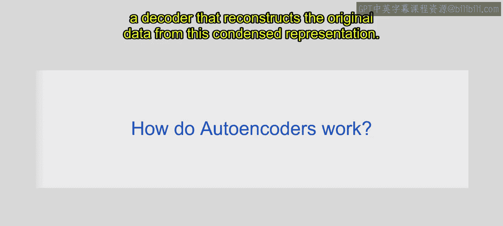
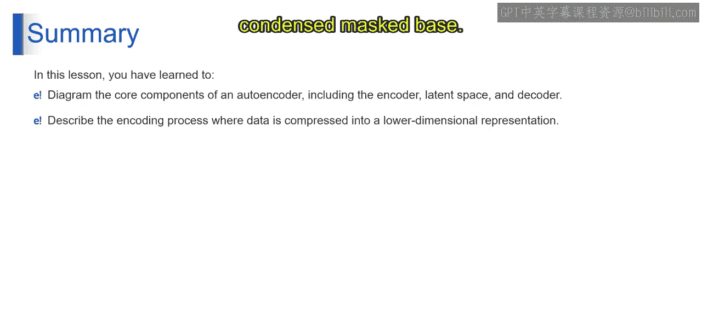

# Edureka《通过LLMs学习生成式AI（基础、应用开发、流行工具，第2、3、4课／共4课）｜Learn Generative AI with LLMs》中英 - P17：16_自编码器的工作原理.zh_en - GPT中英字幕课程资源 - BV1ym421V7gx

Hello everyone welcome to generative AI foundations So now let's understand working of auto encoders in this we are going to cover what or auto encodes and how do they work by the end of this lesson you are able to constructstrict the framework of auto encoders and apply them to practical encoding and decoding patterns so let's get started first before understanding how do they work let's understand first of all what or auto encoders so imagine you are a student trying to remember a long and detailed story to make it easier you decide to write a summary capturing the essential details this summary is like the encoded representation in an auto encodeder containing the crucial information in more condensed format means in technical understanding auto encoders are a type of neural network designed to compress and then re。

😊。

Construct the input data， much like a student summary。

 They consist of an encoder that compress the input into a reduced dimensional representation and a decoder that reconstructs the original data from this condensed representation。

 So now let's understand how do auto encoders work。 So as I mentioned。

 the were by learning to compress and then reconstruct input data in a way that captures essential features。

 They consist of two main components。 One is encoder and the other one is decoder。

 So this is the pictorial representation of how auto encoders works。 So first of all。

 it will take the input data。 So this is the initial data that you want the auto encodeder to process。

 For instance， if you are working with the images。 the input could be a collective of pixel values representing the image information。

 that should be the image data。 Now next。

It will be sent to the encoder。 Okay， let's take the other example。

 Think of it as a magic trick that transforms your stuff into smaller。

 more manageable form So the journey So just imagine you are packing for your weekend getaway you start with a big suitcase representing your detailed belongings which in our tech talk is like the original input data whatever we are giving now enter the encoder。

 this is your magical packing assistant here the encoder is like your packing assistant deciding what to take and what to live behind for your weekend getaway trip in this the auto encoder the encoders take the input data which is nothing but your weekend essentials and maps it to the latent space。

 which is nothing but again a lower dimensional representation that is nothing but the latent space or encoding layer。

😊，Of neurons， your packaging strategy。 So imagine you are strategically placing items in your suitcase layer by layer to optimize the space within the net。

 The encoder consists of layers of neurons or the nodes that progressively reduce the dimensionality of the input data。

 Each layer extracts increasingly abstract and highleve features from your belongings。

 It's like deciding which items are essentials for the trip。

 So here we represented the same one means you are not just throwing everything in。

 you are carefully selecting the essential items like clothes and snacks and whatever it is。

 So means in the technical terminology。 each layer in the encoder extracts increasingly abstract and high level features from the input data。

 It's like peeling of layers of details， keeping only the essential elements。😊。

That represent your belongings in a more concise manner。

 this encoder is like a strategic packing assistant for your data deciding what features to keep it maps the input data to the lower dimensional representation which is nothing but the latent space by progressively reducing the dimensionality each layer extract more abstract and high level features simplifying the representation just like efficiently packing for a trip the encoder's role is crucial for learning efficient representation of data in the auto encoders so now let's understand the second one that is latent space。

😊，So think of it as a compact suitcase so here is the representation。

 This is a latent space so where you have distilled the essence of your belongings for this trip from the input to the encoder and then to the latent space so remember our we getaway packing so after your packing assistant from the encoder strategically decided what to take you now have a compact suitcase that is nothing but the latent space here it's like having the condensed version of your essentials So in technical understanding the latent space is like the compact suitcase holding the most crucial items for your trip means the latent space is the reduced dimensional representation of the input data created by the encoder in concise distilled version capturing the essence of your belongings。

😊，Now， the dimensions representing the features， each pocket or the section in your suitcase represents a specific category of items in the latent space。

 Each dimension represents a learned feature or characteristic of the data。

 It's like having different sections in your suitcase for the clothes and snacks。

 So in case if you want to keep the essential information means less redundancy。

 you have removed under3 items keeping only whats essential fi trip by encoding data in the latent space。

 auto encoders can capture essential information while reducing redundancy from this。

 It's like distilling your belongings， making your suitcase more efficient。

 less cluttered means the latent space is a condensed representation created by the encoder。

 each dimension in the latent space represents。😊，Learned feature of characteristics of the provided input data。

 It captures the essential information while minimizing the redundancy。

 making it an efficient and meaningful representation。

 similar to having a wellpack suitcase ready for any trip the latent space in auto encodecoder calls a concentrated form of essential data。

 So now let's understand the decoders。 So upon reaching your destination of your trip。

 you unpack and reconstruct your belongings from the condensed suitcase。

 your aim is to recreate the original set as closely as possible means the decoder。

 this decoder takes the information from the latent space and reconstruct the original data。

 It attempts to faithfully reproduce the input based on the compressed representation。

 It's like unpacking the phase of your trip where you strive to。

We createate the original magic from your well packed packed suitcase。

 So the decoder is like an expert unpacker， recreating your belongings from the compact suitcase means in the auto encoders。

 the decos take the encoder representation from the latent space and attempts to reconstruct the original data。

 It's the phase where we aim to bring back the details we packed in the initial phase。😊。

Similar to the encoder decoder consists of layers of neurons。

 each layer works to progressively reconstruct the original data。

 adding details with each step means here your goal is to recreate the magic of your wellpack case ensuring nothing is missing and misplaced the decoder's primary goal is to generate the data that closely matches the input data。

 whatever we have provided it strives to reconstruct the original details capturing the essence of the initial input means the decoder is like an expert unpack working to recreate the original data It takes the encoded representation from the latent space and adds details to the details layer by layer the goal is to generate reconstructed data that ideally resembles the original input data just as you unpack to recreate the comfort of your belongings at your desk。

The decoder in auto encoders aims to bring back the essence of the input data。 Now， finally。

 the output。 this is the final result generated by the auto encoder after reconstruction process。

 Ily， it should closely resemble the input data。 and now the summary。

 So we have uncovered the magical trial encoder latent space and also the decoder。

 the encoder are packing pro condensed your belongings into a compact suitcase a latent space。

 then comes the decoder。 your unpacking expert working hard to create the original magic。

 Imagine it like a suitcase journey packing compacting and then unpacking to bring back the essence of your belongings。

 So we have learned the art of encodecoding， turning detailed data into condensed masterpiece。

 Thank you。

