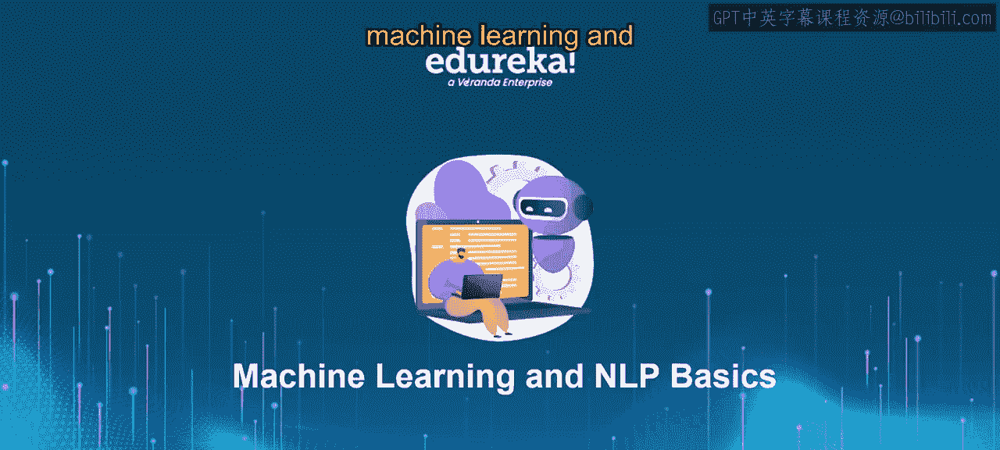
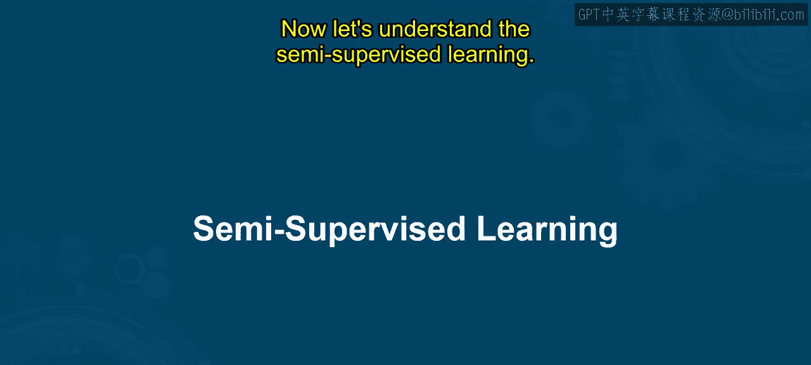
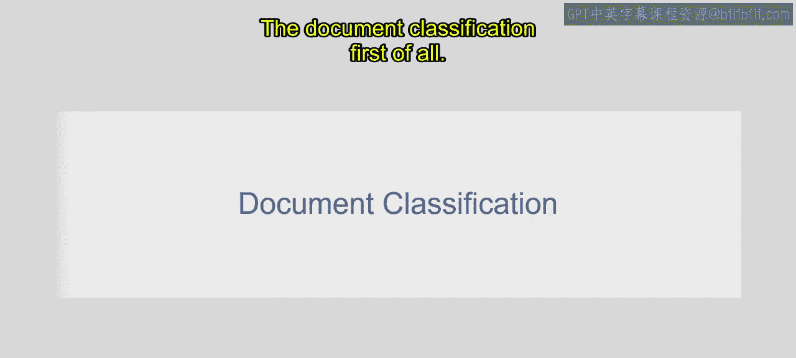
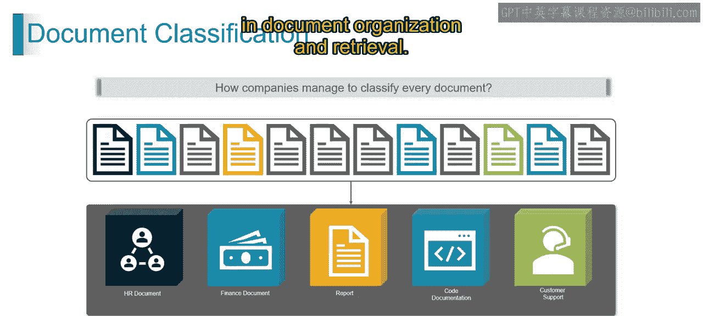
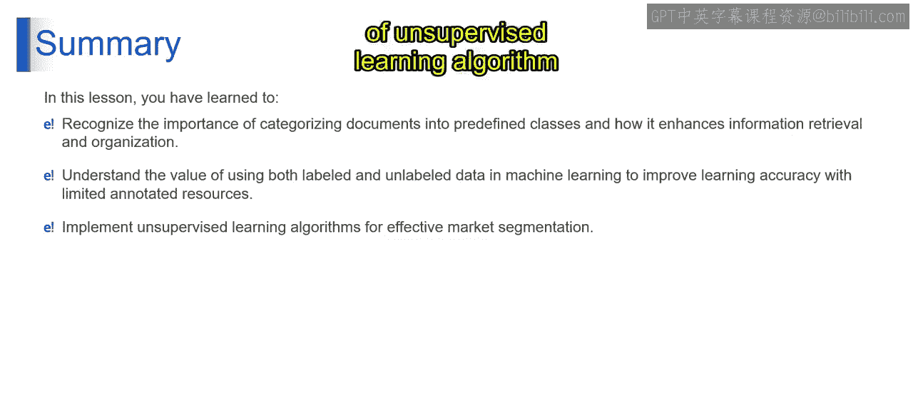

# Edureka《通过LLMs学习生成式人工智能（机器学习和NLP基础，第1课／共4课）｜Learn Generative AI with LLMs》中英字幕 - P18：17_半监督学习.zh_en - GPT中英字幕课程资源 - BV1q4421Q7qh

Hello everyone， let's dive into the captivating world of machine learning and the foundational concepts of NLP together。

 So now let's understand the semiupervised learning in this。

 we are going to cover the document classification an introduction to semiupervised learning。😊。

And then applications to semisupervised learning By the end of the session。

 you are able to classify the documents using appropriate techniques and summarize semiupervised learning principles and implement semiupervised learning for document categorization so let's get started the document classification first of all so here we have an example imagine you are organizing a messy files of documents。

 some with the labels indicating the type like HR finance report core recommendation and customer support while others are unlabeled but they are having some coloring okay semiupervised learning is like having a mix of labeled and unlabeled documents you use the labeled ones to guide the classification for the unlabeled ones means technically the labeled documents。

 whatever we are having the documents with the labels and color。😊。

Indicate their category such as HR finance report and whatever it is。

 and then the unlabeled document， these documents lack explicit labels but contain valuable information that can still help classify them based on their color means semisupervised learning approach how exactly it is going to work here is that by combining the labeled and unlabeled documents semiupervised learning algorithms can understand the labeled data to infer the patterns and structures in the unlabeled data with any of the characteristics。

 for example here the color this allows for more accurate classification of documents even when only a partition of them are labeled then what is the classification process here the algorithm analysis the content and feature of both labeled and unlabeled。

😊，Documents to identify the similarities and differences， for example。

 the size of the book and the color of the book， it then uses this information to classify the unlabeled documents into appropriate categories based on the patterns learned from the labeled data means semiupervised learning in document classification enables companies to efficiently manage and classify large volumes of documents by leveraging both labeled and unlabeled data。

 improving accuracy and scalability in document organization and retrieval based on this understanding Now let's understand what exactly a semisupervised learning is all about semisupervised learning is like having a mix of labelbeled and unlabeled examples when you are learning something new semiupervised learning is a。

😊。

Of machine learning， where the algorithm is trained on a combination of labeled and unlabeled data。

 the labeled data provides explicit examples for algorithm to learn from while the unlabeled data helps the algorithm discover patterns and the structures in the data by leveraging both types of the data semiupervised learning algorithms can improve their performance and generalize better to new unseen examples compared to the using labeled data alone in our example the labeled data a small portion of data is labeled in the image This is the data that provides the foundation for initial training of the model and establishes a categories or classifications the model should learn from and then unlabeled test data here the larger portion of the data is unlabeled。

😊，In the image， this is shown as unlabeled test data。This unlabeled data。

 though not directly informing the model specific classifications can still be used to identify the patterns and relationships within the data then the next one is of training process so the labeled data is used to train the model initially and then the model is used to make the predictions about the unlabeled data points means by here in our case it's all about the coloring。

 these predictions are referred to as pseudolabels then the model improvement means the pseudolabeled data along with the original labelbeled data are then used to further train the model this can improve the overall accuracy of the model especially when labeled data is provided means semiupervised learning is a way to get better results from the machine learning model by leveraging。

😊，Both labeled and unlabeled data this can be essentially useful in situations where labeled data is expensive or difficult to obtain。

 so now let explore the benefits of semiupervised learning cost efficiency semisupervised learning reduces the need for large amount of the labeled data which can be costly and time consuming to acquire by leveraging both labeled and unlabeled data it allows for more efficient use of resources while still achieving high performance models then improve accuracy so incorporating unlabeled data into the learning process helps semisupvised learning algorithms to uncover the underlying patterns and structures in the data leading to more accurate models compared to using labeled data alone Next better generalization semiupervised learning generalizes better to。

😊，New data by leveraging unlabeled data for broader data understanding。

 then it offers flexibility across various data types and learning tasks suitable for reliable scenarios with the limited labeled data。

 then robustness it demonstrates the robustness toward noise and outliers filtering the relevant information for more reliable predictions。

 Then efficient resource use。 So it maximizes resource efficiency by utilizing both labeled and unlabeled data reducing the need for additional labeling efforts and computational resources。

 So these all are the benefits。😊，Now the summary in this lesson you have discovered the significance of categorizing the documents into predefined classes for better information retrieval and organization Additionally。

 you have learned the importance of leveraging both labeled and unlabeled data in machine learning to enhance learning accuracy especially when unnotated resources are less Furthermore。

 you have gained the ability to implement the understanding of unsupervised learning algorithm for efficient approaches Thank you。

😊。

