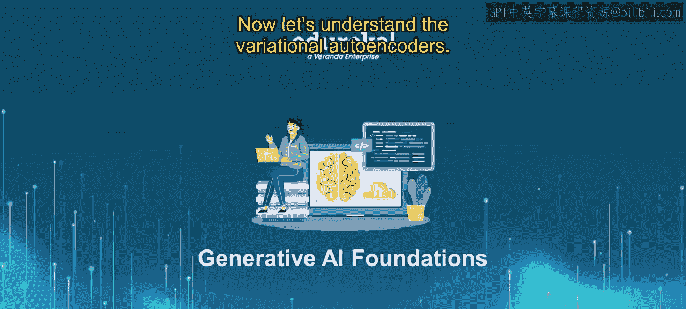
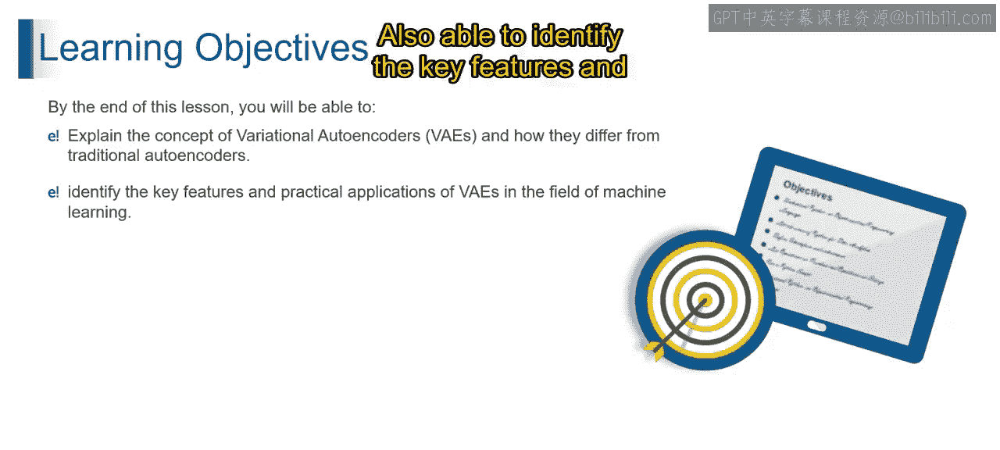
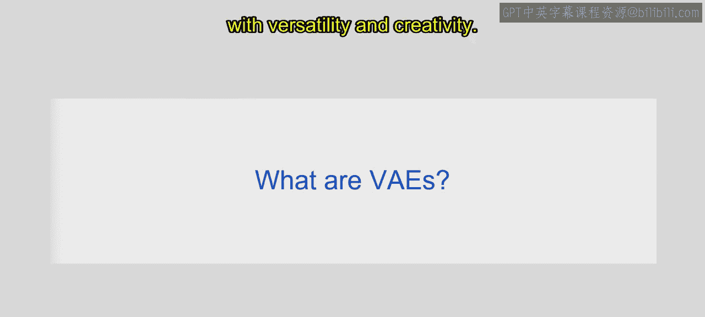
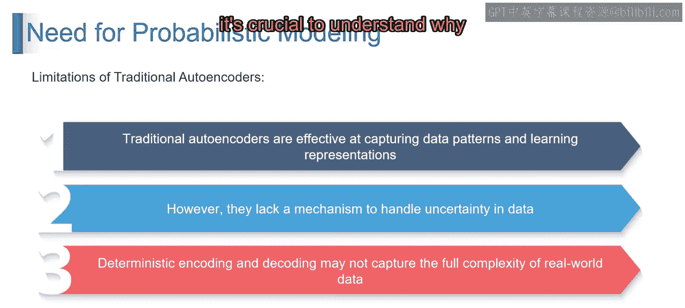
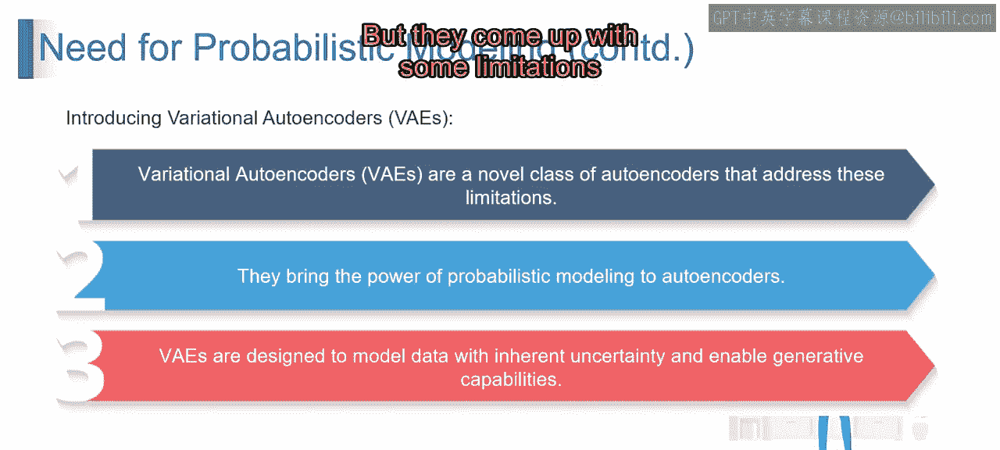
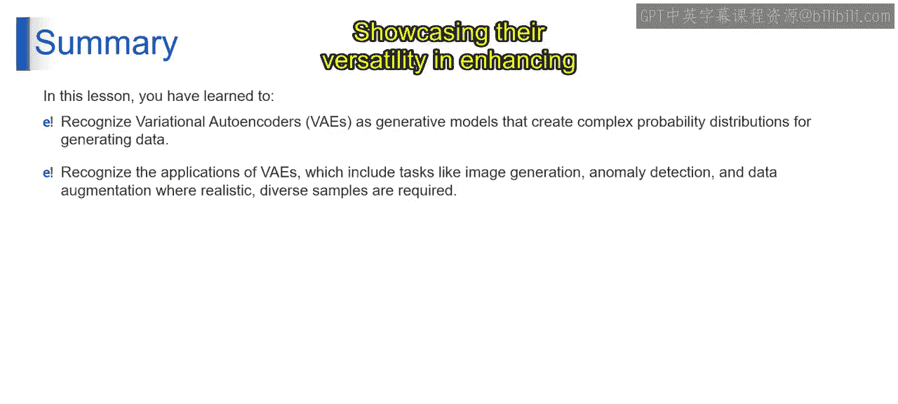

# Edureka《通过LLMs学习生成式AI（基础、应用开发、流行工具，第2、3、4课／共4课）｜Learn Generative AI with LLMs》中英 - P18：17_变分自编码器.zh_en - GPT中英字幕课程资源 - BV1ym421V7gx

Hello everyone， welcome to generative AI foundations。

 So now let's understand the variational auto encoders in this we are going to cover what are the VAs and what are the different features of the Vaas and what are the applications of thes by the end of the session you are able to understand the concept of variational autoenrs and how they differ from traditional auto encoders and also able to identify the key features and practical applications of the Vas in the field of machine learning so let's get started So first of all what are VEs So let's unfold the magic of variation auto encoders So often known as Vas building upon what we discussed VEs add a unique thrust to the standard auto encodeder formula So what's the buzz about variation auto encoders Well Vs go beyond just compressrising and reconstruct。

😊。

The data， they bring in an element of creativity and randomness to the mix。

 So imagine you are a student creating artistic nodes instead of sticking to a fixed to determine style you decided to add a bit of layer making each recreation slightly different that's the spirit of Vaes means injecting creativity into the data generation process Vs like a student adding artistic layer to the nodes inject creativity into data generation by introducing this randomness Unlike traditional encoders Vs aim for drivers and novel data instances embracing variability just as artistic notes bring uniqueness Vs enhance data generation with versatil and creativity So now let's understand what is the need of probabilistic modeling as。

😊。

We continue our explanation into Vs。 It's crucial to understand why we need to embrace probabilistic modeling。

 So traditional encoders have served as well， right。

 but they come up with some limitations that Vs aim to overcome。

 So imagine learning not just the melody， but also the variations in the musical notess。

 So that's about it。 And then the next one is of generative power。

 So Va go beyond the reconstruction。 They possess strong generative capabilities。

 creating diverse and novel data instances means it's like an artist not just replicating。

 but producing unique pieces with each stroke。 that's about generative power。

 Then let's understand the applications。 Vs find versatile applications from image and speech synthesis to anomaly detection。

😊。

And data generation。 It's like an artistic toolkit。

 Vaas are used for various creative tasks in the world of data。

 So now the last one is of probabilistic foundation。 So Vs built on a solid probabilistic foundation。

 acknowledging and leveraging uncertainty in the data。

 similar to an artist using the unpredictability of colors to enhance the beauty of their work。

 So these all are the different features。 So now let's understand the applications of the Vae。

 First one is of image generation and style transform。

 So Vas exc in generating realistic images and transferring artistic styles。

 allowing for creative visuals visual synthesis。 So think of it as an artist seamlessly blending different painting styles to create unique masterpieces。

 Then the next one is of data imputation and。😊，Denoing so these VEs are adept at filling in missing data and removing noise。

 enhancing data quality and completeness so like restoring an old photograph by filling in missing details and removing unwanted artifactacts so then the next one is of medical image analysis so Vas plays a vital role in analysis medical images aiding in disease diagnosis and treatment planning so imagine a powerful microscope that not only magnifies but also highlights crucial medical details so that's about medical image analysis then the last one is of NLP natural language processing so VaEs contribute to NLP task by generating coherent and diverse text improving language understanding it's akin to an author crafting various versions of a story。

😊，Each with its unique narrative fl， so these all are the different applications means VAEs are versatile generating images。

 transferring styles and enhancing visual creativity so they provide invaluable in imputing data missing values and data and denoicing improving overall data quality in the medical image analysis VaEs aid in diagnosing diseases and planning treatments so these VAas will contribute significantly to natural language processing by generating diverseers and currentrent text So these all are the different applications so coming to the summary VaEs are transformative probabilistic generative models that revolutionize the data representation operating in latent space VaEs introduce artistic variability learn data distributions and exhibit generative pros their applications span。

😊，From creating image generation to medical image analysis and text synthesis in NLP showcasing their versatility in enhancing data quality and fostering creativity。

 Thank you。😊。

