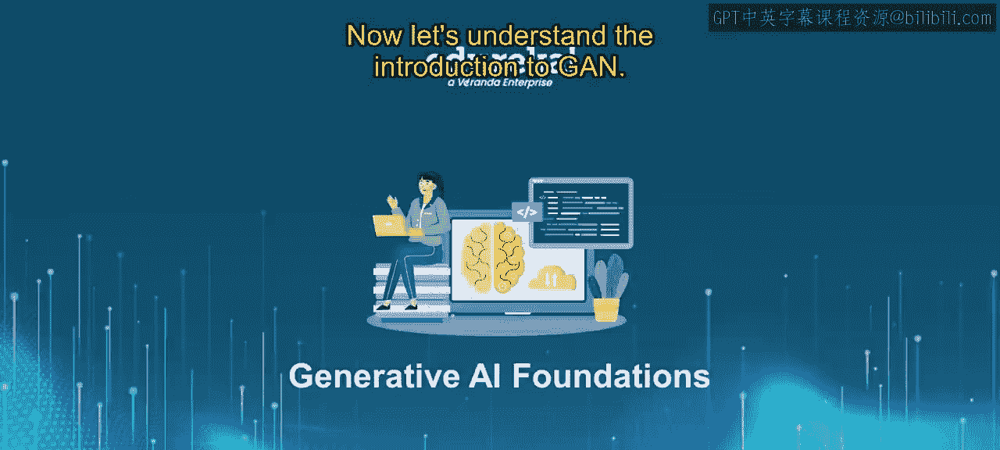
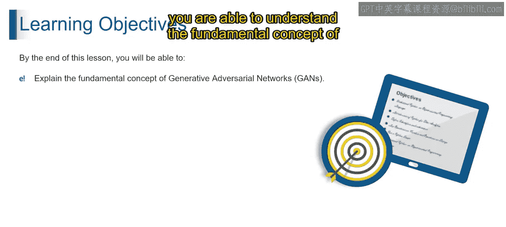
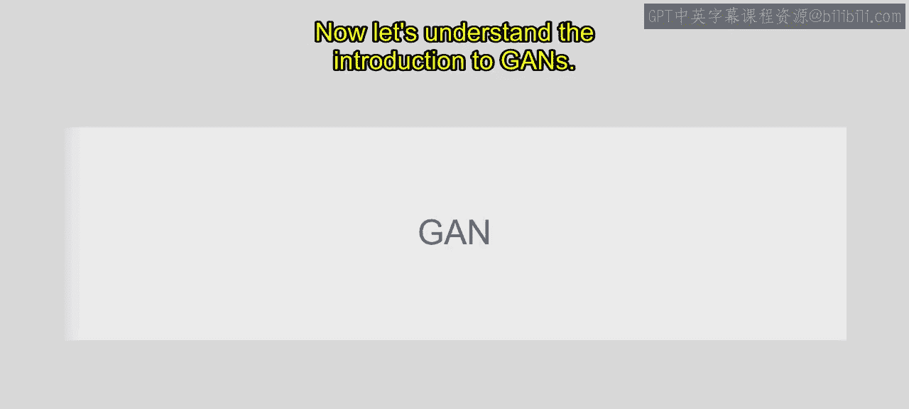
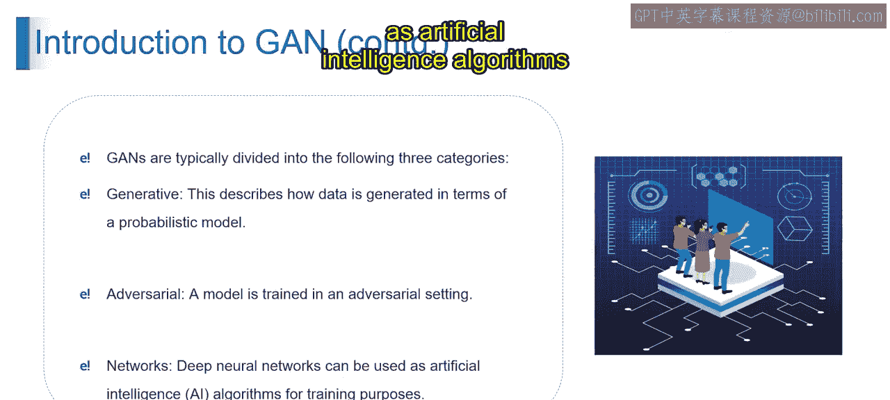
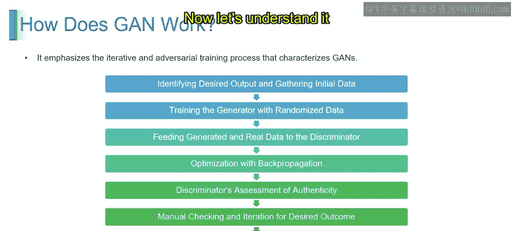
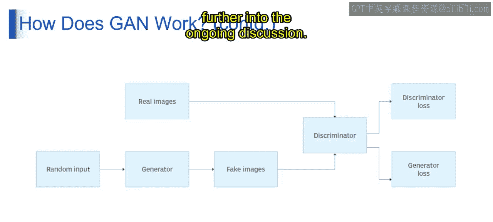

# Edureka《通过LLMs学习生成式AI（基础、应用开发、流行工具，第2、3、4课／共4课）｜Learn Generative AI with LLMs》中英 - P19：18_GAN介绍.zh_en - GPT中英字幕课程资源 - BV1ym421V7gx

Hello everyone， welcome to Generative AI Foundations。

So now let's understand the introduction to GAN in this we are going to cover water GANs and how the working procedure of GAN goes so by the end of this session you are able to understand the fundamental concept talk generative adversarial networks so let's get started first of all what are GANs。

So just imagine a skilled counterfeer and a vigilant bank teller。

 the counterfeiter's goal is to craft currency notes that look identical to the real ones while the teller sharpens their ability to spot the fakes in the digital realm the Gs operate exactly in a similar way the generate fabricates the data resembling real instances like the counterfeiter and the discriminator fine tunes its capacity to genuine from the generated data exactly seem like a bank teller So if we understand the technical definition Gs involve a generator creating data and discriminator learning to distinguish between authentic and generated data this dynamic interaction refines the capability to generate the realistic digital content and the generator produces data to closely resemble real instances and the discriminator evolves。

😊，To differentiate between authentic and generated data。

 this iterative process leads to the continuous improvement of both the components。

 So now let's understand the introduction to Gs So G is life creative artist that learns to make new things。

 Imagine it as a game where to players， a generator the artist and the discriminator。

 the critic compete to improve their skills。 Gs were introduced in 2014 by I Goodslow and his team bringing a gamechan revolution to how mission learn deeply So these Gs are typically divided into the three categories generative adversarial and network。

 So the generative this describes how data is generated in terms of probabilistic model and then the adversarial。

 It is a model is trained in an adversarial setting。 Then the last one is of network。

 It's a deep neural networks。

Can be used as artificial intelligence algorithms for training purposes。

 So now let's understand how does these Gs work。 The first one is of identifying desired output and gathering initial data in this you start by identifying the type of data you want to generate and collecting initial examples to guide the learning process。

 That is what happens in the first step。 Then training the generator with randomized data。

 What happens here is that the generator begins learning by creating the random data trying to mimic the examples gathered in this phase。

 Then the next one is of feeding generated and real data to the discriminator。

 So the discriminator evaluate both the generated and real data to figure out which is which So that's about feeding generated and real data。

 Then the next one is of optimization with。

propagation so the system uses feedback to adjust how the generator creates the data。

 making it better at fooling the discriminator。 Then the next one is discriminator's assessment of authenticity So the discriminator improves its ability to distinguish between the real and generated data then manual checking and iteration for desired outcomes。

 The user monitors the progress making manual adjustments to the generator's training to achieve the desired data output。

 Then the last one is of double feedback loop。 So the iterative process involves a continuous loop where the generator and the discriminator provide feedback to each other refining their skills So in GNs the generator creates the data and the discriminator evaluates its authenticity forming an adversarial loop This iterative process involves back。

😊，Proagation and manual adjustments refines both networks ability resulting in improved data generation over the time。

 The double feedback loop ensures continuous learning and enhancement in G performance。

 Now let's understand it with the pictorial representation。 So here it is。

 the first one is of random input。 So this block represents the starting point for the generator。

 It typically contains random noise or a latent vector。

 So this specific format and size of this input depends on the specific G architecture and the type of the data it's designed to generate example we can take images text or anything as an input。

 Then the next one is of generator。 So this block represents the neural network responsible for generating new data instances。

 It takes the random input as starting point。😊。

So the upcoming video will delve further into the ongoing discussion。😊。

