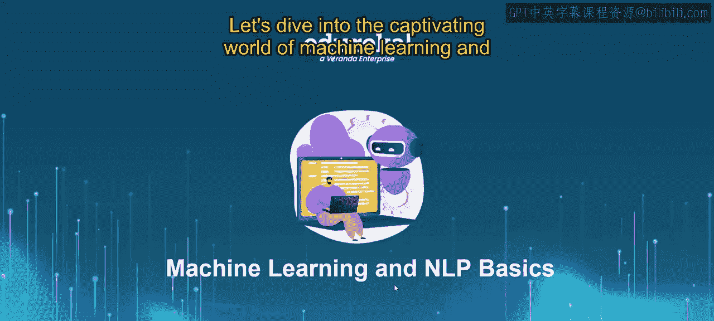
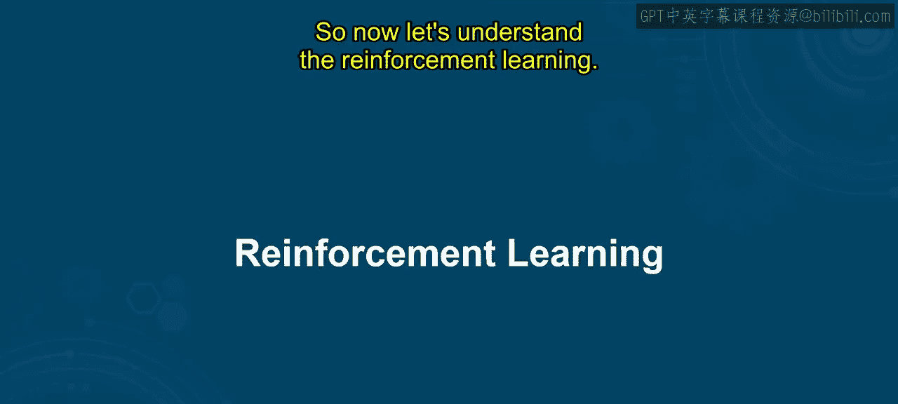
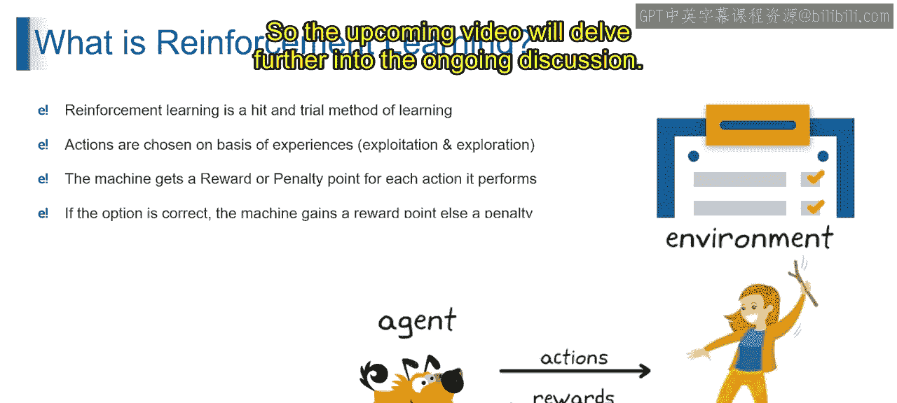

# Edureka《通过LLMs学习生成式人工智能（机器学习和NLP基础，第1课／共4课）｜Learn Generative AI with LLMs》中英字幕 - P19：18_强化学习.zh_en - GPT中英字幕课程资源 - BV1q4421Q7qh

Hello everyone， let's dive into the captivating world of machine learning and the foundational concepts of NLP together。

 So now let's understand the reinforcement learning In this we are going to understand what exactly reinforcement learning and its introduction and what are the different applications of reinforcement learning by the end of the session you are able to understand the basic fundamentals of the reinforcement learning and apply reinforcement learning to decision making tasks So let's get started introduction to reinforcement learning First we have provided with an example use case of training a self-dve car let's simplify the use case of training a self-driving car using reinforcement learning So here the objective is to train a self-driving car to navigate the roads safely and efficiently without relying on predefinine train or test。

😊。

Instead， the missions learn from the consequence of its actions in real time。

 how exactly it goes first of all。 Here is the step by step process。

 The first one is going to be the absorb so the car absorbs its environment through the sensors such as cameras and lighter to gather the information about the road traffic and obstacles。

 then the next one is going to be the select action using the policy means based on the observed data from the camera and all these things the car selects an action to take such as a breaking or steering using a predefined policy or the strategy then the next one is going to be the action once it selects the action。

 the car executes the selected action moving through the environment according to its decisions then once。

😊，Action is done。 then it is going to take the reward or the penalty means the car receives a reward or a penalty based on its performance。

 For example， it receives a reward for safely following the traffic rules or a penalty for colliding with obstacles then the next one is of update policy。

 the car uses the received reward or the penalty to update its policy。

 adjusting its decision making process to improve future actions。 Once if it is done。

 then it will go on iterating the process means the car repeats this process iteratively continuously observing selecting the actions executing them。

 receiving the feedback and updating its policy to learn and improve over the time means here the techniques。

 whatever the steps we have understood here the reinforcement learning enables the。😊。

Driving car to learn from its interactions with the environment。

 gradually improving its decision making abilities to navigate the road safely and efficiently without the need for predefined training data So now let's understand what exactly the reinforcement learning is all about。

 So based on the understanding of cell driving cars in reinforcement learning missions learn through trial and error。

 similar to how we learn from our experiences， they choose actions based on this experiences。

 balancing between exploiting known strategies and exploring new possibilities。

 So what are the key components in this done exploitation and exploit。

 So missions strike a balance between exploiting strategies that have worked well in the past means exploitation and trying。

😊，New actions to discover potentially better outcomes that is going to be the exploration。

 once if it is done then the reward or the penalty。 So after each action。

 the mission receives a reward or pen based on its performance if the action leads to a favorable outcome。

 it gains reward。 Otherwise it incurs a penalty。 So these are the key components of the reinforcement learning。

 Once if it is done， then the learning process。 As I mentioned it is going to be the trial and error the missions iteratively tries different actions learning from the consequences of each action。

 it adjusts its strategies over the time based on the received reward and penalties to maximize its overall performance In the essence。

 reinforcement learning enables mission to learn from their。😊。

Apt their behaviors based on rewards and penalities and gradually improve their decision making abilities through a process of hit and trial。

 so the upcoming video will delve further into the ongoing discussion。😊。

