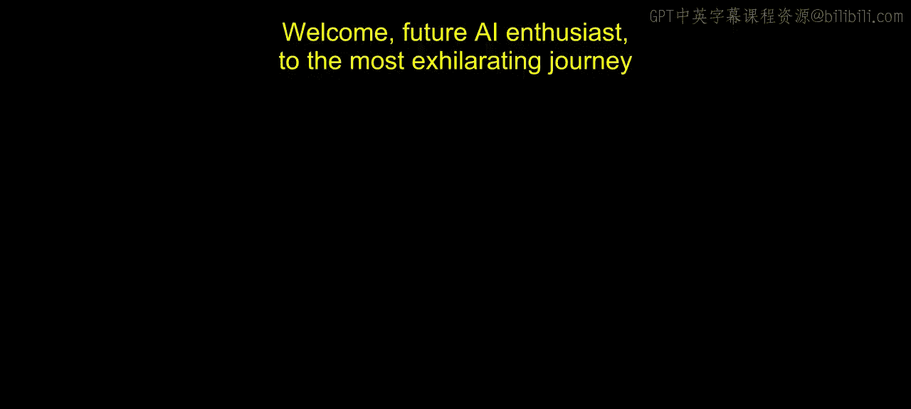
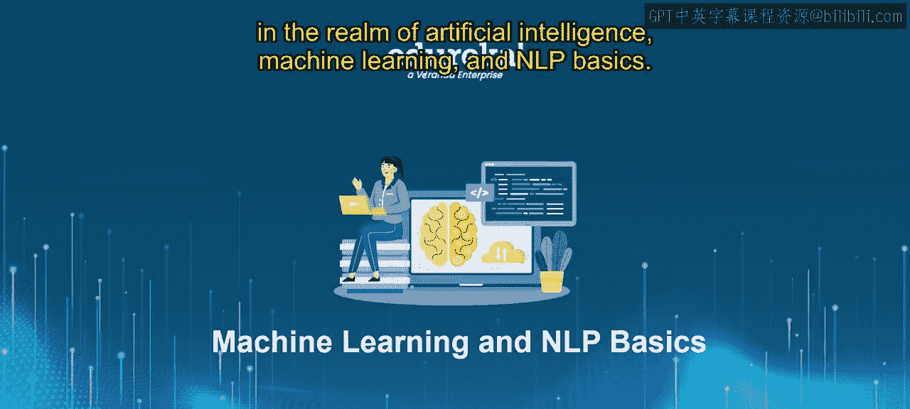
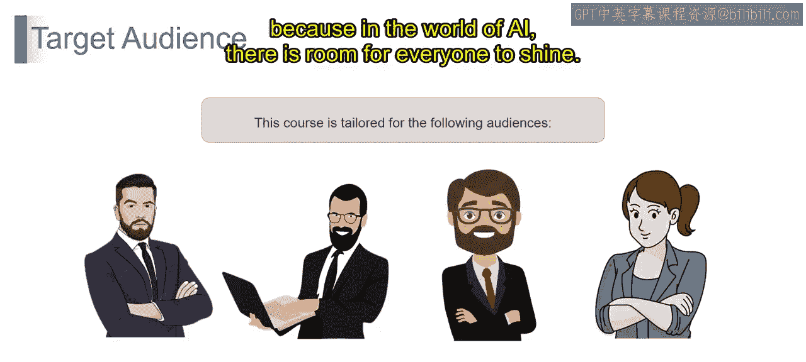
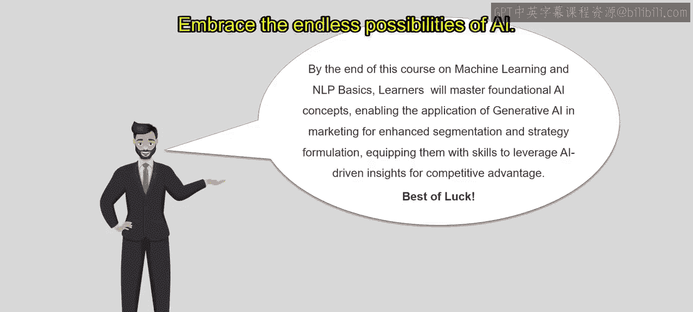

# Edureka《通过LLMs学习生成式人工智能（机器学习和NLP基础，第1课／共4课）｜Learn Generative AI with LLMs》中英字幕 - P1：0_课程介绍.zh_en - GPT中英字幕课程资源 - BV1q4421Q7qh

Welcome Fu AI enthusiasts to the most exhilarating journey in the realm of artificial intelligence。

 machine learning and NLP basics。😊。

I am thrilled to be your guide as we embark on an adventure through the fascinating world of machine learning。

 deep learning and natural language processing， all bundled up in this comprehensive course but before we dive into the depth of algorithms and neural networks let's set the stage imagine a world where machines can not only perform tasks but also learn from the data just like humans that's the essence of machine learning。

 the backbone of modern AI from predicting stock prizes to diagnosing diseases the possibilities are endless now take a leap further into a neural abyss。

😊，Where we uncover deep learning， it's like machine learning on steroids。

 empowering computers to comprehend analyze and even generate human like responses from image recognition to autonom vehicless deep learning is。

😊，Revolutionizing industries worldwide。And then there is a natural language processing where machines。

😊，Understand the complexities of human language Imagine your computer understanding。

 translating and even generating the text like a seasoned intelligent。😊。

That's where the magic happens with NLP driving innovations is。😊，Virtual assistance。😊。

Sentiment analysis and much more throughout this course。

 we will journey through the intricacies of these cutting edge technologies unraveing their mysteries one concept at a time you will gain handson experience tackle real world challenges and emerge with the skills to tackle AI landscape with the confidence。

 so buckle up and get ready to evaluate your understanding of AI from this course whether from this course now you might be wondering is this course right for me Well。

 wonder day no more this exhilarating journey through the AI landscape is tailor made for diverse range of enthusiasts if you are a machine learning engineer eager to sharpen your skills and stay ahead of the curve you are in the right place freshers don't fret。

 we have got you covered with the。😊，Beginning friendly approach that will have you mastering AI in no time and data scientists rejoice。

 dive deep into the world of AI and expand your toolkit with practical insights and hands- on experience and researchers prepared to push the boundaries of innovations as we divel into the latest advancements and techniques driving AI forward。

😊，Whether you are here to advance your career or explore a new passion or pioneered groundbreaking solutions。

 this causes easier gateway to unlocking the full potential of artificial intelligence。😊。

So whatever your background or ambition， join us on this thrilling adventure because in the world of AI。

 there is room for everyone to shine by the end of this course。

 you will be mastered the fundamental concepts of AI。

 paving the way for a deeper understanding of its intricacies。

 you will be equipped with the knowledge and skills to harness the power of generative AI revolutionizing marketing strategies with advanced segmentation and formulation。

 armed with AI drivenn insights， you will be ready to navigate the competitive landscape with confidence leveraging cutting its technology to stay ahead of the curve and drive success for yourself and your organization as you embark on your next chapter armed with newfound knowledge and skill。

😊。

Remember， the sky is the limit， wishing you the best of luck on your journey and may your future India w be filled with success and innovation。

 F high。 embrace the endless possibilities of AI。 Your adventure has only just begun。 Thank you。😊。

