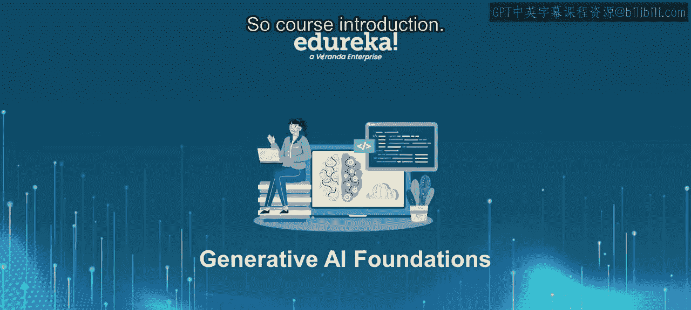
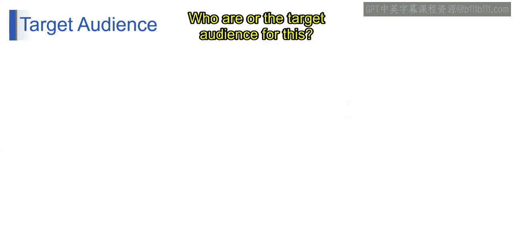
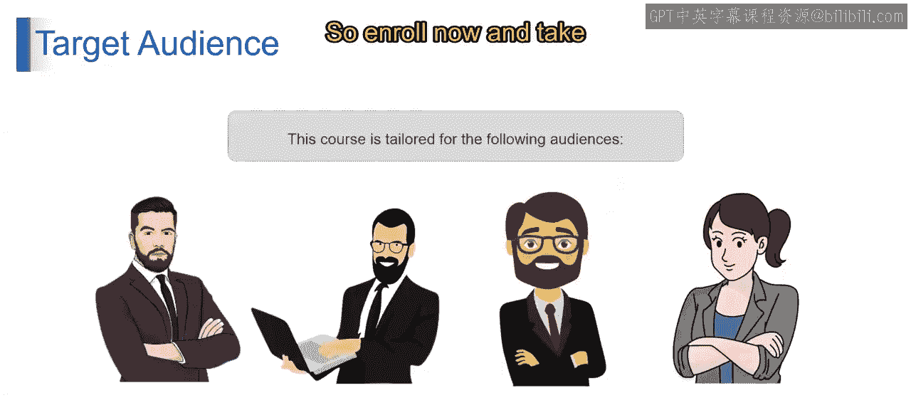
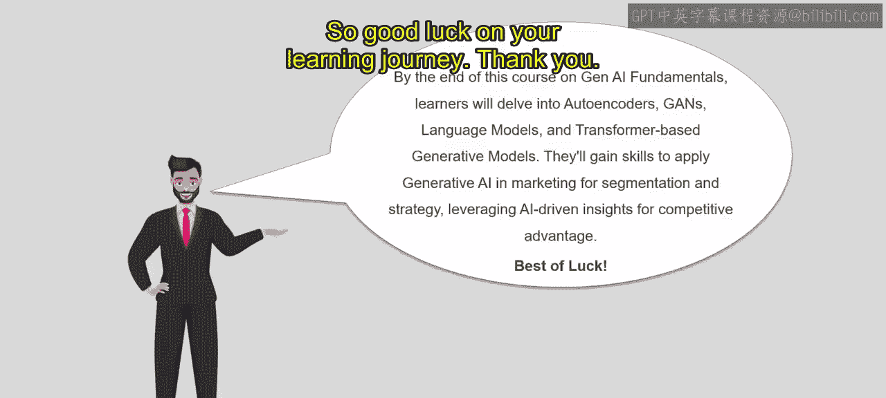

# Edureka《通过LLMs学习生成式AI（基础、应用开发、流行工具，第2、3、4课／共4课）｜Learn Generative AI with LLMs》中英 - P1：0_课程介绍.zh_en - GPT中英字幕课程资源 - BV1ym421V7gx

Hello everyone， welcome to the exciting journey through the worldro Generative AI foundations so get ready to dive into the fascinating worldro cutting edge AI technologies So course interaction in this course we will embark on an exciting journey delving into the core concepts and techniques of generative AI so let's take a quick look at what we are going to cover here The first one is of generative AI fundamentals so we will start by laying down the foundational understanding of the generative AI from understanding what it is to exploring its applications in various domains this section will provide you with a comprehensive overview then we are going to cover auto encoders and Gs so next we will delve into the fundamental techniques of generative AI that is nothing but auto。

😊。

And the generative adversarial networks， you will learn how these models work and how they are used to generate the new data with remarkable realism。

 So it's not only about the Gs we are going to understand all the generative AI large language models and the next one is of the language model and transformer based generative models。

 So in this moving forward， we will explore the transformative power of language models including revolutionary transformer architecture。

 So you will discover how these models are reshaping natural language processing and generation tasks。

 then course wrap up and assessment。 Finally， you will wrap up our journey by summarizing the key takeaways and discussing how you can apply new foundation knowledge。

 plus we will dive into the assessment。😊，Reinforce your understanding and track your progress。

 So who are or the target audience for this。 So let's find out the first when AI or machine learning engineer So if you are already working in the field of AI or machine learning and looking to deepen your understanding of the generative AI dragnics this course is perfect for you So gain insights into cutting edge methods and take your skills to the next level and coming to the freshers are you new to the world of AI and eager to explore its possibilities。

 whether you are a recent graduate or someone looking to transition into a career in AI this course provides a solid foundation in generative AI fundamentals to kick start your journey then data scientists the data scientists seeking broaden the skillet and incorporate generative AI technologies into their toolkit will benefit greatly from this course。

So learn how to leverage generative models to generate synthetic data。

 enhance data augmentation techniques and many more。

 So coming to the researcher So if you are involved in AI research and keen to stay updated with the latest advancements in the generative AI this course is tailored for you So dive into the advanced topics。

 explore cutting edge research papers and gain insights to fill your own research in their voices So no matter what is your background or the expertise level。

 this course offers something valuable for everyone So enroll now and take the first step towards mastering the generative AI So by the end of this course on generative AI fundamentals。

 you will explore autoenrs Gs language models and transformer based generative models。

 So you will learn how to use generative AI in marketing for things like segment。😊。

ingAudience and planning strategies using AI powered insights to stay ahead the of the competition。

 So good luck on your learning journey。😊。

Thank you。