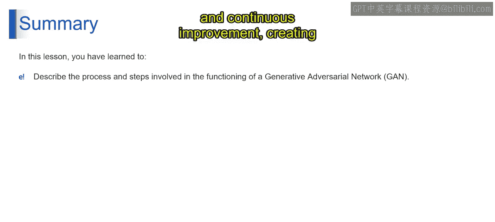
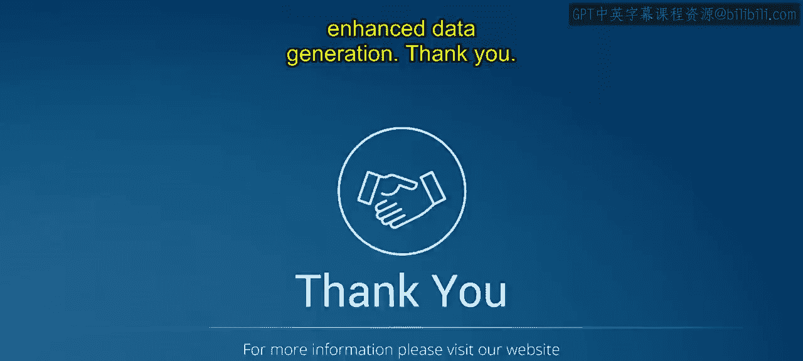

# Edureka《通过LLMs学习生成式AI（基础、应用开发、流行工具，第2、3、4课／共4课）｜Learn Generative AI with LLMs》中英 - P20：19_GAN的工作原理.zh_en - GPT中英字幕课程资源 - BV1ym421V7gx

So let's now explore the progression from our previous discussion through its internal layers and connections the generator transforms this random input into an output image ideally the generator image should be difficult to distinguish from the real image in the training data then the next one is fake images and real images can be sent to the discriminator means the fake images so these are the outputs generated by the generator in the previous step and the real images so these are samples from the actual training data set that the generator is trying to learn from then the next block is discriminator so the block represents the neural network responsible for classifying data as real or fake so it takes both real images and fake images from the previous block the discriminator and。

😊，Is these images and attempts to distinguish between them。

 So then the output it outputs the probability score between0 and1 for each image。

 so0 indicates certainly fake image the image is highly unlikely to be from the real data So one indicates certainly a real image the image shares strong similarities with the image in the real data set so that's how it provides the probability score as0 or1。

 Then the next one is of discriminator loss and generator loss in the discriminator loss these blocks generally So these blocks represents the feedback signals used to update both networks and improve their performance they are calculated using the loss functions that measures the difference between the networks output and the desired outcome So the discriminator loss first to fall。

 So this loss measures how well the discriminator。performedform in accurately classifying both real and fake images。

 Then the next one is of generator loss。 This loss measures how well the generator's output fold the discriminator it reflects how close the generated image was to being classified as the real by the discriminator So using these loss values。

 both networks update their internal parameters through the back propagation and optization algorithm。

 So the goal is to gradually minimize the discriminator loss and the maximize the generator loss leading to a continuous improvement in both the network capabilities means the generator image real image Discriminator classification and calculated losses are used to update both networks in each iteration as training progresses the generator hopefully gets better a generated realistic data and the discriminator。

Gets better at distinguishing between real and the fake data This continuous improvement ultimately leads to the generator producing highly realistic outputs that closely resemble the data it was trained on in summary so in this lesson we have understood the working of the generative advisory network by understanding how the generator and the discriminator iteratively refines their skills through a feedback loop This process involves training the generator assessing data authenticity and continuous improvement creating a dynamic interplay for enhanced data generation Thank you。

😊。

